# Visual Reference Frames

Project: Duramax LLY Engine Lab · Governing plan: [`docs/PLAN.md`](./PLAN.md) · Milestone 3 Spec: [`docs/specs/M3-full-engine.md`](./specs/M3-full-engine.md) §9 · Milestone 4 Spec: [`docs/specs/M4-views.md`](./specs/M4-views.md) §9 · Milestone 8 Spec: [`docs/specs/M8-part-variants.md`](./specs/M8-part-variants.md) §5.2, §7.3 · Milestone 10 Spec: [`docs/specs/M10-exterior-accuracy.md`](./specs/M10-exterior-accuracy.md) §8 · Milestone 11 Spec: [`docs/specs/M11-capped-cutaways.md`](./specs/M11-capped-cutaways.md) §7 · Milestone 12 Spec: [`docs/specs/M12-intake-cover.md`](./specs/M12-intake-cover.md) §8 (with owner-approved pose/checklist deviation **D-047**) · Milestone 13 Spec: [`docs/specs/M13-internal-variants.md`](./specs/M13-internal-variants.md) §8 · Measurements: [`docs/M3-MEASUREMENTS.md`](./M3-MEASUREMENTS.md), [`docs/M4-MEASUREMENTS.md`](./M4-MEASUREMENTS.md), [`docs/M8-MEASUREMENTS.md`](./M8-MEASUREMENTS.md), [`docs/M10-MEASUREMENTS.md`](./M10-MEASUREMENTS.md), [`docs/M11-MEASUREMENTS.md`](./M11-MEASUREMENTS.md), [`docs/M12-MEASUREMENTS.md`](./M12-MEASUREMENTS.md), [`docs/M13-MEASUREMENTS.md`](./M13-MEASUREMENTS.md) · Exterior model record: [`docs/M10-EXTERIOR.md`](./M10-EXTERIOR.md) · Cutaway technique record: [`docs/M11-CUTAWAYS.md`](./M11-CUTAWAYS.md) · Intake cover record: [`docs/M12-COVER.md`](./M12-COVER.md) · Internal variants record: [`docs/M13-INTERNAL-VARIANTS.md`](./M13-INTERNAL-VARIANTS.md)

These twenty-two fixed reference frames establish canonical camera poses, crank angles, display/view configurations, and catalog build selections for visual regression checks across milestones (`RF-1`…`RF-4` established at M3; `RF-5`…`RF-7` added at M4; `RF-8`…`RF-10` added at M8; `RF-11`…`RF-13` added and exterior-on frames `RF-3`, `RF-7`, `RF-8`, `RF-9` re-baselined at M10; `RF-14`…`RF-17` added and `RF-6` re-baselined with capped-solid cutaways at M11; `RF-18`…`RF-20` added for the optional LLY intake manifold cover at M12, with `RF-19`/`RF-20` poses and `RF-19` clipped-legend scope recorded under **D-047** while `RF-1`…`RF-17` keep `intakeCover` off; `RF-21`…`RF-22` added for the `rods_forged` internal connecting-rod variant at M13 while `RF-1`…`RF-20` keep `rods_stock`).

## Common Capture Convention

- **Build:** Production bundle (`npm run build && npm run preview`), reproducible directly via `?rf=RF-1` through `?rf=RF-22`
- **Viewport:** `1440 × 900` CSS px (`devicePixelRatio = 1`; Antigravity's built-in Chromium webview `page.screenshot()` serializes `1440×900` `16:10` viewports as `1024×640` `16:10` PNGs including the HUD readouts — standing `1024×640` convention for all frames)
- **Camera Lens & Up Axis:** `PerspectiveCamera` with `fov = 42°`, `near = 0.02 m`, `far = 20 m`, `camera.up = [0, 0, 1]` (`+Z` vertical; `+X` front of engine along crank axis; `-Y` RH bank `[1,3,5,7]`; `+Y` LH bank `[2,4,6,8]`)
- **Block Midpoint Reference:** `centerXM = 0.2300 m` (`230.0 mm` ahead of the `X = 0` rear block plane)
- **Studio Lighting:** Confirmed Milestone 3 studio look (D-024, D-034 — `studio_small_09_2k.hdr` IBL @ `0.8`, ACES Filmic exposure `1.1`, background `0x0b0b0d`, `FogExp2(0x0b0b0d, 0.11)`, `2048×2048` `PCFSoftShadowMap` directional key light onto studio floor at `Z = -0.245 m`)

---

## Summary Table

| Frame | Crank Angle `θ` | Camera Position `[X, Y, Z]` (m) | Camera Target `[X, Y, Z]` (m) | Quality Profile | Exterior | View States (`Explode / Section / X-Ray / Labels`) | Variants | Capture File |
| --- | ---: | --- | --- | --- | --- | --- | --- | --- |
| **RF-1** | `0°` | `[1.0100, -0.7800, 0.5600]` | `[0.2500, -0.0100, 0.1200]` | `Full` | `Off` (unchecked) | `0% / Off / Off / Off` | `stock` | [`reference-frames/RF-1.png`](./reference-frames/RF-1.png) |
| **RF-2** | `470°` | `[0.6600, -0.3800, 0.5600]` | `[0.4025, -0.2000, 0.2550]` | `Full` | `Off` (unchecked) | `0% / Off / Off / Off` | `stock` | [`reference-frames/RF-2.png`](./reference-frames/RF-2.png) |
| **RF-3** | `180°` | `[1.3800, -1.1800, 0.7200]` | `[0.3000, -0.0200, 0.1700]` | `Full` | `On` (checked) | `0% / Off / Off / Off` | `stock` | [`reference-frames/RF-3.png`](./reference-frames/RF-3.png) |
| **RF-4** | `705°` | `[0.2300, -0.0020, 1.1800]` | `[0.2300, 0.0000, 0.1400]` | `Full` | `Off` (unchecked) | `0% / Off / Off / Off` | `stock` | [`reference-frames/RF-4.png`](./reference-frames/RF-4.png) |
| **RF-5** | `90°` | `[1.2800, -1.0800, 0.7400]` | `[0.3100, -0.0500, 0.1800]` | `Full` | `Off` (unchecked) | `100% / Off / Off / On` | `stock` | [`reference-frames/RF-5.png`](./reference-frames/RF-5.png) |
| **RF-6** | `0°` | `[1.0600, -0.5400, 0.4800]` | `[0.2900, -0.0200, 0.1400]` | `Full` | `Off` (unchecked) | `0% / Front–Back (X) @ 402.5 mm / Off / Off` | `stock` | [`reference-frames/RF-6.png`](./reference-frames/RF-6.png) |
| **RF-7** | `180°` | `[1.3800, -1.1800, 0.7200]` | `[0.3000, -0.0200, 0.1700]` | `Full` | `On` (checked) | `0% / Off / On / Off` | `stock` | [`reference-frames/RF-7.png`](./reference-frames/RF-7.png) |
| **RF-8** | `180°` | `[1.3800, -1.1800, 0.7200]` | `[0.3000, -0.0200, 0.1700]` | `Full` | `On` (checked) | `0% / Off / Off / Off` | `turbo_large, intake_highflow, exhaust_4in, intercooler_upgraded` | [`reference-frames/RF-8.png`](./reference-frames/RF-8.png) |
| **RF-9** | `0°` | `[-0.6200, 1.2200, 0.8600]` | `[0.2800, 0.0200, 0.1600]` | `Full` | `On` (checked) | `0% / Off / Off / Off` | `turbo_large, intake_highflow, exhaust_4in, intercooler_upgraded` | [`reference-frames/RF-9.png`](./reference-frames/RF-9.png) |
| **RF-10** | `90°` | `[1.2800, -1.0800, 0.7400]` | `[0.3100, -0.0500, 0.1800]` | `Full` | `Off` (unchecked) | `100% / Off / Off / On` | `turbo_large, pistons_lowcomp` | [`reference-frames/RF-10.png`](./reference-frames/RF-10.png) |
| **RF-11** | `180°` | `[1.3800, -1.1800, 0.7200]` | `[0.3000, -0.0200, 0.1700]` | `Full` | `On` (checked) | `0% / Off / Off / Off` | `stock` | [`reference-frames/RF-11.png`](./reference-frames/RF-11.png) |
| **RF-12** | `0°` | `[-0.6200, 1.2200, 0.8600]` | `[0.2800, 0.0200, 0.1600]` | `Full` | `On` (checked) | `0% / Off / Off / Off` | `stock` | [`reference-frames/RF-12.png`](./reference-frames/RF-12.png) |
| **RF-13** | `705°` | `[0.2300, -0.0020, 1.1800]` | `[0.2300, 0.0000, 0.1400]` | `Full` | `On` (checked) | `0% / Off / Off / Off` | `stock` | [`reference-frames/RF-13.png`](./reference-frames/RF-13.png) |
| **RF-14** | `180°` | `[0.9000, -0.6200, 0.2500]` | `[0.4000, -0.1500, 0.0200]` | `Full` | `Off` (unchecked) | `0% / Front–Back (X) @ 402.5 mm / Off / Off` | `stock` | [`reference-frames/RF-14.png`](./reference-frames/RF-14.png) |
| **RF-15** | `470°` | `[0.6600, -0.3800, 0.5600]` | `[0.4025, -0.2000, 0.2550]` | `Full` | `Off` (unchecked) | `0% / Front–Back (X) @ 402.5 mm / Off / Off` | `stock` | [`reference-frames/RF-15.png`](./reference-frames/RF-15.png) |
| **RF-16** | `180°` | `[1.3800, -1.1800, 0.7200]` | `[0.3000, -0.0200, 0.1700]` | `Full` | `On` (checked) | `0% / Front–Back (X) @ 402.5 mm / Off / Off` | `stock` | [`reference-frames/RF-16.png`](./reference-frames/RF-16.png) |
| **RF-17** | `0°` | `[0.2300, 1.0500, 0.4500]` | `[0.2300, -0.1200, 0.1600]` | `Full` | `Off` (unchecked) | `0% / Side (Y) @ -185 mm / Off / Off` | `stock` | [`reference-frames/RF-17.png`](./reference-frames/RF-17.png) |
| **RF-18** | `180°` | `[1.3800, -1.1800, 0.7200]` | `[0.3000, -0.0200, 0.1700]` | `Full` | `On` (checked) | `0% / Off / Off / Off` *(Intake cover `On`)* | `stock` | [`reference-frames/RF-18.png`](./reference-frames/RF-18.png) |
| **RF-19** | `705°` | `[0.9200, -0.5800, 0.5600]` *(D-047)* | `[0.2800, -0.0100, 0.3100]` *(D-047)* | `Full` | `On` (checked) | `0% / Front–Back (X) @ 300.0 mm / Off / Off` *(Intake cover `On`)* | `stock` | [`reference-frames/RF-19.png`](./reference-frames/RF-19.png) |
| **RF-20** | `90°` | `[1.2800, -1.0800, 1.1200]` *(D-047)* | `[0.3100, -0.0200, 0.3000]` *(D-047)* | `Full` | `On` (checked) | `100% / Off / Off / Off` *(Intake cover `On`)* | `stock` | [`reference-frames/RF-20.png`](./reference-frames/RF-20.png) |
| **RF-21** | `90°` | `[1.2800, -1.0800, 0.7400]` | `[0.3100, -0.0500, 0.1800]` | `Full` | `Off` (unchecked) | `100% / Off / Off / Off` | `rods_forged` | [`reference-frames/RF-21.png`](./reference-frames/RF-21.png) |
| **RF-22** | `0°` | `[1.0600, -0.5400, 0.4800]` | `[0.2900, -0.0200, 0.1400]` | `Full` | `Off` (unchecked) | `0% / Front–Back (X) @ 388.3 mm / Off / Off` | `rods_forged` | [`reference-frames/RF-22.png`](./reference-frames/RF-22.png) |

---

## Section-Fill Checklist (Shared by `RF-6`, `RF-14`…`RF-17`, and `RF-19`, Milestone 11 Spec §7.2, extended M12)

Every section-active reference frame (`RF-6`, `RF-14`, `RF-15`, `RF-16`, `RF-17`, `RF-19`) must pass all six shared criteria — failing any single item fails the frame:

1. **Solid cut faces:** Every visible part that meets the section plane shows a flat, uniformly hatched section face at the plane — no far interior wall, no open tube/box interior, no dark cavity along the cut. (Genuine cylinder bores above/below the piston, two-wall duct inner bores, and empty clearances between separate parts remain open.) The M12 cover's open thin-walled underside is a material band at the cut: the cover cap must show the wall band and leave the open cavity as air, not a filled slab. The "no dark cavity along the cut" rule applies to the cut wall material, not to the intentionally open underside.
2. **Depth correctness:** Nothing behind the plane draws in front of a cut face; the cap occludes the internals it should, and no cap covers un-cut geometry in front of the plane.
3. **One section colour:** All cut faces use the same unlit cut-bronze base (`[0.290, 0.170, 0.086]` linear) and hatch (`[0.196, 0.112, 0.055]` linear) colour; no part PBR material or firing orange (`0xf97316`) appears *on* a cut face.
4. **Hatch quality:** `45°` lines, uniform world spacing (`5.0 mm` perpendicular period, `1/3` duty), no swimming/stretching/moiré, and no hatch on non-cut surfaces.
5. **Crisp cut edge:** The boundary between the cap and the part's outer surface is a clean silhouette; no gap ring of background appears between them.
6. **No spurious fill:** No cap patch floats in air or appears where the plane does not cut material.

---

## Rod-Variant Checklist (RF-21, RF-22, Milestone 13 Spec §8.1)

**Shared (`RF-21` and `RF-22`):**
1. The variant is present on all eight rods; the stock rods are not also visible (no double geometry).
2. The H-beam is visibly wider/thicker than the stock rod; the cap fasteners read as a stepped 12-point head (an illustrative placeholder, not a published feature).
3. The rod keeps the stock big-end width and journal; the cap sits on the crankpin, and the small end sits on the piston pin.
4. No rod intersects the piston skirt, crank web, adjacent rod, block or oil pan.
5. The firing-highlight colour remains on the pistons only; the rods are not emissive.
6. The rod material reads as forged steel with a dark fastener and bronze bushing; no texture/decal.

**Per-frame:**
- **`RF-21`:** The exploded rods are separated with the rest of the internal assembly; the beam/flange difference is legible at this camera; the pose is the committed `RF-10` camera pose (verified directly for `rods_forged` at `G-FRAME-M13`, not claimed from `RF-10`'s `turbo_large + pistons_lowcomp` image); labels (`Off`) do not obscure the part.
- **`RF-22`:** The cut face is a flat, hatched solid at **`X = 388.3 mm`, through the station-0 RH rod** (deliberately not `RF-6`'s `X = 402.5 mm` inter-rod gap); there is no open chain, gap, or floating cap; the rod section is continuous with the M11 cap convention; the other parts cut by the plane follow the same convention and do not obscure the rod face.

---

## Frame Definitions

### RF-1 — Whole Engine Default View (`θ = 0°`, Exterior Off)

- **Crank angle:** `θ = 0°` (Cylinder 1 at compression/firing TDC, firing window `[0°, 90°)`)
- **Camera position (m):** `[1.0100, -0.7800, 0.5600]` (`[centerXM + 0.78, -0.78, 0.56]` — app default startup camera)
- **Camera target (m):** `[0.2500, -0.0100, 0.1200]` (`[centerXM + 0.02, -0.01, 0.12]` — app default startup target)
- **Quality profile:** `Full` (`PCFSoftShadowMap` `2048×2048` enabled)
- **Exterior:** `Off` (default unchecked)
- **Build selection:** `stock` (all 12 catalog slots stock)
- **What to look for:**
  - All 8 cylinders rendered with detailed assemblies (zero M1 primitive cylinders, bank boxes, or valve discs remaining).
  - Orange emissive firing highlight (`0xf97316` @ `0.85`) strictly on **Cylinder 1** (front-right RH piston at TDC), with the other 7 pistons in standard cast-aluminum finish.
  - Four shared-pin crank throws (stations `1&2`, `3&4`, `5&6`, `7&8`) each carrying two side-by-side connecting rods (`±14.2 mm` seats on `58 mm` journals) tied together by the turned `32.4 mm`-radius main crankshaft, rear flywheel flange, and front pulley/snout disc.
  - Even studio HDRI reflections across both RH and LH banks from front to rear, grounded by the soft directional shadow on the dark matte floor (`Z = -0.245 m`).

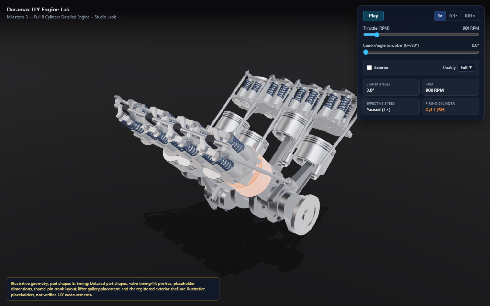

---

### RF-2 — Cylinder 1 Head & Peak Intake Lift Close-Up (`θ = 470°`, Exterior Off)

- **Crank angle:** `θ = 470°` (Cylinder 1 intake cam lobe at peak lift, `intakeLift = 9.9 mm`, `exhaustLift = 0.0 mm`)
- **Camera position (m):** `[0.6600, -0.3800, 0.5600]`
- **Camera target (m):** `[0.4025, -0.2000, 0.2550]` (aimed at Cylinder 1's RH head & rocker gallery at `stationCenterX = 0.4025 m`)
- **Quality profile:** `Full`
- **Exterior:** `Off`
- **Build selection:** `stock` (all 12 catalog slots stock)
- **What to look for:**
  - **Intake spring compression & valve opening:** Cylinder 1's two valley-side (`+W`) blued-steel helical intake springs visibly compressed relative to the uncompressed exhaust springs (`-W`), with the intake valve bridge depressed and both intake valve heads extending down into the combustion chamber.
  - **Rocker arm tilt & pushrod rise:** Cylinder 1's intake forged rocker arm tilted nose-down (`-θ_in`) about the rocker shaft while its tail cup rises (`+W_cup · sin θ_in`), driven smoothly by the leaning intake pushrod without detaching from the cup or lifter socket.
  - **Deck slab recess windows (§4):** Clean passage of Cylinder 1's own exhaust pushrod through the `[+26, +41] mm` valley-edge gallery notch (`floor |X| = 42.99 mm <= 43.0 mm`) and Cylinder 3's intake pushrod through Cylinder 1's `-X` `[-8, +11] mm` deck recess window with zero metal intersection.

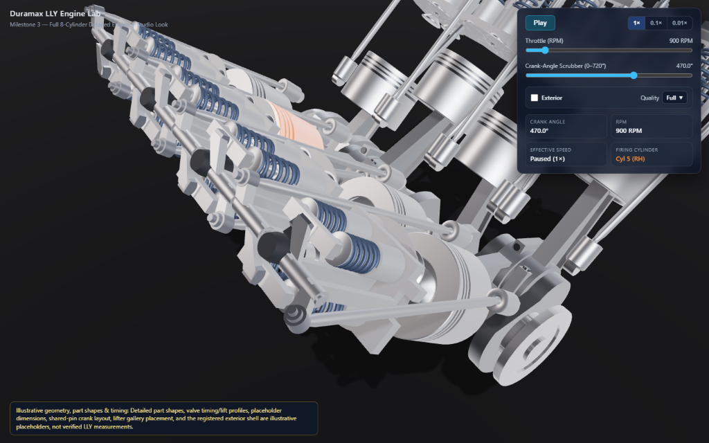

---

### RF-3 — Whole Engine with Project-Frame Exterior Shell (`θ = 180°`, Exterior On)

- **Crank angle:** `θ = 180°` (Cylinder 7 RH firing TDC; firing order `1-2-7-8-4-5-6-3`, step 3 at `180°`)
- **Camera position (m):** `[1.3800, -1.1800, 0.7200]`
- **Camera target (m):** `[0.3000, -0.0200, 0.1700]`
- **Quality profile:** `Full`
- **Exterior:** `On` (checked)
- **View states:** `Explode = 0%`, `Section = Off`, `X-Ray = Off`, `Labels = Off`
- **Build selection:** `stock` (all 12 catalog slots stock)
- **What to look for (re-baselined at M10):**
  1. **Project-frame registration & corrected front-drive stack (M10 §§5.1, 5.4):** `public/Duramax_LLY_2005_66L_V8.glb` (`37,100` tris across `22` top-level system groups and `92` `extras.partId` features) authored directly in the master project frame (`uniformScale = 1.0`, `translationM = [0, 0, 0]`, glTF Y-up→Z-up basis `[[1,0,0],[0,0,1],[0,-1,0]]`, `det = +1`) — front cooling fan (`X = 570..615 mm`), thermal clutch (`X = 530..570 mm`), and harmonic-balancer pulley (`X = 464..492 mm`, hub anchor `[478, 0, 0] mm` enclosing the internal damper disc at `X = 466..476 mm`, `282.6 mm` rearward of the M3 concept shell's floating damper) facing `+X`, rear turbine/downpipe overhanging `-X` (`X_min = -272.52 mm`), V-valley and Garrett GT3788VA turbocharger oriented `+Z` up, crank centerline coaxial with `(Y = 0, Z = 0)`.
  2. **Full internal containment:** Inner casting walls enclose all 8 cylinders' rocker castings, valve springs, heads, pushrods, and crank webs with `≥ 9.34 mm` general 3D clearance (`≥ 8.00 mm` requirement; `2.20 mm` at the clamped deck/head land; `3.80 mm` radial / `2.80 mm` axial at the crank snout) — zero internal geometry piercing the valve covers, heads, front cover, block skirt, or oil pan across the entire `0°..705°` cycle.
  3. **Floor clearance & untextured PBR fidelity:** Exterior oil-pan sump (`Z_min = -0.2235 m`, `21.50 mm` above the `Z = -0.2450 m` studio ground plane) and blue spin-on oil filter sit cleanly above the studio floor across the 12-material untextured PBR palette (`23` merged exterior meshes = `12` global-merge buckets + `11` preserved-subtree meshes: `6` `turbo_unit` + `2` `turbo_downpipe` + `3` `intake_tract`; `0` embedded textures, `castShadow = false`, `receiveShadow = false`), with the M10 subtitle (`Milestone 10 — Exterior Accuracy`) and narrowed exterior disclaimer caption in the HUD.

*Caption: Stock 2005 Duramax LLY exterior hardware authored in the project frame (`37,100` triangles, untextured 12-material PBR palette); individual casting proportions, fitting positions, and surface detail remain illustrative.*

---

### RF-4 — Top-Down V-Valley & Gallery Symmetry View (`θ = 705°`, Exterior Off)

- **Crank angle:** `θ = 705°` (end of the 48-step `0°..705°` `15°` cycle sweep; Cylinder 3 RH in the `[630°, 720°)` firing window)
- **Camera position (m):** `[0.2300, -0.0020, 1.1800]` (centered above `blockCenterX = 0.2300 m` looking straight down `+Z -> -Z` into the `90°` V-valley; `-0.002 m` Y offset avoids collinear up-vector singularity)
- **Camera target (m):** `[0.2300, 0.0000, 0.1400]`
- **Quality profile:** `Full`
- **Exterior:** `Off`
- **Build selection:** `stock` (all 12 catalog slots stock)
- **What to look for:**
  - **90° bank bilateral symmetry:** RH bank (`Cyls 1, 3, 5, 7` on `-Y`, staggered `+14.2 mm` ahead of LH in rod seating via `-14.2 mm` RH / `+14.2 mm` LH rod seats on each shared station) and LH bank (`Cyls 2, 4, 6, 8` on `+Y`) mirrored cleanly across the `Y = 0` crank plane, including chiral X-mirrored LH rockers (`det = +1` winding preserved).
  - **Asymmetric lifter gallery rows (§4):** Distinct inner/outer valley lifter rows (`intake W = +36 mm, X = +56 mm`; `exhaust W = +55 mm, X = -35 mm`) cleanly separated along both banks (`30.6 mm` nearest center spacing for `Ø 23.85 mm` bodies).
  - **Leaning cross-station pushrod clearances:** Non-intersecting intake/exhaust pushrod corridors (`28.9 mm` minimum 3D center-to-center distance for `Ø 9 mm` tubes) threading cleanly through the tiled cylinder-head deck notches without grazing adjacent pistons or spring towers.
  - **Firing highlight:** Orange emissive highlight visible on **Cylinder 3** (`RH` second station from front, firing window `[630°, 720°)`).

---

### RF-5 — Exploded Whole Engine with Live Labels (`θ = 90°`, Explode `100%`, Labels On)

- **Crank angle:** `θ = 90°` (Cylinder 2 LH at compression/firing TDC, firing window `[90°, 180°)`)
- **Camera position (m):** `[1.2800, -1.0800, 0.7400]`
- **Camera target (m):** `[0.3100, -0.0500, 0.1800]`
- **Quality profile:** `Full` (`PCFSoftShadowMap` `2048×2048` enabled)
- **Exterior:** `Off` (unchecked)
- **View states:** `Explode = 100%` (`e = 1.0`), `Section = Off`, `X-Ray = Off`, `Labels = On`
- **Build selection:** `stock` (all 12 catalog slots stock)
- **What to look for:**
  - **Axial station spread (`1 + 0.8e = 1.8×` about `X = 230 mm`):** Paired stations spread cleanly to `{-80.5, +126.5, +333.5, +540.5} mm` while the axisymmetric turned main crankshaft stays fixed (`X ∈ [-96, +506] mm`), showing the outer crank throws sliding outboard past the fixed shaft ends at full explode while connecting rods remain locked to their crankpins and wrist pins with exact `208 mm` center-to-center length.
  - **Rigid head-group lift & connected pushrods:** All 8 cylinder-head assemblies (head casting, injector, intake/exhaust valves, helical springs, bridges, and rockers) lift rigidly `+110 mm` outward along each bank's `±45°` bore axis `B`, lifters lift `+55 mm` along `B`, and all 16 pushrods elongate smoothly (`+21.3%` intake / `+21.7%` exhaust) without detaching from lifter sockets or rocker tail cups.
  - **Firing highlight & live HTML label tracking:** Orange emissive highlight on **Cylinder 2 (LH)** at TDC; cylinder number chips `1`–`8` float above each exploded head; Cylinder 1 internal part callouts and crank callouts (`Crankshaft`, `Flywheel flange`) track their exploded 3D anchors while the 3 exterior-only labels (`Turbocharger`, `Harmonic balancer`, `Oil pan`) stay hidden.
  - **Complete unclipped `e = 1` floor shadows (Spec §8):** Soft directional shadows on the `Z = -0.245 m` studio floor remain completely inside the `±0.65 m` key-light shadow frustum under both end stations (`1&2` at `+540.5 mm`, `7&8` at `-80.5 mm`) and all 8 lifted cylinder heads with zero straight-edge frustum clipping.

---

### RF-6 — Front–Back Station 1 Capped Cross-Section Cutaway (`θ = 0°`, Section X @ `402.5 mm`)

- **Crank angle:** `θ = 0°` (Cylinder 1 RH at compression/firing TDC, firing window `[0°, 90°)`)
- **Camera position (m):** `[1.0600, -0.5400, 0.4800]` (`fov = 42°`, `up = [0, 0, 1]`)
- **Camera target (m):** `[0.2900, -0.0200, 0.1400]`
- **Quality profile:** `Full`
- **Exterior:** `Off` (unchecked)
- **View states:** `Explode = 0%`, `Section = Front–Back (X)` at `402.5 mm` (`plane normal = (-1, 0, 0)`, `constant = +0.4025 m`, keeping `x <= 0.4025 m`), `X-Ray = Off`, `Labels = Off`
- **Build selection:** `stock` (all 12 catalog slots stock)
- **What to look for (re-baselined at M11 — shared Section-Fill Checklist items 1–6 plus per-frame subjects):**
  1. **Exact Station 1 (`X = 402.5 mm`) cutaway:** Slicing through the front paired station's bore centerline cleanly bisects **Cylinder 1's orange firing piston** at TDC, **Cylinder 2's LH piston**, both front cylinder heads and fuel injectors, the valve bridges and rocker arms, the front shared crankpin/connecting-rod big-ends, and the turned main crankshaft, leaving stations `3&4`, `5&6`, and `7&8` behind the plane completely intact.
  2. **Solid hatched section caps (replaces M4 open-shell look):** Every cut part along `X = 402.5 mm` (`874` cap triangles = `188` static + `686` dynamic) presents a flat, crisp, 45°-hatched cut-bronze cross-section with real depth occlusion; Cylinder 1's un-cut outer piston skirt keeps its orange firing emissive while its cut face renders strictly in the diagrammatic section material; the prior open-shell interior-wall look is completely gone, and the Views panel displays *"Section cut faces are filled as solid, hatched material — a diagrammatic section, not a machined or verified LLY surface."*
  3. **Unclipped studio ground & clipped shadow (`clipShadows = true`):** The studio ground disc (`Z = -0.245 m`) and dark studio backdrop are completely unclipped, while the directional shadow cast onto the floor terminates cleanly along the `X = 402.5 mm` section plane (`section_cap_*` meshes keep `castShadow = false`).

*Caption: Front-station (`X = 402.5 mm`) cutaway re-baselined at Milestone 11 (`RF-6`), showing solid 45°-hatched cut-bronze cross-sections across Cylinder 1 (firing at TDC), Cylinder 2, both front heads, injectors, bridges, rockers, connecting rods, crank throw, and main shaft.*

---

### RF-7 — Ghosted Exterior Shell in X-Ray Mode (`θ = 180°`, Exterior On + X-Ray On)

- **Crank angle:** `θ = 180°` (Cylinder 7 RH at compression/firing TDC, firing window `[180°, 270°)`)
- **Camera position (m):** `[1.3800, -1.1800, 0.7200]` (matching `RF-3` / `RF-11` camera pose for direct opaque-vs-X-ray comparison)
- **Camera target (m):** `[0.3000, -0.0200, 0.1700]`
- **Quality profile:** `Full`
- **Exterior:** `On` (checked)
- **View states:** `Explode = 0%`, `Section = Off`, `X-Ray = On` (`transparent = true`, `opacity = 0.22`, `depthWrite = false`), `Labels = Off`
- **Build selection:** `stock` (all 12 catalog slots stock)
- **What to look for (re-baselined at M10):**
  1. **Translucent project-frame LLY packaging (`opacity = 0.22`, `depthWrite = false`):** All `23` merged exterior shell meshes (`37,100` tris across `12` global material buckets + `11` preserved-subtree meshes — upper/lower cast-aluminum valve covers with injector reliefs, proud 8-injector rows, cast-iron heads and outboard exhaust manifolds, two-piece Y-bridge, resonator, intake mouthpiece/duct, hot/cold stainless charge pipes, rear-valley GT3788VA turbocharger, corrected front serpentine belt drive + 9-blade fan at `X = 464..615 mm`, RH valve-cover fuel filter, and deep-sump oil pan) render as a clean semi-transparent silhouette around the internal V8 assembly without z-buffer occlusion artifacts.
  2. **Coaxial front-snout nesting & internal firing highlight:** All 8 detailed cylinder heads, blued-steel valve springs, pushrods, connecting rods, shared crank throws, the internal front pulley/damper disc (`X = 466..476 mm`, `r = 57 mm`) nested coaxially inside the ghosted `ext_damper` ring (`X = 464..492 mm`, `r = 60.8..99 mm`), and the glowing orange **Cylinder 7 (RH)** piston at rear-right TDC read clearly through the ghosted shell.

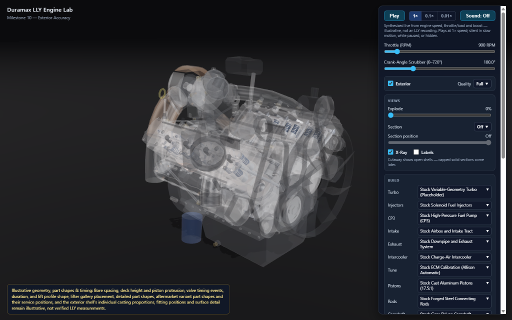

---

### RF-8 — Modified External Hardware, Front Three-Quarter (`θ = 180°`, Exterior On)

- **Crank angle:** `θ = 180°` (Cylinder 7 RH at compression/firing TDC, firing window `[180°, 270°)`)
- **Camera position (m):** `[1.3800, -1.1800, 0.7200]` (matching `RF-3` / `RF-11` camera pose for direct stock-vs-modified exterior comparison)
- **Camera target (m):** `[0.3000, -0.0200, 0.1700]`
- **Quality profile:** `Full`
- **Exterior:** `On` (checked)
- **View states:** `Explode = 0%`, `Section = Off`, `X-Ray = Off`, `Labels = Off`
- **Build selection:** `turbo_large`, `intake_highflow`, `exhaust_4in`, `intercooler_upgraded` (other 8 slots `stock`)
- **What to look for (re-baselined at M10):**
  1. **Clean stock-part replacement (`SHELL_PARTS_REPLACED_BY_SLOT`):** Out of the `23` merged exterior shell meshes (`6` `turbo_unit` + `2` `turbo_downpipe` + `3` `intake_tract` + `12` global merge), hiding the three preserved stock subtrees (`11` meshes / `6,500` tris = `3,400 + 800 + 2,300`) leaves the `12` global-merge shell meshes (`30,600` tris — including the stock RH/LH 3-bolt up-pipes, polished stainless LH `boostPipe` and RH `chargePipeCold`, two-piece `intakeBridge`, `resonator`, `valveCovers`, proud `injectors`, RH `fuelFilter`, and corrected front accessory drive) cleanly visible with zero boundary gaps or z-fighting.
  2. **Front & RH modified external hardware mated to preserved M8 datums:** Byte-identical M8 variant GLBs attach cleanly to the rebuilt shell: `Ø101.6 mm` (`4.0 in`) polished-aluminum high-flow intake tube with black silicone couplers and pleated conical filter (`intake_tract_engine_highflow`, bounds `X[-17.98, 778.54]`, `Y[-639.09, 56.13]`, `Z[289.14, 547.79] mm`) sweeping cleanly over the RH accessory/valve-cover corridor (`2.34 mm` minimum envelope surface gap; `2.94 mm` nearest non-excluded vertex distance to `boostPipe`) from `if_airbox_mount = [587.40, -510.50, 371.90] mm` to `if_compressor_inlet = [13.20, 22.60, 453.60] mm`; `Ø220 × 380 mm` stainless straight-through muffler canister and `Ø101.6 mm` downpipe (`exhaust_system_engine_4inch`) visible behind the RH bank; `turbo_unit_engine_large` (`r = 131 mm` / `Ø 262 mm` aluminum compressor cover, `r = 117 mm` / `Ø 234 mm` cast-iron turbine scroll, VGT actuator) seated in the rear V-valley (`2.29 mm` minimum envelope surface gap; `4.15 mm` nearest non-excluded vertex distance to `boostPipe`); and the top of `intercooler_core_engine_upgraded` connected on the far LH (`+Y`) side at `if_hot_side_inlet = [374.60, 474.80, 146.60] mm`.
  3. **Ground plane & UI coherence:** All four external variant models sit cleanly above the `Z = -245.00 mm` studio floor (`Z_min = -85.00 mm` on V3 = `160.00 mm` ground clearance; `Z_min = -20.00 mm` on V4 = `225.00 mm` ground clearance), and the right-hand Build panel dropdowns show `Large Variable-Geometry Turbo`, `High-Flow Intake`, `4-Inch Exhaust System`, and `Upgraded Intercooler` with the remaining 8 slots on stock.

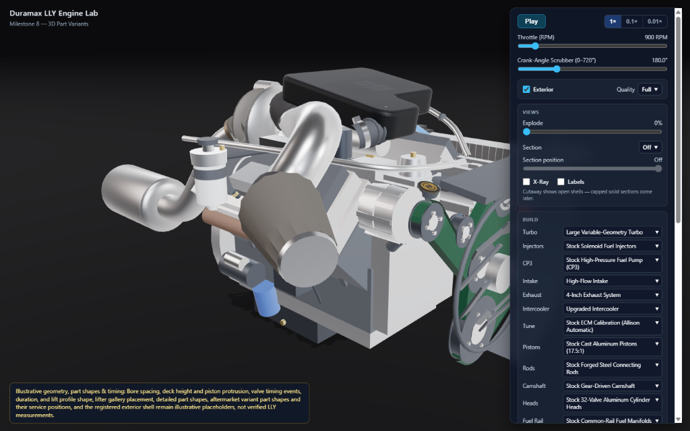

*Caption: Aftermarket variant part shapes (`turbo_large`, `intake_highflow`, `exhaust_4in`, `intercooler_upgraded`) are illustrative procedural models; exterior hardware whose vehicle-side counterparts are absent from the shipped shell (intercooler core, open-element intake filter end, exhaust section beyond the downpipe) is displayed at documented engine-adjacent service positions.*

---

### RF-9 — Modified External Hardware, Rear-Left Three-Quarter (`θ = 0°`, Exterior On)

- **Crank angle:** `θ = 0°` (Cylinder 1 RH at compression/firing TDC, firing window `[0°, 90°)`)
- **Camera position (m):** `[-0.6200, 1.2200, 0.8600]` (rear-left elevated three-quarter pose matching `RF-12`, framing the LH intercooler assembly, V-valley turbocharger, up-pipes, and 4-inch exhaust run)
- **Camera target (m):** `[0.2800, 0.0200, 0.1600]`
- **Quality profile:** `Full`
- **Exterior:** `On` (checked)
- **View states:** `Explode = 0%`, `Section = Off`, `X-Ray = Off`, `Labels = Off`
- **Build selection:** `turbo_large`, `intake_highflow`, `exhaust_4in`, `intercooler_upgraded` (other 8 slots `stock`)
- **What to look for (re-baselined at M10):**
  1. **LH charge-air service display (`intercooler_core_engine_upgraded`):** Foregrounded on the LH (`+Y`) side (`X[80.55, 682.00]`, `Y[472.68, 696.00]`, `Z[-20.00, 338.00] mm`), showing the brushed-aluminum bar-and-plate core with 18 raised vertical fin strips, black powder-coated chamfered end tanks + 3 top mounting brackets, free cold-side `Ø76.2 mm` neck + `Ø84 mm` coupler, and `Ø76.2 mm` hot-side adapter + silicone sleeves connected seamlessly to the rebuilt polished-stainless `boostPipe` end flange (`if_hot_side_inlet = [374.60, 474.80, 146.60] mm`, `0.0000 mm` shell datum contact).
  2. **Rear V-valley turbocharger mating (`turbo_unit_engine_large`) & LLY rear context:** Cast-iron turbine scroll (`r = 117 mm`), steel CHRA + `Ø60 × 80 mm` VGT actuator canister, and `r = 131 mm` (`Ø 262 mm`) aluminum compressor cover mated cleanly with zero flange mismatch to the rebuilt RH/LH 3-bolt up-pipes (`if_turbine_inlet_rh`, `if_turbine_inlet_lh`, `r = 44 mm`), polished stainless stock `boostPipe` (`if_compressor_outlet`, `r = 44 mm`), and high-flow intake coupler (`if_compressor_inlet`, `r = 48 mm`), surrounded by the outboard exhaust manifolds + shields, rear-valley EGR valve/cooler module, LH rear lifting bracket, and RH yellow-loop dipstick.
  3. **4-inch downpipe, muffler & flared tip (`exhaust_system_engine_4inch`):** Stock `turbo_downpipe` (`800` tris) hidden and replaced at `if_turbine_outlet = [-146.20, -59.20, 373.30] mm` (`r = 52 mm` heat-tinted inlet flange on shared normal `[-0.782, -0.247, -0.572]`), sweeping aft (`X ∈ [-1092.64, -113.80] mm`, `Z_min = -85.00 mm`, `111.56 mm` envelope surface clearance to `egrSystem`) through the `Ø101.6 mm` stainless pipe, `Ø220 × 380 mm` straight-through muffler canister, and `Ø101.6 → Ø112 mm` flared tip.

*Caption: Aftermarket variant part shapes (`turbo_large`, `intake_highflow`, `exhaust_4in`, `intercooler_upgraded`) are illustrative procedural models shown at documented engine-adjacent service positions rather than full truck-chassis packaging.*

---

### RF-10 — Low-Compression Pistons in Exploded View (`θ = 90°`, Exterior Off, Explode `100%`, Labels On)

- **Crank angle:** `θ = 90°` (Cylinder 2 LH at compression/firing TDC, firing window `[90°, 180°)`)
- **Camera position (m):** `[1.2800, -1.0800, 0.7400]` (matching `RF-5` camera pose for direct stock-vs-low-compression piston comparison)
- **Camera target (m):** `[0.3100, -0.0500, 0.1800]`
- **Quality profile:** `Full` (`PCFSoftShadowMap` `2048×2048` enabled)
- **Exterior:** `Off` (unchecked)
- **View states:** `Explode = 100%` (`e = 1.0`), `Section = Off`, `X-Ray = Off`, `Labels = On`
- **Build selection:** `turbo_large`, `pistons_lowcomp` (other 10 slots `stock`; `turbo_large` satisfies the M6 `pistons_lowcomp → turbo_large` compatibility rule, while `Exterior = Off` hides external variant geometry so the frame isolates the internal low-compression pistons)
- **What to look for:**
  - **Swapped 8-cylinder instanced piston batches (`rot_piston_c1_lowcomp`):** All 8 pistons (`7` standard + `1` orange emissive firing highlight on **Cylinder 2 LH** at TDC) display the 48-segment forged-aluminum body/skirt (`OD = 102.85 mm`, `r_out = 51.425 mm`), steel three-ring pack, and dark hard-anodized crown carrying the pinned open flat-floor dish (`r_floor = 16.456 mm`, `r_mouth = 29.8265 mm` / `Ø 59.65 mm`, depth `d = 16.2957 mm`, `V_lowcomp = 32.82 cm³` vs `V_stock = 29.59 cm³` omega bowl, `ΔV = +3.23 cm³` for catalog CR `17.5 → 16.5`, with no valve-relief pockets modeled per Spec §3.2 V5).
  - **Identical bore/pin kinematics & M4 explode behavior:** Exact `102.85 mm` OD (`103.00 mm` bore − `0.15 mm` skirt clearance), `49.80 mm` compression height, wrist-pin pivot `(0, 0, 0)`, and `[0, 0, 0]` catalog `explodeVectorMm` preserve identical rod/pin engagement, `+1.8×` axial station spread, floor shadows, and HTML label callouts as `RF-5`.
  - **External variants suppressed with Exterior Off:** Even though `Large Variable-Geometry Turbo` is selected alongside `Low-Compression Forged Pistons (16.5:1)` in the Build panel, no external turbo mesh renders in mid-air while `Exterior = Off` and `X-Ray = Off`.

*Caption: The `pistons_lowcomp` open flat-floor dish crown (with no valve-relief pockets) is an illustrative procedural shape whose bowl-volume increase (`29.59 → 32.82 cm³`, `ΔV = +3.23 cm³`) matches the catalog's `17.5 → 16.5` compression-ratio clearance-volume delta while preserving the stock piston envelope and wrist-pin kinematics.*

---

### RF-11 — Stock LLY Exterior, Front Three-Quarter (`θ = 180°`, Exterior On)

- **Crank angle:** `θ = 180°` (Cylinder 7 RH at compression/firing TDC, firing window `[180°, 270°)`)
- **Camera position (m):** `[1.3800, -1.1800, 0.7200]` (`fov = 42°`, `up = [0, 0, 1]`; matching `RF-3` / `RF-8` front-right three-quarter pose)
- **Camera target (m):** `[0.3000, -0.0200, 0.1700]`
- **Quality profile:** `Full` (`PCFSoftShadowMap` `2048×2048` enabled)
- **Exterior:** `On` (checked)
- **View states:** `Explode = 0%`, `Section = Off`, `X-Ray = Off`, `Labels = Off`
- **Build selection:** `stock` (all 12 catalog slots stock)
- **What to look for (numbered checklist — Spec §§8.1, 8.3):**
  1. **Corrected front-drive stack & K06 serpentine belt (`beltDrive`, `frontCover`):** Harmonic-balancer ring (`ext_damper`, `OD = 198 mm` at `X = 464..492 mm`) centered on `(Y = 0, Z = 0)` over the internal damper disc (`X = 466..476 mm`), 6-rib `20 mm` serpentine belt (`ext_belt`) routed around 9 pulleys in `X = 472..492 mm` (**no water-pump pulley** on the belt; gear-driven `ext_wp_boss` sits behind the belt on `ext_front_cover` — **Discriminator #8**), finned thermal `ext_fan_clutch` (`X = 530..570 mm`), and 9-blade cooling `ext_fan` (`X = 570..615 mm`).
  2. **RH alternator + vacuum pump & LH A/C + P/S accessories (`alternator`, `acComp`):** Upper-RH `ext_alternator` with the belt-driven `ext_vacuum_pump` mounted directly beneath it (**Discriminator #8**), and upper-LH `ext_ac_compressor` + `ext_ps_pump` + `ext_ac_hoses` on the shared `ext_ac_bracket`, flanked by `ext_tensioner`, `ext_idler_a`, and `ext_idler_b`.
  3. **Front bolt-on oil filler neck (`oilFill`):** Discrete cast-aluminum `ext_oil_fill_neck` and black `ext_oil_cap` rising from the LH front cover beside the fan blade plane (`X = 460..540.8 mm`) — not a valve-cover oil filler (**Discriminator #6**).
  4. **Two-piece valve covers & proud two-row injectors (`valveCovers`, `injectors`):** Upper and lower cast-aluminum valve covers per bank (`ext_vc_upper_rh/lh`, `ext_vc_lower_rh/lh`) with cambered longitudinal ribs, PCV boss (`ext_vc_pcv_boss`), grommeted perimeter fasteners (`ext_vc_fasteners`), and four semicircular valley-side reliefs per bank exposing **eight proud injector bodies and harness connectors (`ext_injector_1..8`, `ext_inj_connector_1..8`) in two rows of four** with clipped `ext_inj_return_line` (**Discriminator #1**).
  5. **Two-piece Y-bridge & MAP sensor (`intakeBridge`):** Cast-aluminum `ext_ybridge_duct` and `ext_ybridge_crossover` spanning the front V-valley (`X = 214..346.4 mm`) with black rectangular runner seals (`ext_ybridge_seals`), top-mounted `ext_map_sensor`, and fastener rows (`ext_ybridge_fasteners`) — exposed with no plastic upper engine cover or fabricated lettering (**Discriminator #5**).
  6. **Cold & hot charge pipes, intake mouthpiece/duct & resonator (`chargePipeCold`, `boostPipe`, `intake`, `resonator`):** Passenger-side `Ø63.5 mm` polished stainless `ext_charge_cold` rising from its front service-point coupler into the Y-bridge front with black silicone boots and worm-gear band clamps (no clip ring), driver-side `Ø63.5 mm` polished stainless `ext_charge_hot` running forward along the LH flank to `if_hot_side_inlet`, black `ext_resonator` box clamped above the turbo inlet, and corrugated `ext_intake_duct` terminating cleanly at `if_airbox_mount`.
  7. **Block skirt, oil pan & RH valve-cover fuel filter (`blockPan`, `fuelFilter`):** Cast-iron `ext_block` skirt and engine mounts, painted deep-front-sump `ext_pan` (`Z_min = -223.50 mm` with `ext_drain_boss` and blue spin-on oil filter), and the `ext_fuel_filter_head` + vertical spin-on `ext_fuel_filter_canister` mounted on the RH valve cover.

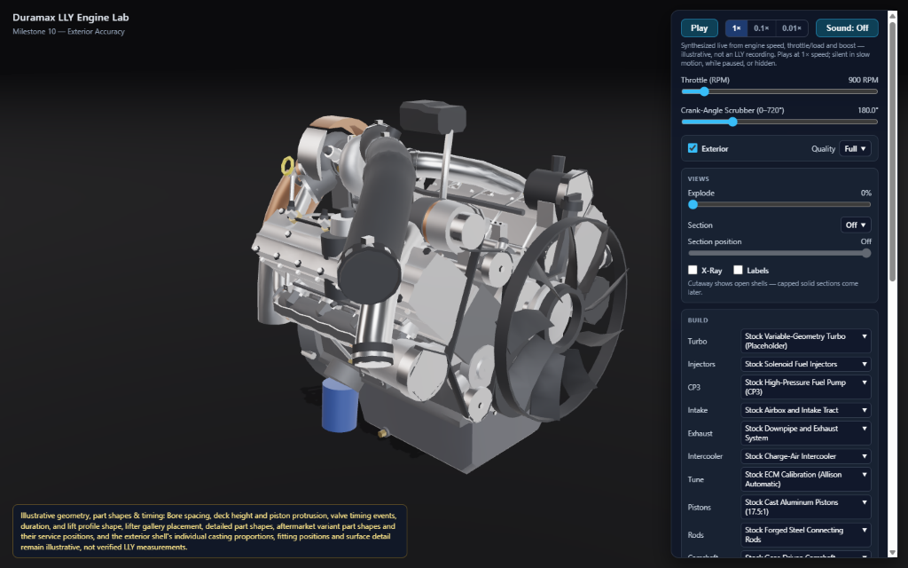

*Caption: Stock 2005 Duramax LLY front three-quarter exterior (`RF-11`), verifying the corrected crank-snout front-drive stack, front oil filler neck, vacuum pump under the alternator (no belt-driven water pump), two-piece Y-bridge, both charge pipes, and proud valley-trough injector rows.*

---

### RF-12 — Stock LLY Exterior, Rear-Left Three-Quarter (`θ = 0°`, Exterior On)

- **Crank angle:** `θ = 0°` (Cylinder 1 RH at compression/firing TDC, firing window `[0°, 90°)`)
- **Camera position (m):** `[-0.6200, 1.2200, 0.8600]` (`fov = 42°`, `up = [0, 0, 1]`; matching `RF-9` rear-left elevated three-quarter pose)
- **Camera target (m):** `[0.2800, 0.0200, 0.1600]`
- **Quality profile:** `Full` (`PCFSoftShadowMap` `2048×2048` enabled)
- **Exterior:** `On` (checked)
- **View states:** `Explode = 0%`, `Section = Off`, `X-Ray = Off`, `Labels = Off`
- **Build selection:** `stock` (all 12 catalog slots stock)
- **What to look for (numbered checklist — Spec §§8.1, 8.3):**
  1. **Garrett GT3788VA rear-valley turbocharger (`turbo` child 3, `turbo_unit`):** Cast-iron turbine scroll with **two separate 3-bolt inlet flanges** (`if_turbine_inlet_rh`, `if_turbine_inlet_lh`, `r = 44 mm`) and `r = 52 mm` V-band outlet neck (`if_turbine_outlet`), cast-aluminum compressor volute (`if_compressor_inlet` `r = 48 mm`, `if_compressor_outlet` `r = 44 mm`), bearing housing with top brass oil-feed banjo, coolant banjos, and lower oil drain, **small passenger-side VGT control solenoid + vane-position sensor** (no large external wastegate canister), and two-piece stamped heat shield (**Discriminator #3**).
  2. **Dual 3-bolt up-pipes & crushed-oval downpipe (`turbo` children 0, 1, 2):** Shielded driver-side `ext_uppipe_lh` and passenger-side `ext_uppipe_rh` (with firewall-clearance flat) rising behind the cylinder heads from the outboard manifold collectors to the two separate turbine inlet flanges, plus `turbo_downpipe` (`Ø88.9 mm` round V-band mouth crushed to a flat oval mid-run behind the bellhousing with a copper-heat-tinted shield band and RH manifold support bracket).
  3. **Outboard exhaust manifolds & heat shields (`exhaustManifolds`, `heads`):** Four-runner cast-iron `ext_exh_manifold_lh` and `ext_exh_manifold_rh` bolted to the **outboard** exhaust-port stubs (`ext_exh_port_stub_lh_1..4`, `ext_exh_port_stub_rh_1..4`) of `ext_head_lh`/`ext_head_rh`, wrapped in full-length stamped steel heat shields (`ext_exh_shield_lh`, `ext_exh_shield_rh`) that feed the lower up-pipe flanges (**Discriminator #4**).
  4. **Rear-valley passenger-side EGR module (`egrSystem`):** `ext_egr_valve` mounted **above** the long tubular `ext_egr_cooler` (`GM 97303654`) on `ext_egr_bracket` at the rear-right of the V-valley beneath the turbo inlet ducting, with `ext_egr_pipes` routing forward toward the intake crossover (**Discriminator #2**).
  5. **Single rear-LH lifting bracket (`liftBracket`):** Stamped steel `ext_lift_bracket` with hoist eye bolted to the rear of the LH cylinder head/block (`X = -33..-17 mm`, `Y = 156..212 mm`, `Z = 268..372 mm`) — asymmetric single rear bracket per GM installation procedure.
  6. **RH dipstick tube & yellow loop handle (`dipstick`):** Steel `ext_dipstick_tube` rising along the rear-right flank from the lower block O-ring boss and ending in the yellow `ext_dipstick_handle` loop (`Z_max = 447.9 mm`) visible behind the RH bank/EGR zone.
  7. **Rear-left main harness break & LH hot charge pipe (`electronics`, `boostPipe`):** Swept `ext_harness_loom` terminating at the multi-pin `ext_harness_main_break` connector bracket at the rear of the LH bank alongside `ext_glowplug_loom`, plus the `Ø63.5 mm` polished stainless `ext_charge_hot` tube sweeping forward along the LH flank to its beaded end flange at `if_hot_side_inlet = [374.6, 474.8, 146.6] mm`.

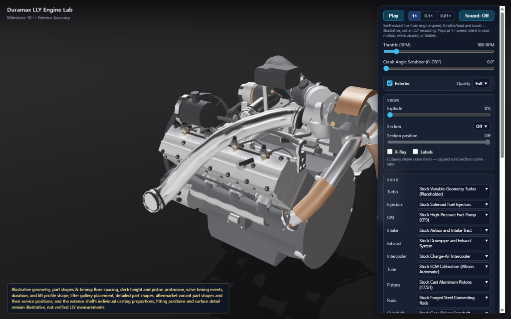

*Caption: Stock 2005 Duramax LLY rear-left three-quarter exterior (`RF-12`), verifying the GT3788VA turbocharger (two-flange inlet, V-band outlet, small passenger-side solenoid), dual up-pipes, crushed-oval downpipe, rear-valley EGR valve above cooler, outboard shielded exhaust manifolds, single LH lifting bracket, and RH yellow-loop dipstick.*

---

### RF-13 — Stock LLY Exterior, Top-Down Valley (`θ = 705°`, Exterior On)

- **Crank angle:** `θ = 705°` (end of the 48-step `0°..705°` `15°` cycle sweep; Cylinder 3 RH in `[630°, 720°)`)
- **Camera position (m):** `[0.2300, -0.0020, 1.1800]` (`fov = 42°`, `up = [0, 0, 1]`; matching `RF-4` top-down valley pose centered above `blockCenterX = 0.2300 m`)
- **Camera target (m):** `[0.2300, 0.0000, 0.1400]`
- **Quality profile:** `Full` (`PCFSoftShadowMap` `2048×2048` enabled)
- **Exterior:** `On` (checked)
- **View states:** `Explode = 0%`, `Section = Off`, `X-Ray = Off`, `Labels = Off`
- **Build selection:** `stock` (all 12 catalog slots stock)
- **What to look for (numbered checklist — Spec §§8.1, 8.3):**
  1. **Two-piece Y-bridge & MAP sensor (`intakeBridge`):** Overhead view of `ext_ybridge_duct` and `ext_ybridge_crossover` spanning the front V-valley (`X = 214..346.4 mm`, `Y = ±144.8 mm`), showing both black rectangular rubber port seals (`ext_ybridge_seals`), top-mounted `ext_map_sensor`, and 18 M8 bolts + 8 studs (`ext_ybridge_fasteners`) (**Discriminator #5**).
  2. **Turbo inlet resonator & intake mouthpiece/duct (`resonator`, `intake`):** Black `ext_resonator` box (`X = 92..236.5 mm`, `Z = 324..556 mm`) perched above the compressor inlet with its front `ext_resonator_clamp` lug, joined to the molded `ext_intake_mouthpiece` air horn, `ext_intake_clamps`, and 4-group corrugated `ext_intake_duct` sweeping outboard to `if_airbox_mount` on the RH (`-Y`) side.
  3. **Proud two-row 8-injector arrangement (`injectors`, `valveCovers`):** All eight injector bodies (`ext_injector_1..8`) and weatherpack connectors (`ext_inj_connector_1..8`) standing proud inside the valley-side semicircular reliefs of `ext_vc_upper_rh` and `ext_vc_upper_lh` in **two rows of four** (`X = {57.5, 172.5, 287.5, 402.5} mm`, `|Y| = 213..291 mm`) with clipped `ext_inj_return_line` (**Discriminator #1**).
  4. **RH valve-cover fuel filter head & vertical canister (`fuelFilter`):** Cast-aluminum `ext_fuel_filter_head` (with black hand-primer plunger, brass bleed/vent screw, and dual hose stubs) mounted on top of the RH upper valve cover (`X = 190.6..268.2 mm`, `Y = -320.0..-189.2 mm`) with the vertical spin-on `ext_fuel_filter_canister` (white canister + WIF sensor/drain base) hanging directly below it inside the viewport (**Discriminator #7**).
  5. **Front-valley Bosch CP3 high-pressure pump (`cp3Fuel`):** `ext_cp3` body seated in the front V-valley (`X = 352..442 mm`, `Y ≈ 0`) behind `ext_front_cover` (`ext_cp3_pad`), accompanied by its side-mounted `ext_fca` actuator, valley `ext_hp_rails`, and steel `ext_hp_lines`.
  6. **Valley harness row & bilateral packaging (`electronics`, `boostPipe`, `chargePipeCold`, `exhaustManifolds`):** Swept `ext_harness_loom` running along the valley edge to the rear-left `ext_harness_main_break`, framed symmetrically by the outboard exhaust manifold shields (`ext_exh_shield_rh/lh`), LH `ext_charge_hot`, RH `ext_charge_cold`, front `ext_oil_fill_neck`/`ext_oil_cap`, and rear GT3788VA `turbo_unit` + `egrSystem`.

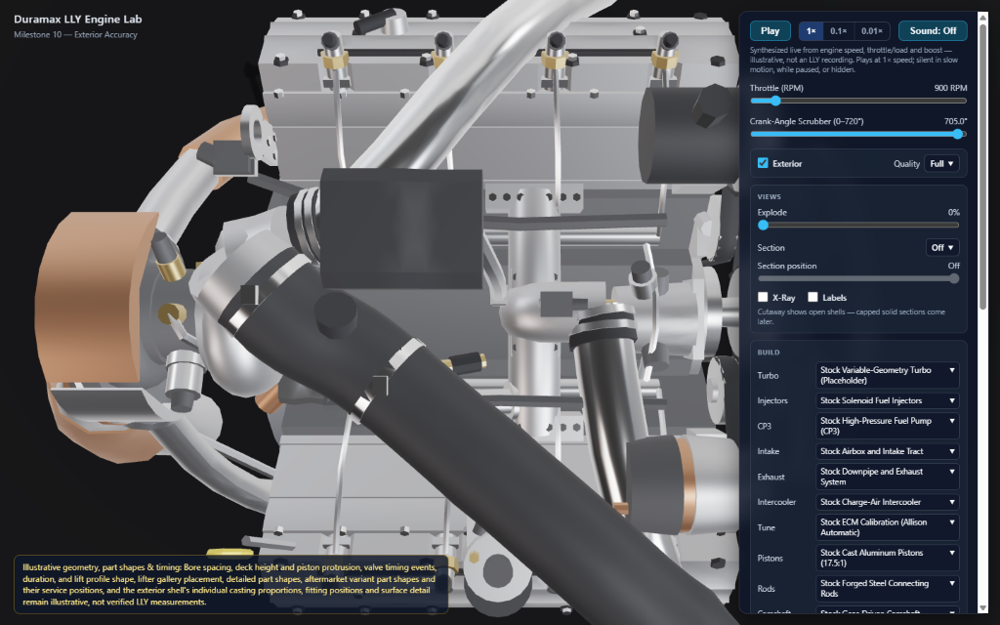

*Caption: Stock 2005 Duramax LLY top-down valley exterior (`RF-13`), verifying the uncovered two-piece Y-bridge + MAP sensor, resonator, intake mouthpiece/duct, two rows of four proud injectors, RH valve-cover fuel filter head + vertical canister, front-valley CP3 pump, and valley harness loom.*

---

### RF-14 — Cut Piston Close-Up (`θ = 180°`, Section X @ `402.5 mm`, Exterior Off)

- **Crank angle:** `θ = 180°` (Cylinder 1 RH at BDC; Cylinder 7 RH firing TDC)
- **Camera position (m):** `[0.9000, -0.6200, 0.2500]` (`fov = 42°`, `up = [0, 0, 1]`)
- **Camera target (m):** `[0.4000, -0.1500, 0.0200]`
- **Quality profile:** `Full` (`PCFSoftShadowMap` `2048×2048` enabled)
- **Exterior:** `Off` (unchecked)
- **View states:** `Explode = 0%`, `Section = Front–Back (X)` at `402.5 mm`, `X-Ray = Off`, `Labels = Off`
- **Build selection:** `stock` (all 12 catalog slots stock)
- **What to look for (numbered checklist — Milestone 11 Spec §7.1–§7.2):**
  1. **Solid piston section from crown to skirt:** The RH Cylinder 1 piston at BDC reads as one continuous solid 45°-hatched cut-bronze cross-section from combustion bowl/crown through the ring belt and wrist-pin region down to the lower skirt, with zero visible hollow interior walls.
  2. **Solid connecting-rod, crank-throw & main-shaft cuts:** Beneath Cylinder 1, the connecting rod's wrist-pin eye/beam/big-end, the front crank throw web/pin, and the main crankshaft journal are cleanly capped in the same plane with crisp outer silhouette edges.
  3. **Open cylinder space above BDC piston:** The swept space above the BDC piston crown up to the Cylinder 1 head deck is **not** filled — kept valves, head deck, and rear station assemblies remain cleanly visible behind the cut plane.
  4. **Shared Section-Fill Checklist items 1–6:** All six shared section-fill invariants pass (no open shells, true bores open, single plane-locked 45° hatch face, exact depth occlusion, crisp cut edge, zero spurious fill).

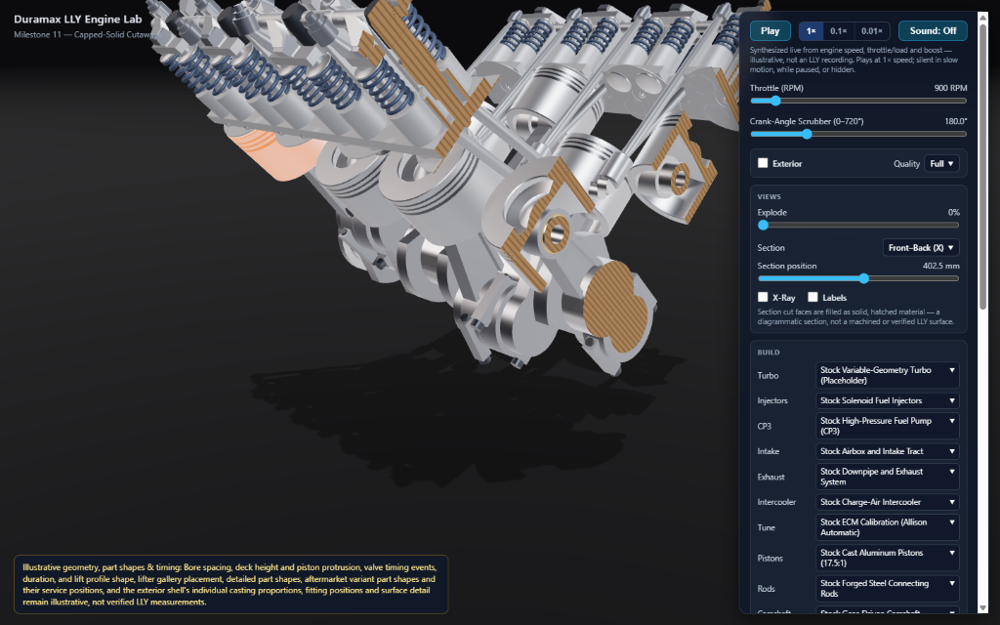

*Caption: Cylinder 1 BDC piston close-up (`RF-14`, Section `X @ 402.5 mm`, Exterior Off), proving a continuous solid hatched cross-section from crown bowl through ring belt and skirt, solid rod/throw/main-shaft sections below, and open swept cylinder space above.*

---

### RF-15 — Cut Cylinder Head Close-Up (`θ = 470°`, Section X @ `402.5 mm`, Exterior Off)

- **Crank angle:** `θ = 470°` (Cylinder 1 peak intake lift `= 9.9 mm`, matching `RF-2`'s crank angle and camera pose)
- **Camera position (m):** `[0.6600, -0.3800, 0.5600]` (`fov = 42°`, `up = [0, 0, 1]`; identical to `RF-2`)
- **Camera target (m):** `[0.4025, -0.2000, 0.2550]`
- **Quality profile:** `Full` (`PCFSoftShadowMap` `2048×2048` enabled)
- **Exterior:** `Off` (unchecked)
- **View states:** `Explode = 0%`, `Section = Front–Back (X)` at `402.5 mm`, `X-Ray = Off`, `Labels = Off`
- **Build selection:** `stock` (all 12 catalog slots stock)
- **What to look for (numbered checklist — Milestone 11 Spec §7.1–§7.2):**
  1. **Solid RH cylinder-head casting section:** Cylinder 1's head casting deck, port/gallery walls, and upper tower at `X = 402.5 mm` read as a clean, solid hatched bronze casting section rather than hollow paper-thin walls.
  2. **Solid injector, valve-bridge & rocker cross-sections:** The central fuel injector body/nozzle tip, depressed intake/exhaust valve bridges, and forged rocker arms crossing `X = 402.5 mm` are cleanly capped in the same plane and occlude geometry behind them.
  3. **Rear blued-steel helical springs visible & un-cut at `X = 402.5 mm`:** Because `X = 402.5 mm` passes cleanly between Cylinder 1's front (`X ≈ 424.5 mm`, clipped away) and rear (`X ≈ 380.5 mm`, kept) valve/spring rows, no spring `ConvexHull` proxy is falsely emitted at `X = 402.5 mm`, and the kept rear blued-steel helical coils read intact behind the head/injector caps.
  4. **Shared Section-Fill Checklist items 1–6:** All six shared section-fill invariants pass with zero hollow openings or gap rings.

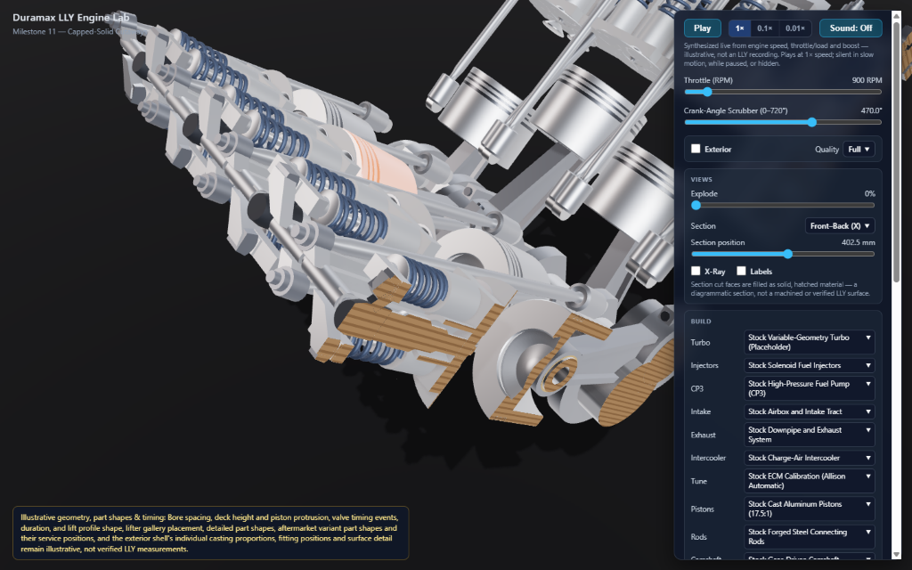

*Caption: Cylinder 1 head close-up at peak intake lift (`RF-15`, Section `X @ 402.5 mm`, `RF-2` pose), verifying solid hatched cross-sections across the head casting, central injector, bridges, and rockers while keeping the un-cut `X ≈ 380.5 mm` rear spring row intact.*

---

### RF-16 — Sectioned Exterior Shell (`θ = 180°`, Section X @ `402.5 mm`, Exterior On)

- **Crank angle:** `θ = 180°` (matching `RF-3` / `RF-11` crank angle and front three-quarter camera pose)
- **Camera position (m):** `[1.3800, -1.1800, 0.7200]` (`fov = 42°`, `up = [0, 0, 1]`; identical to `RF-3` / `RF-11`)
- **Camera target (m):** `[0.3000, -0.0200, 0.1700]`
- **Quality profile:** `Full` (`PCFSoftShadowMap` `2048×2048` enabled)
- **Exterior:** `On` (checked)
- **View states:** `Explode = 0%`, `Section = Front–Back (X)` at `402.5 mm`, `X-Ray = Off`, `Labels = Off`
- **Build selection:** `stock` (all 12 catalog slots stock)
- **What to look for (numbered checklist — Milestone 11 Spec §7.1–§7.2):**
  1. **Solid exterior casting & pan cross-section (`1,068` shell cap triangles, `1,942` total):** The upper/lower valve covers, cylinder heads, deep-skirt V-block, valley CP3 pump body, outboard exhaust manifolds/shields, and oil pan sliced at `X = 402.5 mm` form a crisp, continuous hatched cut-bronze section (`2` non-watertight fastener open chains closed cleanly by local in-plane chords, `0` dropped groups, `0` false valley cutouts across material-merged shell buckets).
  2. **No hollow tube or duct openings:** Cut plumbing and air-tract conduits crossing `X = 402.5 mm` (corrugated RH intake duct, LH hot-side charge pipe, RH cold-side charge pipe, return/fuel lines) are cleanly capped according to their modelled single-wall or annular geometry — zero open paper-thin shells.
  3. **Honest solid-section occlusion (§2.2 convention):** Because the exterior shell castings are closed single-surface solids, their solid cross-section at `X = 402.5 mm` legitimately occludes internal parts behind the cut face (toggling X-Ray On or Exterior Off reveals the capped internals behind it).
  4. **Shared Section-Fill Checklist items 1–6:** All six shared section-fill invariants pass across all `23` exterior shell meshes.

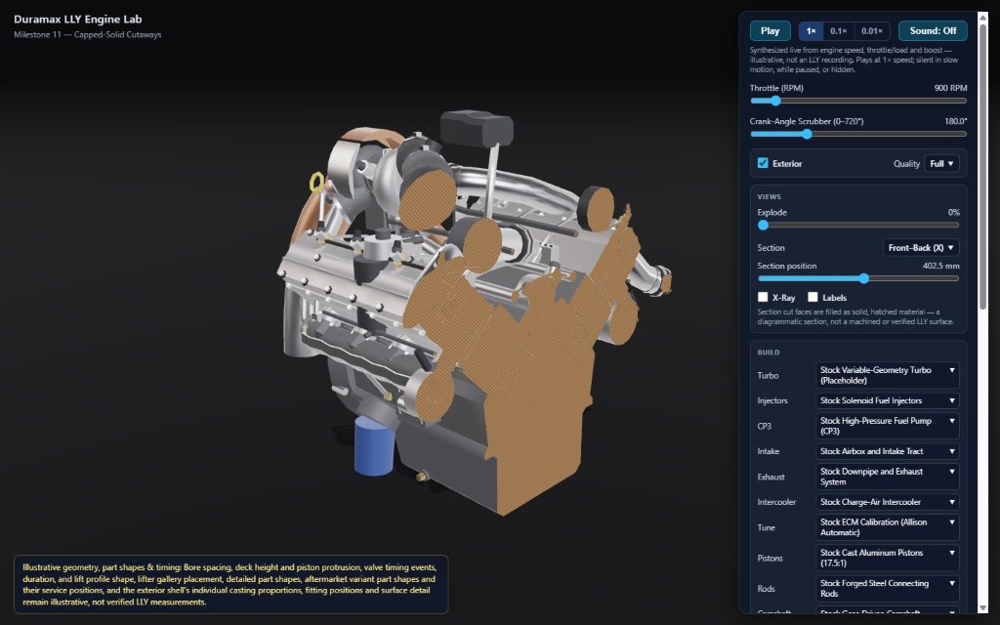

*Caption: Sectioned 2005 Duramax LLY exterior shell (`RF-16`, Section `X @ 402.5 mm`, `RF-3`/`RF-11` pose), eliminating hollow open-shell castings and pipes across the block, oil pan, valve covers, CP3 valley, exhaust manifolds, intake duct, and charge pipes.*

---

### RF-17 — Longitudinal RH Bank Section (`θ = 0°`, Section Y @ `-185 mm`, Exterior Off)

- **Crank angle:** `θ = 0°` (Cylinder 1 RH at compression/firing TDC, firing window `[0°, 90°)`)
- **Camera position (m):** `[0.2300, 1.0500, 0.4500]` (`fov = 42°`, `up = [0, 0, 1]`; viewed from the `+Y` LH side toward `-Y` RH bank)
- **Camera target (m):** `[0.2300, -0.1200, 0.1600]`
- **Quality profile:** `Full` (`PCFSoftShadowMap` `2048×2048` enabled)
- **Exterior:** `Off` (unchecked)
- **View states:** `Explode = 0%`, `Section = Side (Y)` at `-185 mm` (`plane normal = (0, -1, 0)`, `constant = -0.185 m`, keeping `y <= -0.185 m`), `X-Ray = Off`, `Labels = Off`
- **Build selection:** `stock` (all 12 catalog slots stock)
- **What to look for (numbered checklist — Milestone 11 Spec §7.1–§7.2):**
  1. **Solid longitudinal RH bank cross-sections (`2,600` cap triangles):** Slicing along `Y = -185 mm` through the RH bank (`Cylinders 1, 3, 5, 7`) cleanly caps all four RH cylinder-head castings, all four RH pistons (Cylinder 1 at TDC, Cylinders 3/5/7 along their stroke phases), and the intersected RH intake-valve stems/heads and bridges/rockers in one coplanar 45°-hatched cut-bronze plane.
  2. **LH bank & V-valley cleanly clipped away:** Everything with `Y > -185 mm` (entire LH bank `Cylinders 2, 4, 6, 8`, central crankshaft, connecting rods whose world-`Y` span `[-174.0, +27.7] mm` lies inboard of `-185 mm`, and valley lifters/pushrods) is completely removed by the Side (`Y`) clip plane rather than painted over.
  3. **Kept outboard RH spring rows intact & un-cut:** The outboard RH spring rows (`Y ≈ -202 / -235 mm`, strictly on the kept `y <= -185 mm` side) remain visible in their true helical coil geometry behind the cut plane with zero spurious spring hull caps.
  4. **Shared Section-Fill Checklist items 1–6:** Proves Side (`Y`) mode extracts, classifies, and renders solid hatched caps identically to Front–Back (`X`) mode.

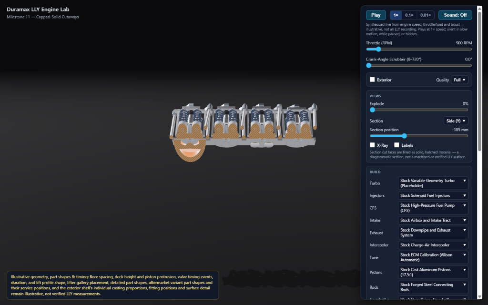

*Caption: Longitudinal Side (`Y @ -185 mm`) cutaway (`RF-17`, viewed from `+Y` toward the RH bank), showing solid hatched sections across RH Cylinders `1, 3, 5, 7` heads, pistons, and valve stems with the LH bank and valley cleanly clipped away.*

---

### RF-18 — Optional LLY Intake Manifold Cover On, Front Three-Quarter (`θ = 180°`, Exterior On, Intake Cover On)

- **Crank angle:** `θ = 180°` (Cylinder 7 RH at compression/firing TDC; matching `RF-3` / `RF-11` pose for direct uncovered-vs-covered Y-bridge comparison)
- **Camera position (m):** `[1.3800, -1.1800, 0.7200]` (`fov = 42°`, `up = [0, 0, 1]`; identical to `RF-11`)
- **Camera target (m):** `[0.3000, -0.0200, 0.1700]`
- **Quality profile:** `Full` (`PCFSoftShadowMap` `2048×2048` enabled)
- **Exterior:** `On` (checked)
- **View states:** `Explode = 0%`, `Section = Off`, `X-Ray = Off`, `Labels = Off`, **`Intake cover = On`**
- **Build selection:** `stock` (all 12 catalog slots stock)
- **What to look for (numbered checklist — Milestone 12 Spec §8.1):**
  1. **Separate black plastic shield over the front/mid valley:** `public/models/intake_cover_lly.glb` (`1,040` tris = `500` body + `540` lettering; `0` textures) reads as a removable matte-black plastic shield (`mat_cover_plastic`, linear RGB `[0.028, 0.029, 0.032]`, roughness `0.62`) seated cleanly above the cast-aluminium Y-bridge (`18.046 mm` vertical clearance above `ext_map_sensor`) and valve covers with zero z-fighting.
  2. **Evidenced three-line `6.6` / `TURBO` / `DIESEL` legend (`45` stroke prisms):** Raised rectilinear stroke geometry (`0.8 mm` relief on the flat `Z = 417.2 mm` top pad; `mat_cover_letter` roughness `0.38`) catches the studio key light in three stacked lines (`6.6` / `TURBO` / `DIESEL`) without looking like a separate metal badge; no fabricated `DURAMAX` wordmark and no guessed diamond-field texture appear.
  3. **Y-bridge main top hidden, rear-right plumbing corridor exposed:** The cover hides the main top of `intakeBridge` (`ext_ybridge_duct` / `ext_ybridge_crossover` / `ext_map_sensor`) while the rear-right relief (`P1–P2–P3`) leaves the RH turbo-inlet plumbing corridor (`ext_intake_duct`) and rear `ext_resonator` (`8.454 mm` X gap) cleanly exposed.
  4. **Clearance & simplified two-point retention:** Zero clipping against `chargePipeCold` (`5.172 mm` under-footprint clearance; `369.078 mm` group max sits outside the rear-right relief), `alternator` (`8.084 mm`), `acComp` (`8.246 mm`), `resonator` (`8.793 mm`), `electronics` (`25.908 mm`), or `intake` (`48.049 mm`); the simplified integrated front mount leg meets the cold charge pipe at `if_intake_cover_duct_clamp` (`[372.0, -95.4, 353.4] mm`, representing, not modelling, the separate EPC clamp) and the rear tower sits over `intakeBridge` at `if_intake_cover_rear_bolt` (`[260.0, 0.0, 333.4] mm`).

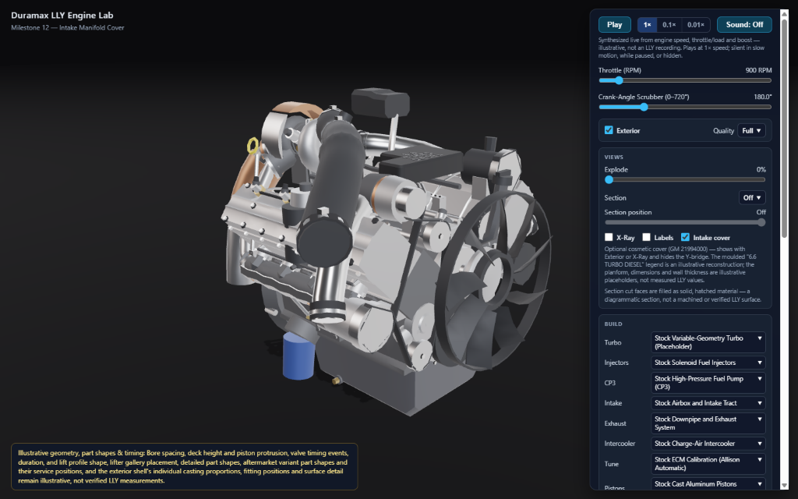

*Caption: Optional GM `21994000` plastic upper intake manifold cover enabled over the stock LLY exterior (`RF-18`), showing the matte-black shield, raised three-line `6.6 TURBO DIESEL` legend, rear-right plumbing relief, and simplified front/rear mounts (planform, dimensions, wall thickness, and stroke font are illustrative placeholders).*

---

### RF-19 — Sectioned Intake Manifold Cover & Open Underside Cavity (`θ = 705°`, Section X @ `300.0 mm`, Exterior On, Intake Cover On)

- **Crank angle:** `θ = 705°` (end of the `0°..705°` cycle sweep)
- **Camera position (m):** `[0.9200, -0.5800, 0.5600]` (`fov = 42°`, `up = [0, 0, 1]` — **owner-approved deviation D-047** front-side cutaway pose with `X = +920.0 mm > 300.0 mm` so the `+X`-facing cut plane at `X = 300.0 mm` is viewed directly rather than occluded from behind by the kept cover roof at `RF-13`'s `X = +230.0 mm`)
- **Camera target (m):** `[0.2800, -0.0100, 0.3100]` (**D-047**)
- **Quality profile:** `Full` (`PCFSoftShadowMap` `2048×2048` enabled)
- **Exterior:** `On` (checked)
- **View states:** `Explode = 0%`, `Section = Front–Back (X)` at `300.0 mm` (`plane normal = (-1, 0, 0)`, `constant = +0.300 m`, keeping `x <= 0.300 m`), `X-Ray = Off`, `Labels = Off`, **`Intake cover = On`**
- **Build selection:** `stock` (all 12 catalog slots stock)
- **What to look for (numbered checklist — Milestone 12 Spec §8.1 + shared Section-Fill Checklist items 1–6 + D-047):**
  1. **True thin-wall material-band cap on the cover (`+28` cover cap triangles, `3,102` total):** Slicing `ext_intake_cover_body` (watertight `2.5 mm` wall with `0` boundary edges) at `X = 300.0 mm` renders a flat, crisp, 45°-hatched cut-bronze U-band (`Z = 370.0..417.2 mm`, `Y = -40.0..+120.0 mm`) — neither an uncapped paper-thin shell nor a chord-closed solid block.
  2. **Intentionally open under-cover air cavity:** Beneath the `2.5 mm` roof band (`Z = 370.0..414.7 mm`), the cover's open underside remains air (exposing the un-cut rear mounting boss at `X = 260.0 mm` inside the cavity), satisfying the M12 open-underside rule in item 1 of the shared Section-Fill Checklist.
  3. **Unchanged solid M11 Y-bridge & engine section below:** Directly beneath the open under-cover cavity, `intakeBridge` (`ext_ybridge_duct` / `ext_ybridge_crossover`), `valveCovers`, `heads`, `blockPan`, `turbo`/intake plumbing, and internal Cylinder 3/4 assemblies present solid 45°-hatched cut-bronze sections (`3,074` non-cover cap triangles) with zero floating caps or silhouette gaps.
  4. **Clipped forward legend pad (`D-047` scope):** Because `Section X @ 300.0 mm` clips `X > 300.0 mm` (leaving `55.0 mm` of rear cover length `X ∈ [245.0, 300.0]`), the forward `6.6 / TURBO / DIESEL` legend block (`X ∈ [304.0, 386.0]`) lies on the clipped side; no `DURAMAX` wordmark or diamond-field texture appears on the kept rear cover (`RF-18` and `RF-20` verify full three-line legend legibility).

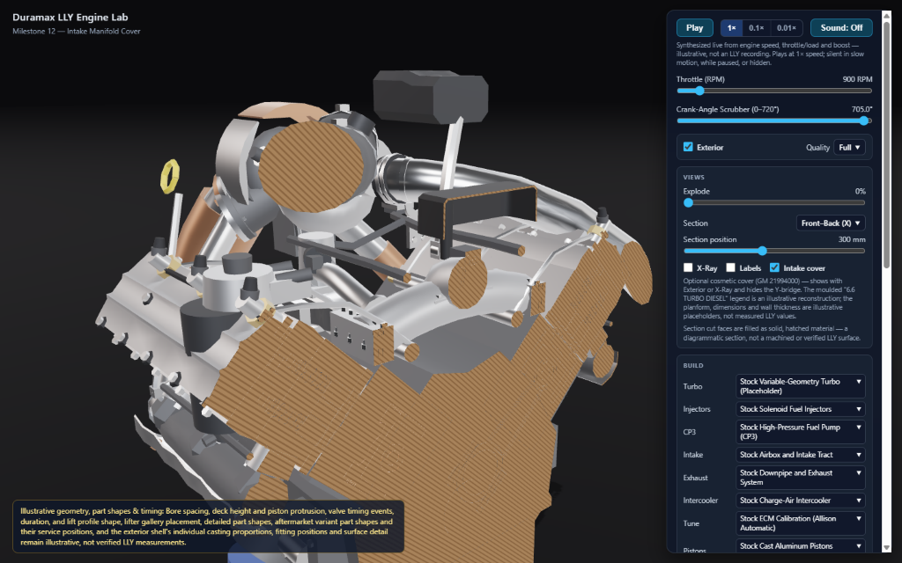

*Caption: Front-side cutaway at `X = 300.0 mm` (`RF-19`, pose per D-047), proving the cover's hatched `2.5 mm` thin-wall U-band (`+28` cap triangles), intentionally open under-cover cavity (with the rear mounting tower visible inside), and unchanged solid M11 Y-bridge cross-section beneath.*

---

### RF-20 — Exploded Intake Manifold Cover (`+Z 260 mm`) Over Exposed Y-Bridge (`θ = 90°`, Explode `100%`, Exterior On, Intake Cover On)

- **Crank angle:** `θ = 90°` (Cylinder 2 LH at compression/firing TDC)
- **Camera position (m):** `[1.2800, -1.0800, 1.1200]` (`fov = 42°`, `up = [0, 0, 1]` — **owner-approved deviation D-047** elevated front-right pose above the `+260 mm` lifted cover top `Z = 0.6780 m`, replacing `RF-5`'s `Z = 0.7400 m` `2.52°` grazing angle with a `17.2°` pad view)
- **Camera target (m):** `[0.3100, -0.0200, 0.3000]` (**D-047**)
- **Quality profile:** `Full` (`PCFSoftShadowMap` `2048×2048` enabled)
- **Exterior:** `On` (checked)
- **View states:** `Explode = 100%` (`e = 1.0`, cover offset `[0, 0, +260] mm`), `Section = Off`, `X-Ray = Off`, `Labels = Off`, **`Intake cover = On`**
- **Build selection:** `stock` (all 12 catalog slots stock)
- **What to look for (numbered checklist — Milestone 12 Spec §8.1 + D-047):**
  1. **Exact `+Z 260 mm` rigid group lift (`Z_max = 678.0 mm`):** At `e = 1.0`, `intake_cover_lly` translates strictly `+260.0 mm` along `+Z` with zero rotation or XY drift, clearing the exterior shell (`Z_max = 556.0 mm`) while both closed mounting towers (`if_intake_cover_rear_bolt`, `if_intake_cover_duct_clamp`) travel rigidly with the cover body.
  2. **Y-bridge completely exposed beneath:** Lifting the cover reveals the entire two-piece cast-aluminium `intakeBridge` (`ext_ybridge_duct`, `ext_ybridge_crossover`, `ext_ybridge_seals`, top `ext_map_sensor`, and fastener rows) and `ext_charge_cold` neck in the front valley alongside the exploded internal head/valvetrain banks.
  3. **Legible three-line `6.6 / TURBO / DIESEL` legend:** All three raised rectilinear stroke lines (`6.6` / `TURBO` / `DIESEL`, `540` tris across `45` stroke prisms) remain crisply legible on the matte-black pad (`mat_cover_letter` vs. `mat_cover_plastic`), with no `DURAMAX` wordmark and no diamond-field texture.

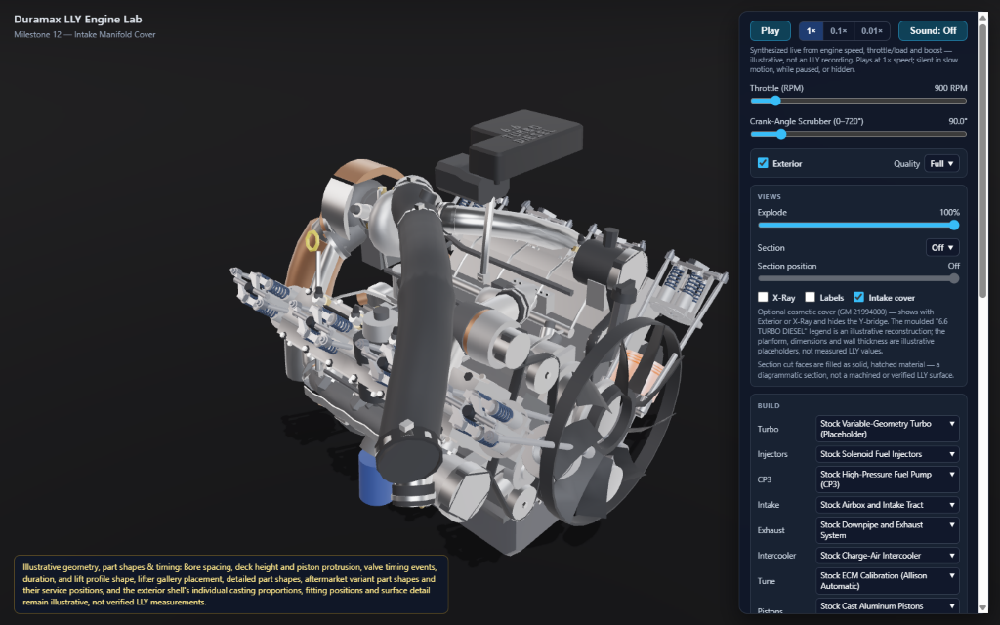

*Caption: Exploded view (`RF-20`, `Explode = 100 %`, pose per D-047) with the optional GM `21994000` intake manifold cover lifted `+Z 260 mm` above the exposed two-piece Y-bridge and MAP sensor, keeping both integrated mounts attached and the three-line `6.6 TURBO DIESEL` legend legible.*

---

### RF-21 — Heavy-Duty Forged Connecting Rods in Exploded Internal View (`θ = 90°`, Exterior Off, Explode `100%`)

- **Crank angle:** `θ = 90°` (Cylinder 2 LH at compression/firing TDC, firing window `[90°, 180°)` — matching `RF-5` / `RF-10` camera pose)
- **Camera position (m):** `[1.2800, -1.0800, 0.7400]` (`fov = 42°`, `up = [0, 0, 1]`; exact committed `RF-10` camera position)
- **Camera target (m):** `[0.3100, -0.0500, 0.1800]` (exact committed `RF-10` camera target)
- **Quality profile:** `Full` (`PCFSoftShadowMap` `2048×2048` enabled)
- **Exterior:** `Off` (unchecked)
- **View states:** `Explode = 100%` (`e = 1.0`), `Section = Off`, `X-Ray = Off`, `Labels = Off`, `Intake cover = Off`
- **Build selection:** `rods_forged` (other 11 catalog slots `stock`)
- **What to look for (Rod-Variant Checklist shared items 1–6 + `RF-21` item):**
  1. **Swapped 8-cylinder instanced forged rods (`rot_conrod_c1_forged`, `1,372` tris × `8` = `10,976`):** All eight connecting rods display the visibly wider/thicker H-beam shank (`30.343 / 18.568 mm` flange outer Y, `8.177 mm` flange thickness, `5.258 mm` web half-width — illustrative placeholders) and dark stepped 12-point cap fasteners with integral washer flanges (illustrative placeholder) with zero stock-rod double geometry.
  2. **Preserved stock kinematic interface & M4 station spread:** Identical `163.0 mm` centre-to-centre length, `62.9 mm` crankpin bore, `34.5 mm` wrist-pin bronze bushing, and `27.676 mm` big-end axial width (`0.724 mm` shared-pin inter-rod gap) keep all eight rods seated cleanly on their crankpins and wrist pins at `+1.8×` axial station spread with zero interference.
  3. **PBR material & highlight discipline:** Untextured forged-steel body, dark fasteners, and bronze small-end bushing; orange firing emissive remains strictly on **Cylinder 2 (LH)** piston at TDC; labels off so no chips obscure the shanks or cap fasteners.

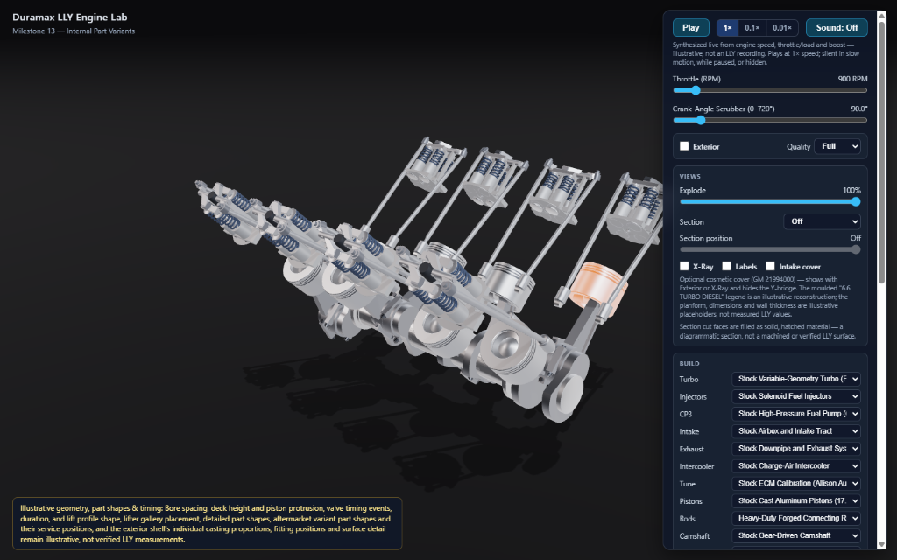

*Caption: `rods_forged` (`rot_conrod_c1_forged.glb`) in `100 %` exploded internal view (`RF-21`, `RF-10` camera pose), preserving the stock `163.0 / 62.9 / 34.5 / 27.676 mm` interface while displaying the illustrative heavier H-beam flanges/web and stepped 12-point cap fasteners.*

---

### RF-22 — Sectioned Station-0 RH Forged Connecting Rod (`θ = 0°`, Section X @ `388.3 mm`, Exterior Off)

- **Crank angle:** `θ = 0°` (Cylinder 1 RH at compression/firing TDC, firing window `[0°, 90°)` — matching `RF-6` camera pose)
- **Camera position (m):** `[1.0600, -0.5400, 0.4800]` (`fov = 42°`, `up = [0, 0, 1]`; exact committed `RF-6` camera position on the removed `+X` side looking toward `X ≤ 388.3 mm`)
- **Camera target (m):** `[0.2900, -0.0200, 0.1400]` (exact committed `RF-6` camera target)
- **Quality profile:** `Full` (`PCFSoftShadowMap` `2048×2048` enabled)
- **Exterior:** `Off` (unchecked)
- **View states:** `Explode = 0%`, **`Section = Front–Back (X)` at `388.3 mm`** (`plane normal = (-1, 0, 0)`, `constant = +0.3883 m`, keeping `x <= 0.3883 m` — deliberately `388.3 mm` through the station-0 RH rod `[374.462, 402.138] mm`, not `RF-6`'s `402.5 mm` inter-rod gap), `X-Ray = Off`, `Labels = Off`, `Intake cover = Off`
- **Build selection:** `rods_forged` (other 11 catalog slots `stock`)
- **What to look for (Rod-Variant Checklist shared items 1–6 + Section-Fill Checklist items 1–6 + `RF-22` item):**
  1. **True longitudinal cross-section through the station-0 RH forged rod (`X = 388.3 mm`, `526` rod cap tris, `2,234` total):** Slicing along the station-0 RH rod seat (`402.5 − 14.2 = 388.3 mm`, `13.838 mm` inside each big-end face) cuts the watertight 10-component `rot_conrod_c1_forged` (`0` open chains, `0` dropped groups, NDC projection `x ∈ [-0.143, 0.157], y ∈ [-0.512, -0.064]`) into a flat, crisp, 45°-hatched cut-bronze cross-section facing the `+X` camera, with the paired LH rod at `416.7 mm` cleanly clipped away so it cannot occlude the cut face.
  2. **Zero stock-rod double capping:** Hidden and removed stock `conrod` meshes (`visible = false`) contribute `0` cap triangles; only `conrod_variant` is sliced along with Cylinder 1's firing piston, Cylinder 2's LH piston, front heads, crank throw, and main shaft in the shared M11 section convention.

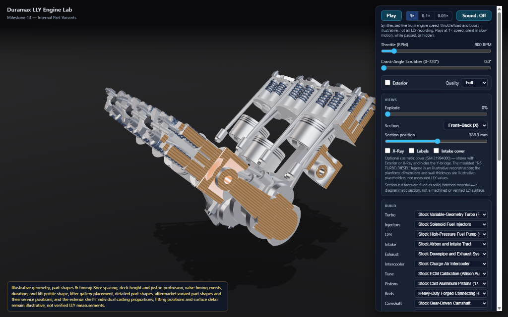

*Caption: Station-0 RH forged connecting-rod cutaway at `X = 388.3 mm` (`RF-22`, `RF-6` camera pose), proving a solid 45°-hatched longitudinal cross-section through `rot_conrod_c1_forged` continuous with the Milestone 11 cap convention.*

---

## LLY Exterior Discriminators (Milestone 10 Spec §8.3)

Every item below distinguishes a 2005 Duramax LLY (`VIN 2`) from generic V8 diesel placeholders and sibling Duramax generations (`LB7` internal injectors / no EGR; aftermarket canister turbos; valve-cover oil fillers; belt-driven water pumps) and is verified visible in its named reference frame(s):

| # | LLY Discriminator | Named Frame(s) | Governing `extras.partId`s | Status | Fails the Milestone If |
| ---: | --- | --- | --- | :---: | --- |
| **1** | Eight injector bodies + connectors **proud of** the valve covers, in two rows of four | `RF-11`, `RF-13` | `ext_injector_1..8`, `ext_inj_connector_1..8`, `ext_inj_return_line`, `ext_vc_upper_rh`, `ext_vc_upper_lh` | **PASS** | Injectors are hidden under covers (LB7 style), or modelled as outboard external fuel rails |
| **2** | EGR module at the rear of the valley (valve **above** long tubular cooler) | `RF-12` | `ext_egr_valve`, `ext_egr_cooler`, `ext_egr_pipes`, `ext_egr_bracket` | **PASS** | Absent, or placed on the wrong side/front |
| **3** | Garrett GT3788VA in the rear valley, **two separate inlet flanges**, V-band outlet, **small passenger-side solenoid**, no wastegate canister | `RF-12` | `turbo_unit` (`turbo` child `3`) | **PASS** | A large external wastegate canister, or a single twin-scroll flange |
| **4** | **Outboard** exhaust manifolds with heat shields feeding up-pipes behind the heads | `RF-12` | `ext_exh_manifold_rh/lh`, `ext_exh_shield_rh/lh`, `ext_exh_port_stub_*`, `ext_uppipe_rh/lh` | **PASS** | Manifolds in the valley, or up-pipes starting in mid-air |
| **5** | Two-piece Y-bridge over the valley front with its rectangular seals and MAP sensor | `RF-11`, `RF-13` | `ext_ybridge_duct`, `ext_ybridge_crossover`, `ext_ybridge_seals`, `ext_map_sensor`, `ext_ybridge_fasteners` | **PASS** | Absent, or hidden beneath an upper plastic cosmetic cover |
| **6** | Oil filler neck at the **front**, beside the fan shroud | `RF-11` | `ext_oil_fill_neck`, `ext_oil_cap` | **PASS** | A valve-cover oil filler |
| **7** | Fuel filter head **on the right valve cover** with a vertical spin-on canister below | `RF-13` | `ext_fuel_filter_head`, `ext_fuel_filter_canister` | **PASS** | Absent, or frame-mounted |
| **8** | **No water-pump pulley** on the serpentine belt; **vacuum pump under the alternator** | `RF-11` | `ext_belt`, `ext_wp_boss`, `ext_alternator`, `ext_vacuum_pump` | **PASS** | A belt-driven water-pump pulley, or a missing vacuum pump |
