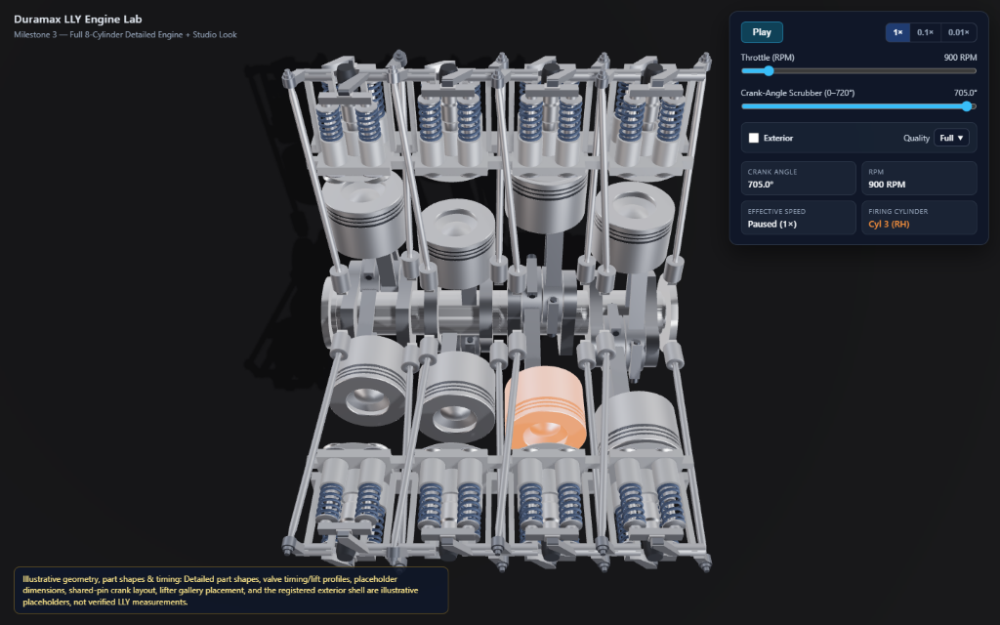
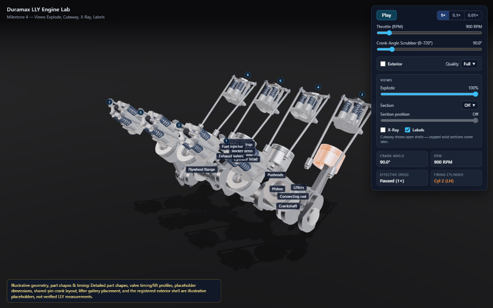
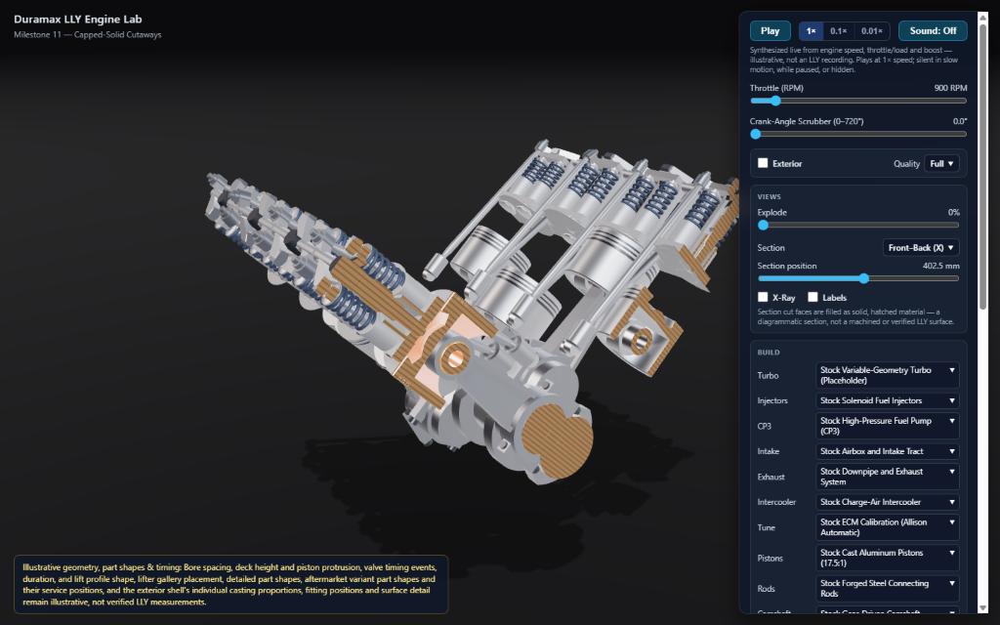
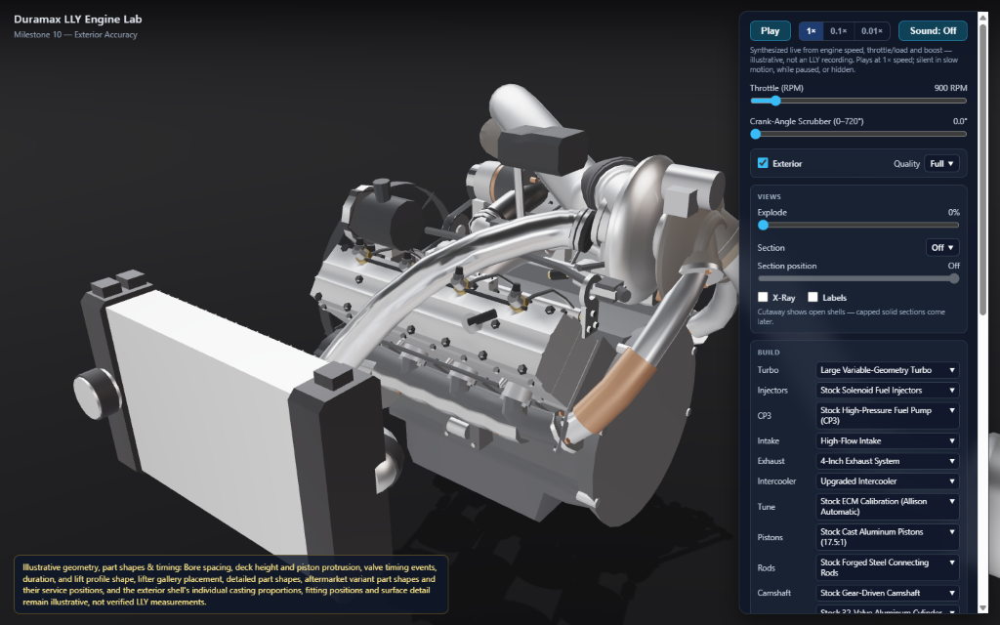
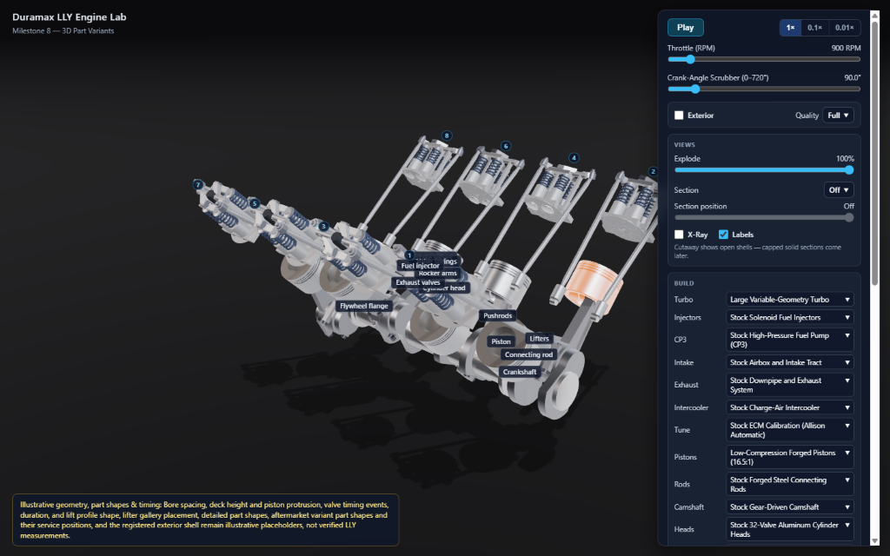

# Visual Reference Frames

Project: Duramax LLY Engine Lab · Governing plan: [`docs/PLAN.md`](./PLAN.md) · Milestone 3 Spec: [`docs/specs/M3-full-engine.md`](./specs/M3-full-engine.md) §9 · Milestone 4 Spec: [`docs/specs/M4-views.md`](./specs/M4-views.md) §9 · Milestone 8 Spec: [`docs/specs/M8-part-variants.md`](./specs/M8-part-variants.md) §5.2, §7.3 · Measurements: [`docs/M3-MEASUREMENTS.md`](./M3-MEASUREMENTS.md), [`docs/M4-MEASUREMENTS.md`](./M4-MEASUREMENTS.md), [`docs/M8-MEASUREMENTS.md`](./M8-MEASUREMENTS.md)

These ten fixed reference frames establish canonical camera poses, crank angles, display/view configurations, and catalog build selections for visual regression checks across milestones (`RF-1`…`RF-4` established at M3; `RF-5`…`RF-7` added at M4; `RF-8`…`RF-10` added at M8).

## Common Capture Convention

- **Build:** Production bundle (`npm run build && npm run preview`), reproducible directly via `?rf=RF-1` through `?rf=RF-10`
- **Viewport:** `1440 × 900` CSS px (`devicePixelRatio = 1`; Antigravity's built-in Chromium webview `page.screenshot()` serializes `1440×900` `16:10` viewports as `1024×640` `16:10` PNGs including the HUD readouts — standing `1024×640` convention for all frames)
- **Camera Lens & Up Axis:** `PerspectiveCamera` with `fov = 42°`, `near = 0.02 m`, `far = 20 m`, `camera.up = [0, 0, 1]` (`+Z` vertical; `+X` front of engine along crank axis; `-Y` RH bank `[1,3,5,7]`; `+Y` LH bank `[2,4,6,8]`)
- **Block Midpoint Reference:** `centerXM = 0.2300 m` (`230.0 mm` ahead of the `X = 0` rear block plane)
- **Studio Lighting:** Confirmed Milestone 3 studio look (D-024, D-034 — `studio_small_09_2k.hdr` IBL @ `0.8`, ACES Filmic exposure `1.1`, background `0x0b0b0d`, `FogExp2(0x0b0b0d, 0.11)`, `2048×2048` `PCFSoftShadowMap` directional key light onto studio floor at `Z = -0.245 m`)

---

## Summary Table

| Frame | Crank Angle `θ` | Camera Position `[X, Y, Z]` (m) | Camera Target `[X, Y, Z]` (m) | Quality Profile | Exterior | View States (`Explode / Section / X-Ray / Labels`) | Variants | Capture File |
| --- | ---: | --- | --- | --- | --- | --- | --- | --- |
| **RF-1** | `0°` | `[1.0100, -0.7800, 0.5600]` | `[0.2500, -0.0100, 0.1200]` | `Full` | `Off` (unchecked) | `0% / Off / Off / Off` | `stock` | [`reference-frames/RF-1.png`](./reference-frames/RF-1.png) |
| **RF-2** | `470°` | `[0.6600, -0.3800, 0.5600]` | `[0.4025, -0.2000, 0.2550]` | `Full` | `Off` (unchecked) | `0% / Off / Off / Off` | `stock` | [`reference-frames/RF-2.png`](./reference-frames/RF-2.png) |
| **RF-3** | `180°` | `[1.3800, -1.1800, 0.7200]` | `[0.3000, -0.0200, 0.1700]` | `Full` | `On` (checked) | `0% / Off / Off / Off` | `stock` | [`reference-frames/RF-3.png`](./reference-frames/RF-3.png) |
| **RF-4** | `705°` | `[0.2300, -0.0020, 1.1800]` | `[0.2300, 0.0000, 0.1400]` | `Full` | `Off` (unchecked) | `0% / Off / Off / Off` | `stock` | [`reference-frames/RF-4.png`](./reference-frames/RF-4.png) |
| **RF-5** | `90°` | `[1.2800, -1.0800, 0.7400]` | `[0.3100, -0.0500, 0.1800]` | `Full` | `Off` (unchecked) | `100% / Off / Off / On` | `stock` | [`reference-frames/RF-5.png`](./reference-frames/RF-5.png) |
| **RF-6** | `0°` | `[1.0600, -0.5400, 0.4800]` | `[0.2900, -0.0200, 0.1400]` | `Full` | `Off` (unchecked) | `0% / Front–Back (X) @ 402.5 mm / Off / Off` | `stock` | [`reference-frames/RF-6.png`](./reference-frames/RF-6.png) |
| **RF-7** | `180°` | `[1.3800, -1.1800, 0.7200]` | `[0.3000, -0.0200, 0.1700]` | `Full` | `On` (checked) | `0% / Off / On / Off` | `stock` | [`reference-frames/RF-7.png`](./reference-frames/RF-7.png) |
| **RF-8** | `180°` | `[1.3800, -1.1800, 0.7200]` | `[0.3000, -0.0200, 0.1700]` | `Full` | `On` (checked) | `0% / Off / Off / Off` | `turbo_large, intake_highflow, exhaust_4in, intercooler_upgraded` | [`reference-frames/RF-8.png`](./reference-frames/RF-8.png) |
| **RF-9** | `0°` | `[-0.6200, 1.2200, 0.8600]` | `[0.2800, 0.0200, 0.1600]` | `Full` | `On` (checked) | `0% / Off / Off / Off` | `turbo_large, intake_highflow, exhaust_4in, intercooler_upgraded` | [`reference-frames/RF-9.png`](./reference-frames/RF-9.png) |
| **RF-10** | `90°` | `[1.2800, -1.0800, 0.7400]` | `[0.3100, -0.0500, 0.1800]` | `Full` | `Off` (unchecked) | `100% / Off / Off / On` | `turbo_large, pistons_lowcomp` | [`reference-frames/RF-10.png`](./reference-frames/RF-10.png) |

---

## Frame Definitions

### RF-1 — Whole Engine Default View (`θ = 0°`, Exterior Off)

- **Crank angle:** `θ = 0°` (Cylinder 1 at compression/firing TDC, firing window `[0°, 90°)`)
- **Camera position (m):** `[1.0100, -0.7800, 0.5600]` (`[centerXM + 0.78, -0.78, 0.56]` — app default startup camera)
- **Camera target (m):** `[0.2500, -0.0100, 0.1200]` (`[centerXM + 0.02, -0.01, 0.12]` — app default startup target)
- **Quality profile:** `Full` (`PCFSoftShadowMap` `2048×2048` enabled)
- **Exterior:** `Off` (default unchecked)
- **Build selection:** `stock` (all 12 catalog slots stock)
- **What to look for:**
  - All 8 cylinders rendered with detailed assemblies (zero M1 primitive cylinders, bank boxes, or valve discs remaining).
  - Orange emissive firing highlight (`0xf97316` @ `0.85`) strictly on **Cylinder 1** (front-right RH piston at TDC), with the other 7 pistons in standard cast-aluminum finish.
  - Four shared-pin crank throws (stations `1&2`, `3&4`, `5&6`, `7&8`) each carrying two side-by-side connecting rods (`±14.2 mm` seats on `58 mm` journals) tied together by the turned `32.4 mm`-radius main crankshaft, rear flywheel flange, and front pulley/snout disc.
  - Even studio HDRI reflections across both RH and LH banks from front to rear, grounded by the soft directional shadow on the dark matte floor (`Z = -0.245 m`).

---

### RF-2 — Cylinder 1 Head & Peak Intake Lift Close-Up (`θ = 470°`, Exterior Off)

- **Crank angle:** `θ = 470°` (Cylinder 1 intake cam lobe at peak lift, `intakeLift ≈ 12.0 mm`, `exhaustLift = 0.0 mm`)
- **Camera position (m):** `[0.6600, -0.3800, 0.5600]`
- **Camera target (m):** `[0.4025, -0.2000, 0.2550]` (aimed at Cylinder 1's RH head & rocker gallery at `stationCenterX = 0.4025 m`)
- **Quality profile:** `Full`
- **Exterior:** `Off`
- **Build selection:** `stock` (all 12 catalog slots stock)
- **What to look for:**
  - **Intake spring compression & valve opening:** Cylinder 1's two valley-side (`+W`) blued-steel helical intake springs visibly compressed relative to the uncompressed exhaust springs (`-W`), with the intake valve bridge depressed and both intake valve heads extending down into the combustion chamber.
  - **Rocker arm tilt & pushrod rise:** Cylinder 1's intake forged rocker arm tilted nose-down (`-θ_in`) about the rocker shaft while its tail cup rises (`+W_cup · sin θ_in`), driven smoothly by the leaning intake pushrod without detaching from the cup or lifter socket.
  - **Deck slab recess windows (§4):** Clean passage of Cylinder 1's own exhaust pushrod through the `[+26, +41] mm` valley-edge gallery notch (`floor |X| = 42.99 mm <= 43.0 mm`) and Cylinder 3's intake pushrod through Cylinder 1's `-X` `[-8, +11] mm` deck recess window with zero metal intersection.

---

### RF-3 — Whole Engine with Registered Exterior Shell (`θ = 180°`, Exterior On)

- **Crank angle:** `θ = 180°` (Cylinder 7 RH firing TDC; firing order `1-2-7-8-4-5-6-3`, step 3 at `180°`)
- **Camera position (m):** `[1.3800, -1.1800, 0.7200]`
- **Camera target (m):** `[0.3000, -0.0200, 0.1700]`
- **Quality profile:** `Full`
- **Exterior:** `On` (checked)
- **Build selection:** `stock` (all 12 catalog slots stock)
- **What to look for:**
  - **Axis & orientation alignment (§5):** `public/Duramax_LLY_2005_66L_V8.glb` registered cleanly onto the project frame — front cooling fan/harmonic-balancer pulley facing `+X`, rear flywheel/bellhousing adapter overhanging `-X` (`A = 282.1 mm`), V-valley and turbocharger oriented `+Z` up, crank centerline coaxial with `(Y = 0, Z = 0)`.
  - **Full internal containment:** Uniform scale `s = 0.430` encloses all 8 cylinders' rocker castings, heads, crank webs, and pushrods with `≥ 21.4 mm` 3D surface clearance on every side — zero internal geometry poking through the valve covers, block walls, front cover, or oil pan.
  - **Floor clearance & material fidelity:** Exterior oil-pan sump (`Z_min = -0.2236 m`) sits cleanly above the studio ground plane (`Z = -0.2450 m`) with all 22 canonical deduplicated exterior materials (`33` merged exterior meshes post-M8 subtree preservation; `22` pre-M8) preserving the original exterior appearance (`castShadow = false`, `receiveShadow = false`).

---

### RF-4 — Top-Down V-Valley & Gallery Symmetry View (`θ = 705°`, Exterior Off)

- **Crank angle:** `θ = 705°` (end of the 48-step `0°..705°` `15°` cycle sweep; Cylinder 3 RH in the `[630°, 720°)` firing window)
- **Camera position (m):** `[0.2300, -0.0020, 1.1800]` (centered above `blockCenterX = 0.2300 m` looking straight down `+Z -> -Z` into the `90°` V-valley; `-0.002 m` Y offset avoids collinear up-vector singularity)
- **Camera target (m):** `[0.2300, 0.0000, 0.1400]`
- **Quality profile:** `Full`
- **Exterior:** `Off`
- **Build selection:** `stock` (all 12 catalog slots stock)
- **What to look for:**
  - **90° bank bilateral symmetry:** RH bank (`Cyls 1, 3, 5, 7` on `-Y`, staggered `+14.2 mm` ahead of LH in rod seating via `-14.2 mm` RH / `+14.2 mm` LH rod seats on each shared station) and LH bank (`Cyls 2, 4, 6, 8` on `+Y`) mirrored cleanly across the `Y = 0` crank plane, including chiral X-mirrored LH rockers (`det = +1` winding preserved).
  - **Asymmetric lifter gallery rows (§4):** Distinct inner/outer valley lifter rows (`intake W = +36 mm, X = +56 mm`; `exhaust W = +55 mm, X = -35 mm`) cleanly separated along both banks (`30.6 mm` nearest center spacing for `Ø 23.85 mm` bodies).
  - **Leaning cross-station pushrod clearances:** Non-intersecting intake/exhaust pushrod corridors (`28.9 mm` minimum 3D center-to-center distance for `Ø 9 mm` tubes) threading cleanly through the tiled cylinder-head deck notches without grazing adjacent pistons or spring towers.
  - **Firing highlight:** Orange emissive highlight visible on **Cylinder 3** (`RH` second station from front, firing window `[630°, 720°)`).

---

### RF-5 — Exploded Whole Engine with Live Labels (`θ = 90°`, Explode `100%`, Labels On)

- **Crank angle:** `θ = 90°` (Cylinder 2 LH at compression/firing TDC, firing window `[90°, 180°)`)
- **Camera position (m):** `[1.2800, -1.0800, 0.7400]`
- **Camera target (m):** `[0.3100, -0.0500, 0.1800]`
- **Quality profile:** `Full` (`PCFSoftShadowMap` `2048×2048` enabled)
- **Exterior:** `Off` (unchecked)
- **View states:** `Explode = 100%` (`e = 1.0`), `Section = Off`, `X-Ray = Off`, `Labels = On`
- **Build selection:** `stock` (all 12 catalog slots stock)
- **What to look for:**
  - **Axial station spread (`1 + 0.8e = 1.8×` about `X = 230 mm`):** Paired stations spread cleanly to `{-80.5, +126.5, +333.5, +540.5} mm` while the axisymmetric turned main crankshaft stays fixed (`X ∈ [-96, +506] mm`), showing the outer crank throws sliding outboard past the fixed shaft ends at full explode while connecting rods remain locked to their crankpins and wrist pins with exact `208 mm` center-to-center length.
  - **Rigid head-group lift & connected pushrods:** All 8 cylinder-head assemblies (head casting, injector, intake/exhaust valves, helical springs, bridges, and rockers) lift rigidly `+110 mm` outward along each bank's `±45°` bore axis `B`, lifters lift `+55 mm` along `B`, and all 16 pushrods elongate smoothly (`+21.3%` intake / `+21.7%` exhaust) without detaching from lifter sockets or rocker tail cups.
  - **Firing highlight & live HTML label tracking:** Orange emissive highlight on **Cylinder 2 (LH)** at TDC; cylinder number chips `1`–`8` float above each exploded head; Cylinder 1 internal part callouts and crank callouts (`Crankshaft`, `Flywheel flange`) track their exploded 3D anchors while the 3 exterior-only labels (`Turbocharger`, `Harmonic balancer`, `Oil pan`) stay hidden.
  - **Complete unclipped `e = 1` floor shadows (Spec §8):** Soft directional shadows on the `Z = -0.245 m` studio floor remain completely inside the `±0.65 m` key-light shadow frustum under both end stations (`1&2` at `+540.5 mm`, `7&8` at `-80.5 mm`) and all 8 lifted cylinder heads with zero straight-edge frustum clipping.

---

### RF-6 — Front–Back Station 1 Cross-Section Cutaway (`θ = 0°`, Section X @ `402.5 mm`)

- **Crank angle:** `θ = 0°` (Cylinder 1 RH at compression/firing TDC, firing window `[0°, 90°)`)
- **Camera position (m):** `[1.0600, -0.5400, 0.4800]`
- **Camera target (m):** `[0.2900, -0.0200, 0.1400]`
- **Quality profile:** `Full`
- **Exterior:** `Off` (unchecked)
- **View states:** `Explode = 0%`, `Section = Front–Back (X)` at `402.5 mm` (`plane normal = (-1, 0, 0)`, `constant = +0.4025 m`, keeping `x <= 0.4025 m`), `X-Ray = Off`, `Labels = Off`
- **Build selection:** `stock` (all 12 catalog slots stock)
- **What to look for:**
  - **Exact Station 1 (`X = 402.5 mm`) cutaway:** Slicing through the front paired station's bore centerline cleanly bisects **Cylinder 1's orange firing piston** at TDC, **Cylinder 2's LH piston**, both wrist-pin bosses, Cylinder 1 & 2's cylinder heads and fuel injectors, the front shared crankpin/connecting-rod big-end, and the turned main crankshaft, leaving stations `3&4`, `5&6`, and `7&8` behind the plane completely intact.
  - **Open-shell interior walls:** `DoubleSide` internal PBR materials reveal clean open-shell interior geometry at the cut plane (matching the UI note *"Cutaway shows open shells — capped solid sections come later."*).
  - **Unclipped studio ground & clipped shadow (`clipShadows = true`):** The studio ground disc (`Z = -0.245 m`) and dark studio backdrop are completely unclipped, while the directional shadow cast onto the floor terminates cleanly along the `X = 402.5 mm` section plane.

---

### RF-7 — Ghosted Exterior Shell in X-Ray Mode (`θ = 180°`, Exterior On + X-Ray On)

- **Crank angle:** `θ = 180°` (Cylinder 7 RH at compression/firing TDC, firing window `[180°, 270°)`)
- **Camera position (m):** `[1.3800, -1.1800, 0.7200]` (matching `RF-3` camera pose for direct opaque-vs-X-ray comparison)
- **Camera target (m):** `[0.3000, -0.0200, 0.1700]`
- **Quality profile:** `Full`
- **Exterior:** `On` (checked)
- **View states:** `Explode = 0%`, `Section = Off`, `X-Ray = On` (`transparent = true`, `opacity = 0.22`, `depthWrite = false`), `Labels = Off`
- **Build selection:** `stock` (all 12 catalog slots stock)
- **What to look for:**
  - **Translucent registered packaging (`opacity = 0.22`, `depthWrite = false`):** All 33 post-M8 merged exterior shell meshes across the 22 deduplicated exterior materials (`22` merged meshes pre-M8; valve covers, block skirt, oil pan, oil filter, front serpentine belt drive, harmonic balancer, intake plumbing, and rear V-valley turbocharger) render as a clean semi-transparent silhouette around the internal V8 assembly without z-buffer occlusion artifacts.
  - **Full internal visibility & firing highlight through shell:** All 8 detailed cylinder heads, blued-steel valve springs, pushrods, connecting rods, crank throws, and the glowing orange **Cylinder 7 (RH)** piston at rear-right TDC read clearly through the ghosted shell.

---

### RF-8 — Modified External Hardware, Front Three-Quarter (`θ = 180°`, Exterior On)

- **Crank angle:** `θ = 180°` (Cylinder 7 RH at compression/firing TDC, firing window `[180°, 270°)`)
- **Camera position (m):** `[1.3800, -1.1800, 0.7200]` (matching `RF-3` camera pose for direct stock-vs-modified exterior comparison)
- **Camera target (m):** `[0.3000, -0.0200, 0.1700]`
- **Quality profile:** `Full`
- **Exterior:** `On` (checked)
- **View states:** `Explode = 0%`, `Section = Off`, `X-Ray = Off`, `Labels = Off`
- **Build selection:** `turbo_large`, `intake_highflow`, `exhaust_4in`, `intercooler_upgraded` (other 8 slots `stock`)
- **What to look for:**
  - **Clean stock-part replacement (`SHELL_PARTS_REPLACED_BY_SLOT`):** Out of the `33` post-split merged exterior shell meshes (`6` `turbo_unit` + `1` `turbo_downpipe` + `5` `intake_tract` + `21` global merge), hiding the three preserved stock subtrees (`12` meshes / `8,356` tris) leaves the `21` global-merge shell meshes (`23,040` tris — including the stock RH/LH up-pipes and blue hot-side `boostPipe`) cleanly visible with zero boundary gaps or z-fighting.
  - **Front & RH modified external hardware in frame:** `Ø101.6 mm` (`4.0 in`) polished-aluminum high-flow intake tube with black silicone couplers and pleated conical filter (`intake_tract_engine_highflow`, bounds `X[-17.98, 778.54]`, `Y[-639.09, 56.13]`, `Z[289.14, 547.79] mm`) sweeping cleanly over the RH accessory/valve-cover corridor (`17.52 mm` minimum envelope surface gap; `20.41 mm` nearest non-excluded vertex distance to `acComp`) from `if_airbox_mount = [587.40, -510.50, 371.90] mm` to `if_compressor_inlet = [13.20, 22.60, 453.60] mm`; `Ø220 × 380 mm` stainless straight-through muffler canister and `Ø101.6 mm` downpipe (`exhaust_system_engine_4inch`) visible behind the RH bank; `turbo_unit_engine_large` (`r = 131 mm` / `Ø 262 mm` aluminum compressor cover, `r = 117 mm` / `Ø 234 mm` cast-iron turbine scroll, VGT actuator) seated in the rear V-valley; and the top of `intercooler_core_engine_upgraded` connected on the far LH (`+Y`) side at `if_hot_side_inlet = [374.60, 474.80, 146.60] mm`.
  - **Ground plane & UI coherence:** All four external variant models sit cleanly above the `Z = -245.00 mm` studio floor (`Z_min = -85.00 mm` on V3 = `160.00 mm` ground clearance; `Z_min = -20.00 mm` on V4 = `225.00 mm` ground clearance), and the right-hand Build panel dropdowns show `Large Variable-Geometry Turbo`, `High-Flow Intake`, `4-Inch Exhaust System`, and `Upgraded Intercooler` with the remaining 8 slots on stock.

*Caption: Aftermarket variant part shapes (`turbo_large`, `intake_highflow`, `exhaust_4in`, `intercooler_upgraded`) are illustrative procedural models; exterior hardware whose vehicle-side counterparts are absent from the shipped shell (intercooler core, open-element intake filter end, exhaust section beyond the downpipe) is displayed at documented engine-adjacent service positions.*

---

### RF-9 — Modified External Hardware, Rear-Left Three-Quarter (`θ = 0°`, Exterior On)

- **Crank angle:** `θ = 0°` (Cylinder 1 RH at compression/firing TDC, firing window `[0°, 90°)`)
- **Camera position (m):** `[-0.6200, 1.2200, 0.8600]` (rear-left elevated three-quarter pose framing the LH intercooler assembly, V-valley turbocharger, up-pipes, and 4-inch exhaust run)
- **Camera target (m):** `[0.2800, 0.0200, 0.1600]`
- **Quality profile:** `Full`
- **Exterior:** `On` (checked)
- **View states:** `Explode = 0%`, `Section = Off`, `X-Ray = Off`, `Labels = Off`
- **Build selection:** `turbo_large`, `intake_highflow`, `exhaust_4in`, `intercooler_upgraded` (other 8 slots `stock`)
- **What to look for:**
  - **LH charge-air service display (`intercooler_core_engine_upgraded`):** Foregrounded on the LH (`+Y`) side (`X[80.55, 682.00]`, `Y[472.68, 696.00]`, `Z[-20.00, 338.00] mm`), showing the brushed-aluminum bar-and-plate core with 18 raised vertical fin strips, black powder-coated chamfered end tanks + 3 top mounting brackets, free cold-side `Ø76.2 mm` neck + `Ø84 mm` coupler, and `Ø76.2 mm` hot-side adapter + silicone sleeves connected at the `boostPipe` service datum (`if_hot_side_inlet = [374.60, 474.80, 146.60] mm`).
  - **Rear V-valley turbocharger mating (`turbo_unit_engine_large`):** Cast-iron turbine scroll (`r = 117 mm`), steel CHRA + `Ø60 × 80 mm` VGT actuator canister, and `r = 131 mm` (`Ø 262 mm`) aluminum compressor cover mated cleanly to the preserved stock RH/LH up-pipes (`if_turbine_inlet_rh`, `if_turbine_inlet_lh`), blue stock `boostPipe` (`if_compressor_outlet`), and high-flow intake coupler (`if_compressor_inlet`).
  - **4-inch downpipe, muffler & flared tip (`exhaust_system_engine_4inch`):** Stock `turbo_downpipe` hidden and replaced at `if_turbine_outlet = [-146.20, -59.20, 373.30] mm` (`r = 52 mm` heat-tinted inlet flange on shared normal `[-0.782, -0.247, -0.572]`), sweeping aft (`X ∈ [-1092.64, -113.80] mm`, `Z_min = -85.00 mm`) through the `Ø101.6 mm` stainless pipe, `Ø220 × 380 mm` straight-through muffler canister, and `Ø101.6 → Ø112 mm` flared tip.

*Caption: Aftermarket variant part shapes (`turbo_large`, `intake_highflow`, `exhaust_4in`, `intercooler_upgraded`) are illustrative procedural models shown at documented engine-adjacent service positions rather than full truck-chassis packaging.*

---

### RF-10 — Low-Compression Pistons in Exploded View (`θ = 90°`, Exterior Off, Explode `100%`, Labels On)

- **Crank angle:** `θ = 90°` (Cylinder 2 LH at compression/firing TDC, firing window `[90°, 180°)`)
- **Camera position (m):** `[1.2800, -1.0800, 0.7400]` (matching `RF-5` camera pose for direct stock-vs-low-compression piston comparison)
- **Camera target (m):** `[0.3100, -0.0500, 0.1800]`
- **Quality profile:** `Full` (`PCFSoftShadowMap` `2048×2048` enabled)
- **Exterior:** `Off` (unchecked)
- **View states:** `Explode = 100%` (`e = 1.0`), `Section = Off`, `X-Ray = Off`, `Labels = On`
- **Build selection:** `turbo_large`, `pistons_lowcomp` (other 10 slots `stock`; `turbo_large` satisfies the M6 `pistons_lowcomp → turbo_large` compatibility rule, while `Exterior = Off` hides external variant geometry so the frame isolates the internal low-compression pistons)
- **What to look for:**
  - **Swapped 8-cylinder instanced piston batches (`rot_piston_c1_lowcomp`):** All 8 pistons (`7` standard + `1` orange emissive firing highlight on **Cylinder 2 LH** at TDC) display the 48-segment forged-aluminum body/skirt (`OD = 102.85 mm`, `r_out = 51.425 mm`), steel three-ring pack, and dark hard-anodized crown carrying the pinned open flat-floor dish (`r_floor = 16.456 mm`, `r_mouth = 29.8265 mm` / `Ø 59.65 mm`, depth `d = 16.2957 mm`, `V_lowcomp = 32.82 cm³` vs `V_stock = 29.59 cm³` omega bowl, `ΔV = +3.23 cm³` for catalog CR `17.5 → 16.5`, with no valve-relief pockets modeled per Spec §3.2 V5).
  - **Identical bore/pin kinematics & M4 explode behavior:** Exact `102.85 mm` OD (`103.00 mm` bore − `0.15 mm` skirt clearance), `49.80 mm` compression height, wrist-pin pivot `(0, 0, 0)`, and `[0, 0, 0]` catalog `explodeVectorMm` preserve identical rod/pin engagement, `+1.8×` axial station spread, floor shadows, and HTML label callouts as `RF-5`.
  - **External variants suppressed with Exterior Off:** Even though `Large Variable-Geometry Turbo` is selected alongside `Low-Compression Forged Pistons (16.5:1)` in the Build panel, no external turbo mesh renders in mid-air while `Exterior = Off` and `X-Ray = Off`.

*Caption: The `pistons_lowcomp` open flat-floor dish crown (with no valve-relief pockets) is an illustrative procedural shape whose bowl-volume increase (`29.59 → 32.82 cm³`, `ΔV = +3.23 cm³`) matches the catalog's `17.5 → 16.5` compression-ratio clearance-volume delta while preserving the stock piston envelope and wrist-pin kinematics.*
