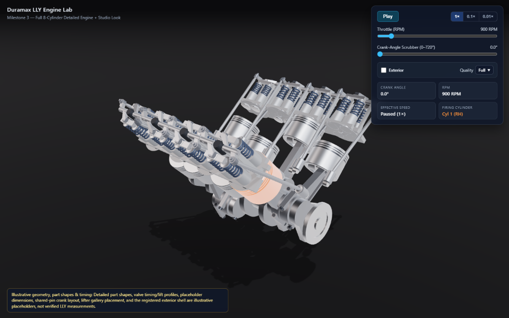
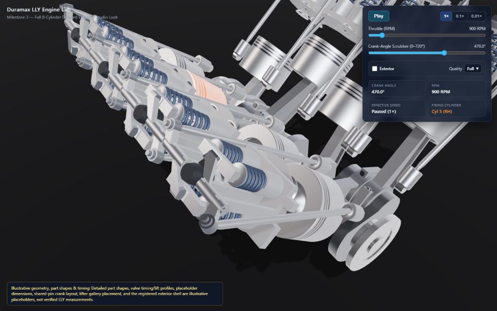
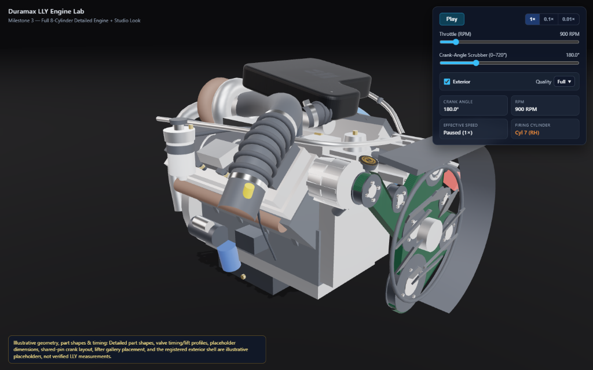
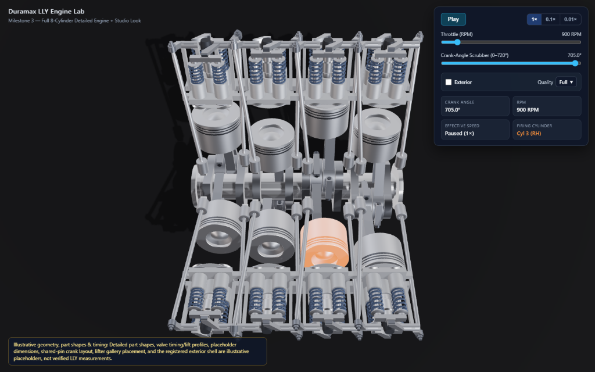

# Visual Reference Frames

Project: Duramax LLY Engine Lab · Governing plan: [`docs/PLAN.md`](./PLAN.md) · Milestone 3 Spec: [`docs/specs/M3-full-engine.md`](./specs/M3-full-engine.md) §9 · Measurements: [`docs/M3-MEASUREMENTS.md`](./M3-MEASUREMENTS.md)

These four fixed reference frames establish canonical camera poses, crank angles, and display configurations for visual regression checks across milestones (closing the `OPEN_ITEMS.md` screenshot reference-frames item).

## Common Capture Convention

- **Build:** Production bundle (`npm run build && npm run preview`), reproducible directly via `?rf=RF-1`, `?rf=RF-2`, `?rf=RF-3`, and `?rf=RF-4`
- **Viewport:** `1440 × 900` CSS px (`devicePixelRatio = 1`; Antigravity's built-in Chromium webview `page.screenshot()` serializes `1440×900` `16:10` viewports as `1024×640` `16:10` PNGs including the HUD readouts)
- **Camera Lens & Up Axis:** `PerspectiveCamera` with `fov = 42°`, `near = 0.02 m`, `far = 20 m`, `camera.up = [0, 0, 1]` (`+Z` vertical; `+X` front of engine along crank axis; `-Y` RH bank `[1,3,5,7]`; `+Y` LH bank `[2,4,6,8]`)
- **Block Midpoint Reference:** `centerXM = 0.2300 m` (`230.0 mm` ahead of the `X = 0` rear block plane)
- **Studio Lighting:** Confirmed Milestone 3 studio look (D-024, D-034 — `studio_small_09_2k.hdr` IBL @ `0.8`, ACES Filmic exposure `1.1`, background `0x0b0b0d`, `FogExp2(0x0b0b0d, 0.11)`, `2048×2048` `PCFSoftShadowMap` directional key light onto studio floor at `Z = -0.245 m`)

---

## Summary Table

| Frame | Crank Angle `θ` | Camera Position `[X, Y, Z]` (m) | Camera Target `[X, Y, Z]` (m) | Quality Profile | Exterior | Capture File |
| --- | ---: | --- | --- | --- | --- | --- |
| **RF-1** | `0°` | `[1.0100, -0.7800, 0.5600]` | `[0.2500, -0.0100, 0.1200]` | `Full` | `Off` (unchecked) | [`reference-frames/RF-1.png`](./reference-frames/RF-1.png) |
| **RF-2** | `470°` | `[0.6600, -0.3800, 0.5600]` | `[0.4025, -0.2000, 0.2550]` | `Full` | `Off` (unchecked) | [`reference-frames/RF-2.png`](./reference-frames/RF-2.png) |
| **RF-3** | `180°` | `[1.3800, -1.1800, 0.7200]` | `[0.3000, -0.0200, 0.1700]` | `Full` | `On` (checked) | [`reference-frames/RF-3.png`](./reference-frames/RF-3.png) |
| **RF-4** | `705°` | `[0.2300, -0.0020, 1.1800]` | `[0.2300, 0.0000, 0.1400]` | `Full` | `Off` (unchecked) | [`reference-frames/RF-4.png`](./reference-frames/RF-4.png) |

---

## Frame Definitions

### RF-1 — Whole Engine Default View (`θ = 0°`, Exterior Off)

- **Crank angle:** `θ = 0°` (Cylinder 1 at compression/firing TDC, firing window `[0°, 90°)`)
- **Camera position (m):** `[1.0100, -0.7800, 0.5600]` (`[centerXM + 0.78, -0.78, 0.56]` — app default startup camera)
- **Camera target (m):** `[0.2500, -0.0100, 0.1200]` (`[centerXM + 0.02, -0.01, 0.12]` — app default startup target)
- **Quality profile:** `Full` (`PCFSoftShadowMap` `2048×2048` enabled)
- **Exterior:** `Off` (default unchecked)
- **What to look for:**
  - All 8 cylinders rendered with detailed assemblies (zero M1 primitive cylinders, bank boxes, or valve discs remaining).
  - Orange emissive firing highlight (`0xf97316` @ `0.85`) strictly on **Cylinder 1** (front-right RH piston at TDC), with the other 7 pistons in standard cast-aluminum finish.
  - Four shared-pin crank throws (stations `1&2`, `3&4`, `5&6`, `7&8`) each carrying two side-by-side connecting rods (`±14.2 mm` seats on `58 mm` journals) tied together by the turned `32.4 mm`-radius main crankshaft, rear flywheel flange, and front pulley/snout disc.
  - Even studio HDRI reflections across both RH and LH banks from front to rear, grounded by the soft directional shadow on the dark matte floor (`Z = -0.245 m`).

---

### RF-2 — Cylinder 1 Head & Peak Intake Lift Close-Up (`θ = 470°`, Exterior Off)

- **Crank angle:** `θ = 470°` (Cylinder 1 intake cam lobe at peak lift, `intakeLift ≈ 12.0 mm`, `exhaustLift = 0.0 mm`)
- **Camera position (m):** `[0.6600, -0.3800, 0.5600]`
- **Camera target (m):** `[0.4025, -0.2000, 0.2550]` (aimed at Cylinder 1's RH head & rocker gallery at `stationCenterX = 0.4025 m`)
- **Quality profile:** `Full`
- **Exterior:** `Off`
- **What to look for:**
  - **Intake spring compression & valve opening:** Cylinder 1's two valley-side (`+W`) blued-steel helical intake springs visibly compressed relative to the uncompressed exhaust springs (`-W`), with the intake valve bridge depressed and both intake valve heads extending down into the combustion chamber.
  - **Rocker arm tilt & pushrod rise:** Cylinder 1's intake forged rocker arm tilted nose-down (`-θ_in`) about the rocker shaft while its tail cup rises (`+W_cup · sin θ_in`), driven smoothly by the leaning intake pushrod without detaching from the cup or lifter socket.
  - **Deck slab recess windows (§4):** Clean passage of Cylinder 1's own exhaust pushrod through the `[+26, +41] mm` valley-edge gallery notch (`floor |X| = 42.99 mm <= 43.0 mm`) and Cylinder 3's intake pushrod through Cylinder 1's `-X` `[-8, +11] mm` deck recess window with zero metal intersection.

---

### RF-3 — Whole Engine with Registered Exterior Shell (`θ = 180°`, Exterior On)

- **Crank angle:** `θ = 180°` (Cylinder 7 RH firing TDC; firing order `1-2-7-8-4-5-6-3`, step 3 at `180°`)
- **Camera position (m):** `[1.3800, -1.1800, 0.7200]`
- **Camera target (m):** `[0.3000, -0.0200, 0.1700]`
- **Quality profile:** `Full`
- **Exterior:** `On` (checked)
- **What to look for:**
  - **Axis & orientation alignment (§5):** `public/Duramax_LLY_2005_66L_V8.glb` registered cleanly onto the project frame — front cooling fan/harmonic-balancer pulley facing `+X`, rear flywheel/bellhousing adapter overhanging `-X` (`A = 282.1 mm`), V-valley and turbocharger oriented `+Z` up, crank centerline coaxial with `(Y = 0, Z = 0)`.
  - **Full internal containment:** Uniform scale `s = 0.430` encloses all 8 cylinders' rocker castings, heads, crank webs, and pushrods with `≥ 21.4 mm` 3D surface clearance on every side — zero internal geometry poking through the valve covers, block walls, front cover, or oil pan.
  - **Floor clearance & material fidelity:** Exterior oil-pan sump (`Z_min = -0.2236 m`) sits cleanly above the studio ground plane (`Z = -0.2450 m`) with all 22 deduplicated/merged material groups preserving the original exterior appearance (`castShadow = false`, `receiveShadow = false`).

---

### RF-4 — Top-Down V-Valley & Gallery Symmetry View (`θ = 705°`, Exterior Off)

- **Crank angle:** `θ = 705°` (end of the 48-step `0°..705°` `15°` cycle sweep; Cylinder 3 RH in the `[630°, 720°)` firing window)
- **Camera position (m):** `[0.2300, -0.0020, 1.1800]` (centered above `blockCenterX = 0.2300 m` looking straight down `+Z -> -Z` into the `90°` V-valley; `-0.002 m` Y offset avoids collinear up-vector singularity)
- **Camera target (m):** `[0.2300, 0.0000, 0.1400]`
- **Quality profile:** `Full`
- **Exterior:** `Off`
- **What to look for:**
  - **90° bank bilateral symmetry:** RH bank (`Cyls 1, 3, 5, 7` on `-Y`, staggered `+14.2 mm` ahead of LH in rod seating via `-14.2 mm` RH / `+14.2 mm` LH rod seats on each shared station) and LH bank (`Cyls 2, 4, 6, 8` on `+Y`) mirrored cleanly across the `Y = 0` crank plane, including chiral X-mirrored LH rockers (`det = +1` winding preserved).
  - **Asymmetric lifter gallery rows (§4):** Distinct inner/outer valley lifter rows (`intake W = +36 mm, X = +56 mm`; `exhaust W = +55 mm, X = -35 mm`) cleanly separated along both banks (`30.6 mm` nearest center spacing for `Ø 23.85 mm` bodies).
  - **Leaning cross-station pushrod clearances:** Non-intersecting intake/exhaust pushrod corridors (`28.9 mm` minimum 3D center-to-center distance for `Ø 9 mm` tubes) threading cleanly through the tiled cylinder-head deck notches without grazing adjacent pistons or spring towers.
  - **Firing highlight:** Orange emissive highlight visible on **Cylinder 3** (`RH` second station from front, firing window `[630°, 720°)`).

