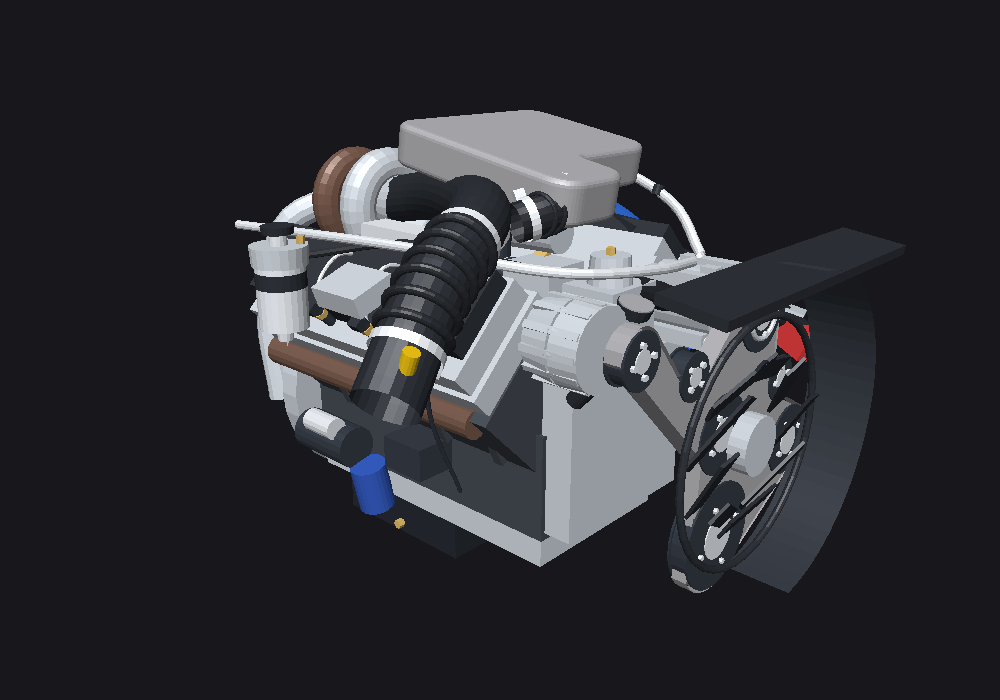
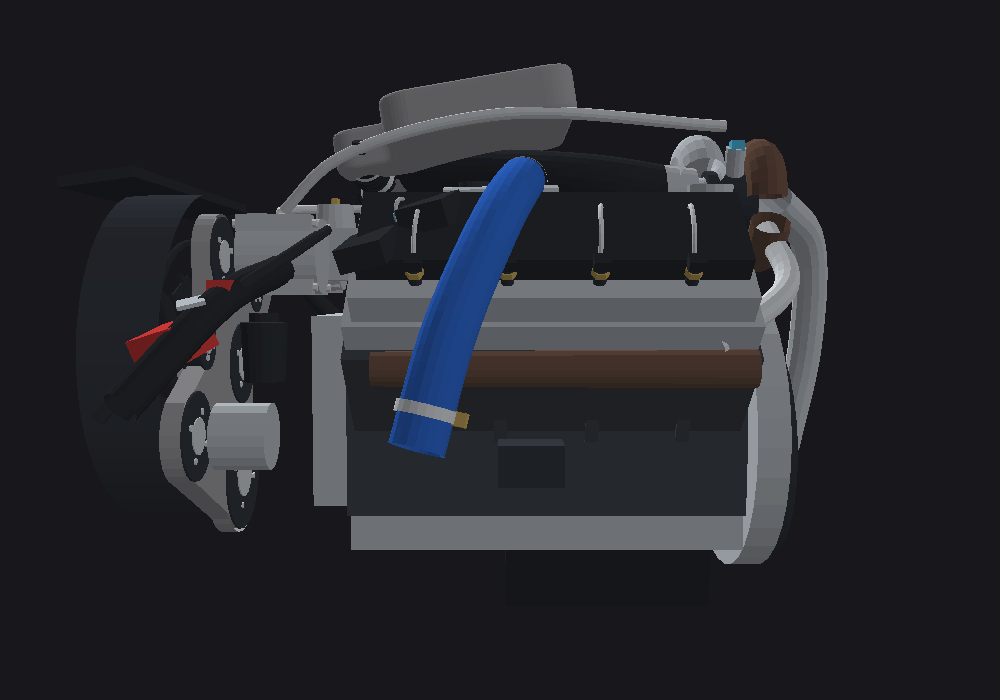
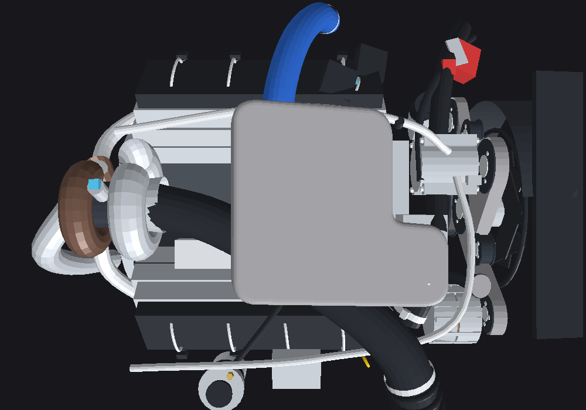

# Milestone 10 Research Survey — 2005 Duramax LLY Exterior Accuracy

Project: Duramax LLY Engine Lab · Planning package: this survey + [`docs/specs/M10-exterior-accuracy.md`](../specs/M10-exterior-accuracy.md) + [`docs/specs/M10-exterior-accuracy-QA.md`](../specs/M10-exterior-accuracy-QA.md) · Governing plan: [`docs/PLAN.md`](../PLAN.md) · Prior surveys used as the format standard: [`L7-verified-data-survey.md`](./L7-verified-data-survey.md), [`M8-variant-references.md`](./M8-variant-references.md), [`M9-engine-sound-survey.md`](./M9-engine-sound-survey.md)

Researched 2026-11-14 by the planning agent with three parallel research sweeps (intake/EGR, turbo/charge-air, front-drive/fuel). **Access mode: text/HTML only.** No image was pixel-verified: every photo or diagram cited below is a *description* from the page's text, its caption, or a forum post's wording, and is marked so. That limitation is carried into the spec rather than hidden.

---

## 1. What this survey had to answer

The milestone brief names thirteen exterior systems: valve covers and injector-harness connectors, intake mouthpiece and tract, Y-bridge, EGR system, turbo, charge pipes, front accessory drive, CP3 and fuel filter head, oil fill and dipstick, engine lifting eyes, and badging. For each, this survey had to establish four things before a spec could be written:

1. **Does the part exist on the LLY**, and is it visible with the hood up (i.e. not buried under a cosmetic cover)?
2. **Where is it** — which side, front/middle/rear, high/low, in the valley or outboard — and what is next to it?
3. **What is its published form and size**, in original units, with a grade.
4. **What is honestly *not* published**, so the spec can label a placeholder instead of inventing a number.

A fifth question emerged from the evidence and is recorded in §19: several widely quoted "LLY" facts are actually LB7, LBZ, LMM or medium-duty (Kodiak/TopKick) facts. Year attribution is therefore a first-class column in this survey, not an afterthought.

---

## 2. Grading and source kinds

Grades follow the M8 precedent ([`M8-variant-references.md`](./M8-variant-references.md) §7):

| Grade | Meaning |
| --- | --- |
| **A** | GM service/workshop literature, GM owner literature, or an official GM parts catalog (EPC group listing) |
| **B** | Established diesel publication, OE component maker (e.g. Garrett/Racor/Bosch) documentation, or OE-maker training material |
| **C** | Specialist vendor fitment spec, vendor technical/installation page, or specialist parts catalog |
| **D** | Forum post, marketing page, auction/photo listing — used only for corroboration or colour |

Verdicts: **ADOPTED** (usable as a design value or a modelling decision), **RECORDED-NOT-ADOPTED** (true but not precise or not applicable enough to pin geometry), **NOT PUBLISHED** (searched and absent — the spec must label the consequence as illustrative), **CONFLICT** (two sources disagree; both are shown).

**Source-count summary (approximate, de-duplicated by URL):** ~22 grade-A, ~10 grade-B, ~18 grade-C, ~20 grade-D. The load-bearing claims in §4–§16 are carried by grade-A/B sources except where explicitly noted. Nothing in this survey rests on a single grade-D source.

**Year traps found (all recorded, none silently resolved):**

| Trap | Detail | Effect |
| --- | --- | --- |
| `charm.li` "2005 … VIN 2" pages | LLY-specific (8th VIN digit 2 = LLY; 1 = LB7, D = LBZ, 6 = LMM) | **Used as the LLY backbone** |
| `charm.li` 2006 / 2008 pages | LBZ / LBZ-LMM | Sibling evidence only; marked per row |
| `gm.saturn.team` "LLY, LBZ"-labelled SI procedures | 2007 Savana / Kodiak **later** LLY (LBZ-adjacent), not the 2004.5–2005 pickup | Part numbers cross-checked against 2004–2005 CK2,3 EPC groups; rows marked |
| Medium-duty (C4500/C5500 Kodiak/TopKick) | Two oil fillers; fuel filter on the **driver** side (pickups: passenger side) | **Not adopted** — the brief is the pickup engine |
| "4.5L baby Duramax" inboard-exhaust quote | A different engine (2010 4.5L V8) | Explicitly rejected (see §8) |

---

## 3. Engine identification and the features that make it read as an *LLY*

| Attribute | Value as published | Source | Kind | Grade | Verdict |
| --- | --- | --- | --- | --- | --- |
| RPO / years | LLY, 2004.5–2005 model years, 6.6 L (403 CID) V8, 90° | [GM EPC engine assembly group](https://www.gmsklad.ru/catalog/cadillac/ESCALADE-ESV-(2WD)-2005/18198) | official parts catalog | A | ADOPTED |
| LLY-specific architecture | "The LLYs is equipped with EGR, catalyst, and a variable geometry turbocharger" | [LBT-149 Duramax training text (search index)](https://thegrouptrainingacademy.com/wp-content/uploads/sites/2/2019/06/4736c8ac06fb24392e41e5c728e51cd8e7f9b525_LBT149-DuramaxDiesel.pdf) | OE-maker training | B | ADOPTED |
| **Injectors outside the valve covers** | "The LLY, LBZ, and LMM engines have the injectors located outside of the valve cover (Figure 16)." | [LBT-149](https://thegrouptrainingacademy.com/wp-content/uploads/sites/2/2019/06/4736c8ac06fb24392e41e5c728e51cd8e7f9b525_LBT149-DuramaxDiesel.pdf) | OE-maker training | B | **ADOPTED — the single most important visual discriminator** |
| Same, independent | "The 2004.5-2006.5 model year Duramax 6600 is an LLY… Injectors and injector fuel return lines are outside the valve covers." | [TheDieselPage print view](https://thedieselpageforums.com/tdpforum/printthread.php?t=27994) | forum | D | ADOPTED (corroboration only) |
| Same, contemporaneous press | "They have external injectors. You don't have to take the valve covers off to replace them." | [DieselPlace](https://www.dieselplace.com/threads/new-duramax.6629/) | forum | D | ADOPTED (corroboration only) |
| First Duramax with 50-state EGR | "the LLY was 50-state legal right out of the box. Its EGR system consisted of an EGR valve … and an EGR cooler in the valley" | [Driving Line, "Duramax History, Lesson 2: LLY"](https://www.drivingline.com/articles/duramax-history-lesson-2-lly/) | established publication | B | ADOPTED (location wording flagged, §7) |
| Turbo | Garrett **GT3788VA** variable-vane ("AVNT3788VA"), oil-pressure-actuated unison ring, **9 controllable vanes**, no wastegate, water-cooled centre housing | [GM: Turbocharger Description and Operation (2005 VIN 2)](https://charm.li/Chevrolet/2005/Silverado%203500%204WD%20V8-6.6L%20DSL%20Turbo%20VIN%202/Repair%20and%20Diagnosis/Powertrain%20Management/Fuel%20Delivery%20and%20Air%20Induction/Turbocharger/Description%20and%20Operation/) | GM service literature (rehost) | A | ADOPTED |
| Turbo position | "mounted in the engine valley at the rear of the engine" | [dieselhub turbo R&R](https://www.dieselhub.com/maintenance/6.6-duramax-turbocharger-removal-and-installation.html) | established publication | B | ADOPTED |
| Exhaust manifolds outboard | Both manifolds are serviced "through the front wheelhouse opening"; the valley holds intake + turbo | [GM: Exhaust Manifold Replacement – Left / Right](https://charm.li/Chevrolet/2005/Silverado%203500%204WD%20V8-6.6L%20DSL%20Turbo%20VIN%202/Repair%20and%20Diagnosis/Engine%2C%20Cooling%20and%20Exhaust/Exhaust%20System/Exhaust%20Manifold/Service%20and%20Repair/Exhaust%20Manifold%20Replacement%20-%20Left/) | GM service literature (rehost) | A | ADOPTED |
| Water pump | **Gear-driven**, not on the accessory belt | [LBT-149](https://thegrouptrainingacademy.com/wp-content/uploads/sites/2/2019/06/4736c8ac06fb24392e41e5c728e51cd8e7f9b525_LBT149-DuramaxDiesel.pdf) | OE-maker training | B | ADOPTED |
| Vacuum pump | **Belt-driven**, "located on the passenger side of the engine just below the alternator" | [LLY vacuum pump service](http://www.dieselmechanic.info/duramax-lly/duramax-lly-diesel-vacuum-pump-service.html) | GM service literature (rehost, LLY category) | A | ADOPTED |
| CP3 pump | Bosch CP3 radial-piston, gear-driven from the camshaft, **does not need timing** | [LLY front cover removal](https://www.dieselmechanic.info/duramax-lly/duramax-lly-front-cover-and-timing-chain-cover-removal.html) | GM service literature (rehost, LLY category) | A | ADOPTED |
| Oil fill | **Not on a valve cover**: discrete neck at the front of the engine, shares front-cover/crossover space | [LLY front cover removal](https://www.dieselmechanic.info/duramax-lly/duramax-lly-front-cover-and-timing-chain-cover-removal.html) | GM service literature (rehost, LLY category) | A | ADOPTED |
| Fuel filter head | "located on the right engine rocker cover"; engine-mounted, spin-on canister below | [GM: Fuel Filter: Locations (2005 VIN 2)](https://charm.li/Chevrolet/2005/Silverado%202500%204WD%20V8-6.6L%20DSL%20Turbo%20VIN%202/Repair%20and%20Diagnosis/Maintenance/Tune-up%20and%20Engine%20Performance%20Checks/Fuel%20Filter/Locations/) | GM service literature (rehost) | A | ADOPTED |
| Dry mass | "At only 835 lbs. dry" (378.8 kg) | [Engine Builder](https://www.enginebuildermag.com/2022/01/dotw-1300-hp-compound-turbo-6-6l-lly-duramax-engine/) | established publication | B | ADOPTED |

**Discriminator checklist (what a "real LLY" must show, and what each item rules out):**

1. **Eight injector bodies with electrical connectors standing proud of the valve covers**, in two rows of four — this is the LLY/LBZ/LMM signature and is *absent* on the LB7 (injectors under the cover). Without it the model reads as a generic Duramax.
2. **An EGR module at the rear of the valley** (valve above cooler) — absent on the LB7.
3. **A GT3788VA in the rear of the valley** with a **two-flange turbine inlet**, a V-band turbine outlet, and a **small VGT solenoid on the passenger side of the bearing housing** (not a large external canister, and no wastegate).
4. **Outboard exhaust manifolds with heat shields** feeding two up-pipes that rise behind the heads — not in-valley manifolds.
5. **A two-piece Y-bridge** over the valley front with a **plastic upper cover** clamped at the front. (This milestone models the bridge, not the cosmetic cover — §12.)
6. **A front-mounted oil filler neck** beside the fan shroud — not a valve-cover filler.
7. **A fuel filter head on the right-hand valve cover** with a canister hanging below it.
8. **A gear-driven water pump** (no water-pump pulley on the belt) plus a **belt-driven vacuum pump under the alternator**.

---

## 4. Valve covers

| Attribute | Value as published | Source | Kind | Grade | Verdict |
| --- | --- | --- | --- | --- | --- |
| Architecture | Two-piece per bank: `97312349 COVER, VLV RKR ARM (UPPER COVER)` qty 02, plus a separate lower rocker cover | [GM EPC TC00-676](https://gmsklad.ru/catalog/cadillac/ESCALADE-ESV-(2WD)-2005/18180) | official parts catalog | A | ADOPTED |
| Two-piece confirmed by gasket kit | "2 Upper Valve Cover Gaskets - 2 Lower Valve Cover Gaskets" | [Alliant Power application guide (PDF)](https://alliantpower.com/sites/default/files/imce/Alliant-Power-Application-Guide_APG0619-low%20res.pdf) | OE-maker documentation | B | ADOPTED |
| Material | GM never states the alloy; aftermarket replacements are "precision machined from billet 6061-T6 aluminum", implying an aluminium OE part | [PPE kit](https://shop.app/products/7454617272563/2004-2010-gm-6-6l-duramax-valve-cover-kit-w-o-accessory-mounting), [HSP](https://dailydrivenperformance.com/hsp-diesel-billet-valve-covers-2004-5-2010-gm-duramax-6-6l-) | vendor / marketing | C / D | NOT PUBLISHED (alloy); RECORDED-NOT-ADOPTED ("metal") |
| Injector reliefs | "the valve covers have a relief in them to go around the injectors" | [TheDieselPage forums](https://www.thedieselpageforums.com/tdpforum/showthread.php?26153-Injector-replacement) | forum | D | RECORDED-NOT-ADOPTED (shape direction is consistent with §3 grade-B evidence) |
| Features carried in the upper cover | PCV valve `97361741`, PCV cover `97329070`, crankcase-vent breather valve `97222874`, crankcase-depression regulator diaphragm plate `97312340` — all "(PART OF 12)" | [GM EPC TC00-676](https://gmsklad.ru/catalog/cadillac/ESCALADE-ESV-(2WD)-2005/18180) | official parts catalog | A | ADOPTED |
| Fasteners | `97372960` M6×30 qty **24**, `97372959` M6×50 qty **8**, `97372958` M6×30 qty **24**, `97315638` insulator/spacer qty **28** | [GM EPC TC00-676](https://gmsklad.ru/catalog/cadillac/ESCALADE-ESV-(2WD)-2005/18180) | official parts catalog | A | ADOPTED |
| Cover-bolt torque | Upper 8 N·m (71 lb·in); lower 10 N·m (89 lb·in), sequenced | [GM SI upper](https://gm.saturn.team/GMC_Truck/Savana/2007/87/1/6314/121539), [GM SI lower](https://gm.saturn.team/GMC_Truck/Savana/2007/87/1/6314/121543) | GM service literature | A | ADOPTED (context) |
| Lettering on covers | "Factory valve covers are plain and uninspiring" | [HSP](https://dailydrivenperformance.com/hsp-diesel-billet-valve-covers-2004-5-2010-gm-duramax-6-6l-) | specialist vendor | C | ADOPTED (negative finding — see §12) |
| Cover dimensions (length, width, height, rib pitch) | — | searched: LLY valve cover dimensions, gasket dimensions | — | — | **NOT PUBLISHED** |

**Layout facts**

- Stack order per bank is **head → lower cover → upper cover → injectors + return line above**; the lower cover cannot come off until the upper cover, glow-plug harness, injectors and return line are clear. [GM SI lower cover](https://gm.saturn.team/GMC_Truck/Savana/2007/87/1/6314/121543)
- The upper cover is **not a plain lid**: one cover carries the PCV valve, PCV cover, breather valve and depression-regulator plate; the other is plainer. [GM EPC TC00-676](https://gmsklad.ru/catalog/cadillac/ESCALADE-ESV-(2WD)-2005/18180)
- **28 grommeted insulators** between cover and fasteners — the cover reads as an isolated, rubber-isolated lid, not metal-on-metal. [GM EPC TC00-676](https://gmsklad.ru/catalog/cadillac/ESCALADE-ESV-(2WD)-2005/18180)
- The driver-side upper cover is hemmed in by the **harness bale connectors at the top, the upper radiator hose/thermostat housing and the driver-side boost tube at the front**. [DuramaxDiesels](https://www.duramaxdiesels.com/forum/threads/what-do-i-need-to-remove.13936/)
- The cover has **reliefs cut to clear the injectors**, which sit outside it; injectors can corrode into the cover bore. [TheDieselPage](https://www.thedieselpageforums.com/tdpforum/showthread.php?26153-Injector-replacement), [DuramaxForum](https://www.duramaxforum.com/threads/changing-injectors-on-my-%E2%80%9805-lly.1036619/)

**Modelling consequence:** model **upper + lower covers per bank** (4 shells), with 4 injector reliefs per upper cover, a PCV boss cluster on one cover, and 14 grommeted fastener heads per bank (24 + 8 fasteners across two banks, plus insulators). Cover outline dimensions are **illustrative**, derived from the bank length and head width of the internal model — see spec §5.2.

---

## 5. Injector harness connectors

| Attribute | Value as published | Source | Kind | Grade | Verdict |
| --- | --- | --- | --- | --- | --- |
| Injectors outside the covers | see §3 | LBT-149 | OE training | B | ADOPTED |
| Visible connector count | One per cylinder → **8 total** (procedure repeats "for the other 3 fuel injectors" per bank) | [GM SI upper cover](https://gm.saturn.team/GMC_Truck/Savana/2007/87/1/6314/121539) | GM service literature | A | ADOPTED |
| All eight alike | "Label all the injector electrical connectors before the connectors are removed in order to prevent reconnecting to the wrong injector" | [GM SI upper cover](https://gm.saturn.team/GMC_Truck/Savana/2007/87/1/6314/121539) | GM service literature | A | ADOPTED |
| Connector mounting | Connectors plug **directly onto the injectors**; a separate "main engine harness electrical connector" is a large connector on a bracket at the **rear of the left bank** | [GM SI upper cover](https://gm.saturn.team/GMC_Truck/Savana/2007/87/1/6314/121539) | GM service literature | A | ADOPTED |
| Return line | LLY-specific rubber injector return line runs along the same row, clipped fitting-by-fitting | [GM SI upper cover](https://gm.saturn.team/GMC_Truck/Savana/2007/87/1/6314/121539) | GM service literature | A | ADOPTED |
| "Valve-cover harness" bale connectors | Must come off to remove the driver-side cover | [DuramaxDiesels](https://www.duramaxdiesels.com/forum/threads/what-do-i-need-to-remove.13936/) | forum | D | RECORDED-NOT-ADOPTED |
| Harness grommet through the cover | "inspect the harness where it enters the valve cover" | [Apex Tech Nation](https://apextechnation.com/articles/duramax-66-injector-harness-chafing) | forum/marketing | D | **CONFLICT** with §3/§5 (injectors outside). Most likely describes LB7/LML. Logged. |
| Connector part number / cavity count / body size | — | searched: LLY injector connector pigtail, valve-cover harness P/N | — | — | **NOT PUBLISHED** |

**Layout facts**

- **Four connectors per bank in a row along the top of each bank in cylinder order front→back**, with the main harness break at the rear of the left bank. [GM SI](https://gm.saturn.team/GMC_Truck/Savana/2007/87/1/6314/121539)
- The row reads as **"valve cover with a row of injector hardware outboard of it"**, unlike the LB7's clean cover. [TheDieselPage](https://thedieselpageforums.com/tdpforum/printthread.php?t=27994)
- Injector tops and connectors **stand proud** of the cover surface — silhouette-defining at any three-quarter view.

**Modelling consequence:** 8 injector bodies (visible upper portion + connector socket) + 8 connectors + the return line + the rear-left main harness break. Bodies and connectors are **illustrative** in size; the *count, row order and proud-of-cover* relationship are sourced.

---

## 6. Intake mouthpiece, tract and resonator

| Attribute | Value as published | Converted | Source | Kind | Grade | Verdict |
| --- | --- | --- | --- | --- | --- | --- |
| Airbox-to-turbo duct P/N | `21993712 DUCT, A/CL OTLT (INCLS 6 clamp)` | — | [GM EPC TC03-843](https://gmsklad.ru/catalog/cadillac/ESCALADE-ESV-(AWD)-2005/20569) | official parts catalog | A | ADOPTED |
| Duct behaviour | "The air duct between the air cleaner housing and the turbo inlet restricts air flow. The restriction is caused by the duct collapsing" | — | [GM bulletin (LLY air cleaner outlet duct)](https://gm.saturn.team/GMC_Truck/TopKick_C_Series__Conventional__C4_C5/2007/bulletins/1879276) | GM service literature | A | ADOPTED |
| Mouthpiece form | "the factory plastic air horn. It connects directly to the factory turbocharger inlet" | — | [DuramaxTuner/S&B](https://duramaxtuner.com/i-2494-turbo-inlet-manifold-for-chevy-gmc-duramax-lly-6-6l.html) | specialist vendor | C | ADOPTED (existence/form); pressure claim not adopted |
| Stock LLY mouthpiece airbox-end diameter | "The LBZ mp is larger on the intake end (4") than the stock mp (3.5")" | 3.5 in ≈ **88.9 mm**; 4 in ≈ 101.6 mm | [TheTruckStop](https://www.thetruckstop.us/forum/threads/turbo-mouthpieces.16336/) | forum | D | RECORDED-NOT-ADOPTED (only figure available; single weak source) |
| Conflicting aftermarket figure | HSP mouthpiece "4.5 inch inlet … reducing to your 4 inch aftermarket intake" | 4.5 in ≈ 114.3 mm | [Sunny Diesel/HSP](https://sunnydiesel.com/products/2004-5-2010-chevrolet-gmc-vgt-intake-mouthpiece-hsp-diesel) | specialist vendor | C | CONFLICT (different part) — recorded |
| User measurement of an LBZ mouthpiece | "my mouth piece is about 4 inches" | ≈ 101.6 mm | [DuramaxForum](https://www.duramaxforum.com/threads/lbz-mouthpiece-on-lly.540897/) | forum | D | RECORDED-NOT-ADOPTED |
| Resonator exists | GM EPC line `25099299 RIVET, A/CL RESO` qty 02 (only "RESO" item in the LLY air-intake group) | — | [GM EPC TC03-843](https://gmsklad.ru/catalog/cadillac/ESCALADE-ESV-(AWD)-2005/20569) | official parts catalog | A | ADOPTED |
| Resonator clamp + torque | "Loosen the intake manifold cover clamp (1) at the resonator" — 6 N·m (53 lb·in) | — | [GM SI Intake Manifold Cover Replacement (search snippet; page paywalled)](https://www.thedieselgarage.com/threads/lly-intake-manifold-cover-replacement.1133/) | GM service literature | A | ADOPTED |
| Airbox assembly | `19201277 CLEANER, AIR (… COVER, INDICATOR)`; element `19166111` (ACDelco A1618C) | — | [GM EPC TC03-843](https://gmsklad.ru/catalog/cadillac/ESCALADE-ESV-(AWD)-2005/20569) | official parts catalog | A | ADOPTED |
| Coupler/hose diameters | — | — | searched: LLY air cleaner outlet duct diameter, OEM mouthpiece diameter | — | — | **NOT PUBLISHED** |
| Turbo compressor inlet bell diameter | — | — | searched: LLY turbo mouthpiece diameter, GT3788VA compressor inlet | — | — | **NOT PUBLISHED** |
| Resonator position/appearance | "the plastic 6.6L Duramax box above the turbocharger inlet" | — | [dieselhub VGT solenoid](https://www.dieselhub.com/maintenance/6.6-duramax-vgt-solenoid.html) | established publication | B | ADOPTED (position) |

**Layout facts**

- Path: **airbox (right/front of the engine bay) → flexible outlet duct → plastic mouthpiece bolted to the compressor inlet → turbo at the rear of the valley**. [DuramaxTuner](https://duramaxtuner.com/i-2494-turbo-inlet-manifold-for-chevy-gmc-duramax-lly-6-6l.html)
- The duct is **soft enough to collapse** under load at high underhood temperature (GM's field test: rev to 1500 rpm and watch the duct) — so a *corrugated/soft* duct is correct, not a rigid tube. [GM bulletin](https://gm.saturn.team/GMC_Truck/TopKick_C_Series__Conventional__C4_C5/2007/bulletins/1879276)
- The resonator sits **above the turbo inlet** and is clamped at the intake manifold cover; the PCV hose also lands on a "resonator tee". [GM SI EGR cooler](https://gm.saturn.team/Chevrolet/Kodiak_C_Series__Conventional__C4_C5/2007/87/10/6451/84184), [dieselhub](https://www.dieselhub.com/maintenance/6.6-duramax-vgt-solenoid.html)
- The mouthpiece is the **choke point immediately upstream of the compressor**, which is why LBZ mouthpieces are the standard swap — a bolt-on requiring a 3.5→4 in coupler. [TheTruckStop](https://www.thetruckstop.us/forum/threads/turbo-mouthpieces.16336/)

**Modelling consequence:** mouthpiece (air horn) at the compressor inlet + **soft corrugated duct** with 3–4 corrugation groups + the **resonator box above the inlet** + clamps, ending outboard at the M8 `if_airbox_mount` datum. The 88.9 mm figure is a single grade-D source: use it as the *nominal* mouthpiece airbox-end diameter, label it illustrative, and keep the compressor-end diameter derived from the compressor inlet datum.

---

## 7. EGR system — including whether the cooler is a distinct visible part

| Attribute | Value as published | Source | Kind | Grade | Verdict |
| --- | --- | --- | --- | --- | --- |
| EGR exists on the LLY | "Its EGR system consisted of an EGR valve to introduce exhaust gases back into the intake stream **and an EGR cooler**…" | [Driving Line](https://www.drivingline.com/articles/duramax-history-lesson-2-lly/) | established publication | B | ADOPTED |
| EGR valve P/N | `97303761 VALVE, EGR (3.680)` — ACDelco 214-2109 | [GM EPC TC03-803](https://gmsklad.ru/catalog/cadillac/ESCALADE-ESV-(2WD)-2005/18343) | official parts catalog | A | ADOPTED |
| **EGR cooler is its own external part** | `97303654 COOLER, EGR VLV` qty 01, with its own gaskets | [GM EPC TC03-803](https://gmsklad.ru/catalog/cadillac/ESCALADE-ESV-(2WD)-2005/18343) | official parts catalog | A | **ADOPTED — yes, model it** |
| Stack order | `97303655 GASKET, EGR VLV (BOTTOM EGR VALVE TO TOP EGR COOLER)` — valve **on top of** cooler | [GM EPC TC03-803](https://gmsklad.ru/catalog/cadillac/ESCALADE-ESV-(2WD)-2005/18343) | official parts catalog | A | ADOPTED |
| EGR pipe | `97303647 TUBE, EGR VLV INT MANIF PASG` (valve → intake manifold, passenger side) | [GM EPC TC00-679](https://www.gmsklad.ru/catalog/cadillac/ESCALADE-ESV-(2WD)-2005/18183) | official parts catalog | A | ADOPTED |
| Cooler coolant plumbing | `97333410 HOSE, EGR VLV`; `97304167 HOSE, HTR INL` qty 02; `97303629 PIPE, HTR INL`; `94011605 SEAL, HTR OTLT PIPE` | [GM EPC TC03-803](https://gmsklad.ru/catalog/cadillac/ESCALADE-ESV-(2WD)-2005/18343) | official parts catalog | A | ADOPTED |
| Only published EGR-adjacent dimension | `15032062 CONNECTOR, HTR INL HOSE (74.93MM LONG) (QUICK CONNECT ASM)` | 74.93 mm | [GM EPC TC03-803](https://gmsklad.ru/catalog/cadillac/ESCALADE-ESV-(2WD)-2005/18343) | official parts catalog | A | ADOPTED (that connector only) |
| Adapter bracket | `97320778 BRACKET, EGR VLV ADAP` qty 01 + stud/bolt | [GM EPC TC03-803](https://gmsklad.ru/catalog/cadillac/ESCALADE-ESV-(2WD)-2005/18343) | official parts catalog | A | ADOPTED |
| Cooler cross-section (approx.) | "a long shiny tube running length wise with the valve cover about 2" round that's the egr cooler" | ≈ 50.8 mm OD | [DieselPlace/DuramaxForum](https://www.duramaxforum.com/threads/egr-valve.221/) | forum | D | RECORDED-NOT-ADOPTED |
| Fastener torques | Cooler tube bolts 50 N·m; rear cooler tube bolts 20 N·m; coolant pipe bolts 25 N·m | [GM SI EGR cooler](https://gm.saturn.team/Chevrolet/Kodiak_C_Series__Conventional__C4_C5/2007/87/10/6451/84184) | GM service literature | A | ADOPTED (context) |
| Location — source 1 | "an EGR cooler in the valley" | [Driving Line](https://www.drivingline.com/articles/duramax-history-lesson-2-lly/) | established publication | B | CONFLICT |
| Location — source 2 | "a heat exchanger mounted in the hot engine valley" | [iFJF vendor page](https://ifjf.net/products/egr-delete-kit-valve-cooler-for-2004-5-2005-chevy-gmc-silverado-sierra-2500-3500-lly-6-6-duramax) | specialist vendor | C | CONFLICT |
| Location — source 3 (most mechanical) | "on the back of the engine… The pass side will have a Y in it, attached to the flange of the cooler (long tube shape). The other end of the cooler tube attaches to the EGR valve, which attaches via flange to the final intake manifold." | [DuramaxForum](https://www.duramaxforum.com/threads/what-is-egr-and-where-located-lly.982633/) | forum | D | CONFLICT (most specific) |
| Location — access order | air cleaner → CAC pipe → PCV hose off the resonator tee → air inlet tube → EGR connector and cooler tubes: the EGR assembly sits **behind/below the turbo inlet ducting** | [GM SI EGR cooler](https://gm.saturn.team/Chevrolet/Kodiak_C_Series__Conventional__C4_C5/2007/87/10/6451/84184) | GM service literature | A | ADOPTED |
| Cooler envelope dimensions | — | searched: EGR cooler dimensions, 97303654 | — | — | **NOT PUBLISHED** |

**Layout facts**

- The whole EGR assembly (cooler + valve + pipes) comes out **upwards as a unit** once the coolant pipe and the cooler-tube bolts are off — it is a compact, self-contained module. [TruckTok delete-kit instructions](https://www.trucktokforum.com/threads/2004-2005-6-6l-chevy-gmc-silverado-lly-duramax-diesel-egr-delete-kit.16/)
- The valve is **above** the cooler (proven by GM's gasket description). [GM EPC](https://gmsklad.ru/catalog/cadillac/ESCALADE-ESV-(2WD)-2005/18343)
- Passenger-side bias, rear of the valley, under the turbo inlet ducting. [DuramaxForum](https://www.duramaxforum.com/threads/what-is-egr-and-where-located-lly.982633/), [GM SI](https://gm.saturn.team/Chevrolet/Kodiak_C_Series__Conventional__C4_C5/2007/87/10/6451/84184)
- Coolant plumbing is a formed pipe plus a short hose; delete kits substitute "about 16 inches of heater hose" — a short, direct span. [DuramaxDiesels](https://www.duramaxdiesels.com/forum/threads/egr-delete-method.12036/)

**Decision taken by the spec:** **model the EGR cooler.** The part's *existence and identity* are grade-A; only its *position* is grade-B/D with a three-way conflict. The spec pins a single position (rear valley, passenger side, valve above cooler, EGR pipe to the intake bridge, coolant hose to the front crossover) and isolates the assembly in one named node group so a later correction is a local re-position rather than a rebuild. This is the milestone's largest single-source geometric risk and is recorded as such (open item + spec §14).

---

## 8. Exhaust manifolds, up-pipes, downpipe

| Attribute | Value as published | Converted | Source | Kind | Grade | Verdict |
| --- | --- | --- | --- | --- | --- | --- |
| Manifold location | **Outboard**, serviced through the front wheelhouse opening | — | [GM Exhaust Manifold – Left](https://charm.li/Chevrolet/2005/Silverado%203500%204WD%20V8-6.6L%20DSL%20Turbo%20VIN%202/Repair%20and%20Diagnosis/Engine%2C%20Cooling%20and%20Exhaust/Exhaust%20System/Exhaust%20Manifold/Service%20and%20Repair/Exhaust%20Manifold%20Replacement%20-%20Left/) | GM service literature (rehost) | A | ADOPTED |
| Manifold count / shields | One per bank, each with a full-length heat shield (shield bolts 8 N·m) | same | GM service literature | A | ADOPTED |
| Manifold-to-head torque | 38 N·m (28 ft·lb), sequenced | same | GM service literature | A | ADOPTED (context) |
| "Manifolds inside the valley" | "exhaust ports face inboard, toward the valley" | — | [lateral-g repost](https://lateral-g.net/forums/showthread.php?t=12382) | forum | D | **REJECTED** — that quote describes the 2010 **4.5 L** V8, not the 6.6 LLY |
| Up-pipe count | **Two**, one per bank (GM: "left exhaust pipe", "right exhaust pipe") | — | [GM Turbocharger Replacement](https://charm.li/Chevrolet/2005/Silverado%203500%204WD%20V8-6.6L%20DSL%20Turbo%20VIN%202/Repair%20and%20Diagnosis/Powertrain%20Management/Fuel%20Delivery%20and%20Air%20Induction/Turbocharger/Service%20and%20Repair/Turbocharger%20Replacement/) | GM service literature (rehost) | A | ADOPTED |
| Up-pipe fasteners | 3 bolts per flange (manifold and turbo), 53 N·m | — | [dieselhub turbo R&R](https://www.dieselhub.com/maintenance/6.6-duramax-turbocharger-removal-and-installation.html), [GM](https://charm.li/Chevrolet/2005/Silverado%203500%204WD%20V8-6.6L%20DSL%20Turbo%20VIN%202/Repair%20and%20Diagnosis/Powertrain%20Management/Fuel%20Delivery%20and%20Air%20Induction/Turbocharger/Service%20and%20Repair/Turbocharger%20Replacement/) | B / A | ADOPTED |
| Up-pipe gaskets | Turbo side 97192618 ×2; manifold side 97188685 ×2 | — | [dieselhub](https://www.dieselhub.com/maintenance/6.6-duramax-turbocharger-removal-and-installation.html) | established publication | B | ADOPTED |
| Turbine inlet arrangement | **Two independent flanges**, one per bank — not one twin-scroll flange | — | [GM](https://charm.li/Chevrolet/2005/Silverado%203500%204WD%20V8-6.6L%20DSL%20Turbo%20VIN%202/Repair%20and%20Diagnosis/Powertrain%20Management/Fuel%20Delivery%20and%20Air%20Induction/Turbocharger/Service%20and%20Repair/Turbocharger%20Replacement/) | GM service literature | A | ADOPTED |
| Up-pipe diameter | — | — | searched: LLY up-pipe diameter | — | — | **NOT PUBLISHED** (only wall gauge: driver side "16G") |
| Downpipe upper joint | V-band "exhaust outlet clamp", 15 N·m | — | [GM](https://charm.li/Chevrolet/2005/Silverado%203500%204WD%20V8-6.6L%20DSL%20Turbo%20VIN%202/Repair%20and%20Diagnosis/Powertrain%20Management/Fuel%20Delivery%20and%20Air%20Induction/Turbocharger/Service%20and%20Repair/Turbocharger%20Replacement/) | GM service literature | A | ADOPTED |
| Downpipe lower joint | Second clamp to the exhaust pipe, 40 N·m | — | same | GM service literature | A | ADOPTED |
| Downpipe shape defect | "restrictive crushed oval design right after the turbine outlet" | — | [PPE 117000500](https://www.fullforcediesel.com/ppe-downpipe-117000500) | specialist vendor | C | ADOPTED (shape) |
| Downpipe diameter | **CONFLICT**: "The OEM downpipe is 3.5 inches, and is squashed" vs 3 in aftermarket replacements | 88.9 vs 76.2 | [DieselPlace](https://www.dieselplace.com/threads/down-pipe-or-turbo-back.15614/) · [PPE](https://www.xtremediesel.com/ppe-117000500-3-stainless-steel-downpipe) | D / C | CONFLICT (recorded) |
| Downpipe P/N | 98050150 | [WCFab](https://www.wcfab.com/i-30055690-2004-5-2010-lly-lbz-lmm-duramax3-stainless-down-pipe.html) | specialist vendor | C | ADOPTED |
| Turbine outlet flange diameter | — | — | searched | — | — | **NOT PUBLISHED** |

**Layout facts**

- Each up-pipe is a **short two-flange pipe**: manifold flange low on the block → turbine inlet at the rear of the valley, rising **up the back of the engine behind the heads**. [GM Exhaust Manifold](https://charm.li/Chevrolet/2005/Silverado%203500%204WD%20V8-6.6L%20DSL%20Turbo%20VIN%202/Repair%20and%20Diagnosis/Engine%2C%20Cooling%20and%20Exhaust/Exhaust%20System/Exhaust%20Manifold/Service%20and%20Repair/Exhaust%20Manifold%20Replacement%20-%20Left/), [LB7-era architecture repost](https://www.thedieselgarage.com/threads/duramax-6600-6-6l-v8-lb7-turbo-diesel-features-benefits.1107/) (sibling, same layout)
- The **passenger-side up-pipe is shaped for firewall clearance**; the **driver-side** carries its own heat shield. [XKV Racing](https://xkvracing.com/products/2001-2016-heavy-duty-upgraded-exhaust-up-pipe-for-01-16-gmc-chevy-lb7-lly-lbz-lml-6-6l-duramax-sl), [dieselhub](https://www.dieselhub.com/maintenance/6.6-duramax-turbocharger-removal-and-installation.html)
- The downpipe drops **straight down behind the turbo alongside the bellhousing**, has a **support bracket to the right manifold** and its own heat shield, and is the tightest part of the exhaust (the crush exists for firewall clearance). [dieselhub](https://www.dieselhub.com/maintenance/6.6-duramax-turbocharger-removal-and-installation.html), [GM](https://charm.li/Chevrolet/2005/Silverado%203500%204WD%20V8-6.6L%20DSL%20Turbo%20VIN%202/Repair%20and%20Diagnosis/Powertrain%20Management/Fuel%20Delivery%20and%20Air%20Induction/Turbocharger/Service%20and%20Repair/Turbocharger%20Replacement/)

**Modelling consequence:** add **outboard exhaust manifolds with heat shields** (these are *missing entirely* from the current shell) and re-shape the two up-pipes as short two-flange pipes; model the downpipe as a **round 88.9 mm stub at the V-band crushed to a flat oval mid-run** (the conflict is recorded, the shape claim is grade-C).

---

## 9. Turbocharger

| Attribute | Value as published | Converted | Source | Kind | Grade | Verdict |
| --- | --- | --- | --- | --- | --- | --- |
| Model | Garrett **GT3788VA** variable-vane | — | [dieselhub turbo R&R](https://www.dieselhub.com/maintenance/6.6-duramax-turbocharger-removal-and-installation.html) | established publication | B | ADOPTED |
| Garrett designations | Assembly "AVNT3788VA"; cartridge 791900-5020S; speed sensor 763527-0712; new OE replacement 848212-5001S (replaces GM 97387896 / 98011735 / 12639460) | — | [Turbomaster](https://www.turbomaster.com/turbo/garrett/848212-5001s/), [Alliant Power](https://parts.alliantpower.com/en-us/air-systems/turbochargers/848212-5001s-gar131) | vendor / parts catalog | B | ADOPTED |
| Vanes / actuation | "9 controllable vanes"; solenoid works with oil pressure to rotate the unison ring; **no wastegate** | — | [GM Turbocharger Description and Operation](https://charm.li/Chevrolet/2005/Silverado%203500%204WD%20V8-6.6L%20DSL%20Turbo%20VIN%202/Repair%20and%20Diagnosis/Powertrain%20Management/Fuel%20Delivery%20and%20Air%20Induction/Turbocharger/Description%20and%20Operation/) | GM service literature | A | ADOPTED |
| VGT solenoid form | Proportional solenoid **inserted into the passenger side of the bearing housing**, bracket + one 8 mm 12-pt bolt ~6 o'clock; 2-pin connector; coil 3.42–4.18 Ω; P/N 792593-0001 | — | [dieselhub VGT solenoid](https://www.dieselhub.com/maintenance/6.6-duramax-vgt-solenoid.html) | established publication | B | ADOPTED — **not a large external canister** |
| Vane position sensor | Threaded into the housing; 3 circuits; Garrett 763527-0512 / GM 12643471 | — | [GM](https://charm.li/Chevrolet/2005/Silverado%203500%204WD%20V8-6.6L%20DSL%20Turbo%20VIN%202/Repair%20and%20Diagnosis/Powertrain%20Management/Fuel%20Delivery%20and%20Air%20Induction/Turbocharger/Description%20and%20Operation/) | GM service literature | A | ADOPTED |
| Turbine housing | Cast iron, integral vane ring, V-band to centre housing | — | [dieselhub rebuild](https://www.dieselhub.com/maintenance/6.6-duramax-turbocharger-rebuild.html) | established publication | B | ADOPTED |
| Compressor housing | Aluminium; separate backing plate; 4 bolts | — | [dieselhub rebuild](https://www.dieselhub.com/maintenance/6.6-duramax-turbocharger-rebuild.html) | established publication | B | ADOPTED |
| Inlet joint | "turbocharger intake mouthpiece (single Marman clamp)" | — | [dieselhub](https://www.dieselhub.com/maintenance/6.6-duramax-turbocharger-removal-and-installation.html) | established publication | B | ADOPTED |
| Outlet joint | "charged air cooler inlet duct connector" pushed on and clamped, 6 N·m — **no bolted elbow** | — | [GM Turbocharger Replacement](https://charm.li/Chevrolet/2005/Silverado%203500%204WD%20V8-6.6L%20DSL%20Turbo%20VIN%202/Repair%20and%20Diagnosis/Powertrain%20Management/Fuel%20Delivery%20and%20Air%20Induction/Turbocharger/Service%20and%20Repair/Turbocharger%20Replacement/) | GM service literature | A | ADOPTED |
| Oil feed / drain | Feed banjo at the **top**, 34 N·m; return to the **top of the flywheel housing**, 25 N·m | — | same | GM service literature | A | ADOPTED |
| Coolant | Water-cooled centre housing: inlet banjo driver side, 25 N·m; outlet banjo 26 N·m, 90° hose to passenger side | — | [GM Turbo Coolant Hoses/Pipes](https://charm.li/Chevrolet/2005/Silverado%203500%204WD%20V8-6.6L%20DSL%20Turbo%20VIN%202/Repair%20and%20Diagnosis/Engine%2C%20Cooling%20and%20Exhaust/Cooling%20System/Turbocharger%20Coolant%20Line/Service%20and%20Repair/Turbocharger%20Coolant%20Hoses%2FPipes%20Replacement/Inlet/) | GM service literature | A | ADOPTED |
| Mounting | 3 turbocharger bolts, 108 N·m, on a pedestal in the valley | — | [GM](https://charm.li/Chevrolet/2005/Silverado%203500%204WD%20V8-6.6L%20DSL%20Turbo%20VIN%202/Repair%20and%20Diagnosis/Powertrain%20Management/Fuel%20Delivery%20and%20Air%20Induction/Turbocharger/Service%20and%20Repair/Turbocharger%20Replacement/) | GM service literature | A | ADOPTED |
| Heat shields | Two-piece turbo heat shield (upper + lower) plus a glow-plug-controller shield; the upper "CANNOT be removed without bending or cutting" | — | [dieselhub](https://www.dieselhub.com/maintenance/6.6-duramax-turbocharger-removal-and-installation.html) | established publication | B | ADOPTED |
| Housing / wheel dimensions | **CONFLICT / NOT PUBLISHED**: compressor inducer 62.6 / 63.5 / 63.4 / 61 mm; turbine 73×64 13-blade vs 72.5×66.5 mm; A/R listed only as "VNT" | — | [XDP](https://www.xtremediesel.com/blog/2021/09/13/2004-5-2005-gm-6-6l-lly-duramax-buyers-guide/), [WWM](https://wwmperformance.com/products/garrett-new-stock-replacement-gt3788va-turbocharger-848212-5001s-2004-5-2010-6-6l-duramax-lly-lbz-lmm), [Weavertown](https://weavertowndiesel.com/product/duramax-turbos-lly-64mm/) | vendor / forum | C/D | **NOT PUBLISHED (GM)** — do not pin a wheel size |
| Compressor inlet bell diameter / outlet spigot diameter | — | — | searched | — | — | **NOT PUBLISHED** |

**Layout facts**

- "the turbocharger is mounted in the engine valley **at the rear** of the engine"; the oil return lands on the flywheel housing, corroborating the rear/valley position. [dieselhub](https://www.dieselhub.com/maintenance/6.6-duramax-turbocharger-removal-and-installation.html), [GM](https://charm.li/Chevrolet/2005/Silverado%203500%204WD%20V8-6.6L%20DSL%20Turbo%20VIN%202/Repair%20and%20Diagnosis/Powertrain%20Management/Fuel%20Delivery%20and%20Air%20Induction/Turbocharger/Service%20and%20Repair/Turbocharger%20Replacement/)
- The **compressor side is passenger-side/top**: the VGT solenoid is on the passenger side of the bearing housing and the plastic resonator box sits above the compressor inlet. [dieselhub VGT](https://www.dieselhub.com/maintenance/6.6-duramax-vgt-solenoid.html)
- The **compressor outlet feeds a duct running forward on the driver side** to the CAC. [dieselhub](https://www.dieselhub.com/maintenance/6.6-duramax-turbocharger-removal-and-installation.html), [WCFab PDF](https://www.wcfab.com/files/Installation%20Instructions/duramax-driver-side-intercooler-pipe.pdf)
- The unit is **buried under a two-piece heat shield**. [dieselhub](https://www.dieselhub.com/maintenance/6.6-duramax-turbocharger-removal-and-installation.html)

**Modelling consequence:** the current shell's `turbo` child 3 (2,056 tris) is in the right *place* (rear valley, X[−149, +36], Y[−116, +135], Z[278, 510]) but the wrong *form*: two plain cylinders plus an actuator box. M10 rebuilds it with a two-flange turbine inlet, V-band outlet neck, compressor cover + inlet bell + outlet spigot, a **small passenger-side solenoid** (not a Ø60×80 canister), vane-position sensor, oil feed banjo at top, oil drain to the flywheel housing, and the two-piece heat shield. **Wheel sizes are not pinned** (not published).

---

## 10. Charge pipes and intercooler interface

| Attribute | Value as published | Converted | Source | Kind | Grade | Verdict |
| --- | --- | --- | --- | --- | --- | --- |
| Hot side = driver side | "Remove the driver side intercooler tube (hot side)" | — | [dieselhub](https://www.dieselhub.com/maintenance/6.6-duramax-turbocharger-removal-and-installation.html) | established publication | B | ADOPTED |
| Hot-side OEM diameter | "Replace the restrictive 2.5-inch OEM intercooler hot charge pipe" | 63.5 mm | [PPE 115022010](https://www.xtreemediesel.com/ppe-115022010-hot-side-intercooler-pipe-kit-brushed) | specialist vendor | C | ADOPTED |
| Hot-side form | One-piece pipe; bead-rolled at the turbo; **elbow boot at the intercooler**; thin silicone boot at the turbo outlet | — | [WCFab](https://www.wcfab.com/i-29282375-2004-5-2010-lly-lbz-lmm-duramax-driver-hot-side-3-intercooler-pipe-kit.html) | specialist vendor | C | ADOPTED |
| Hot-side GM P/Ns | 25789159 / 15188717 / 15188715 | — | same | specialist vendor | C | ADOPTED |
| Cold side = passenger side | Cold-side pipe runs from the intercooler outlet up to the intake | — | [WCFab cold side (LLY)](https://duramaxtuner.com/i-1834-2004-5-2005-lly-duramax-3-passenger-cold-side-intercooler-pipe-kit.html) | specialist vendor | C | ADOPTED |
| Cold-side OEM diameter (LLY) | 2.5 in OEM, replaced by 3 in (the LBZ/LMM is 3.5 in — a year split) | 63.5 mm | same | specialist vendor | C | ADOPTED |
| Cold-side joint at intake, **2005** | **Hose clamp + hose** — "Loosen the charged air cooler outlet duct to intake hose clamp", 6 N·m | — | [GM Turbocharger Replacement (2005 VIN 2)](https://charm.li/Chevrolet/2005/Silverado%203500%204WD%20V8-6.6L%20DSL%20Turbo%20VIN%202/Repair%20and%20Diagnosis/Powertrain%20Management/Fuel%20Delivery%20and%20Air%20Induction/Turbocharger/Service%20and%20Repair/Turbocharger%20Replacement/) | GM service literature | A | ADOPTED |
| Cold-side joint at intake, 2006+ | Quick-connect with a clip | — | [GM Intake Manifold Tube Replacement (2006)](https://charm.li/Chevrolet/2006/Silverado%202500%204WD%20V8-6.6L%20DSL%20Turbo/Repair%20and%20Diagnosis/Engine%2C%20Cooling%20and%20Exhaust/Engine/Intake%20Manifold/Service%20and%20Repair/Intake%20Manifold%20Tube%20Replacement/) | GM service literature | A | **NOT ADOPTED for a 2005** — no clip ring |
| Vendor claim of clip ring on 2004.5–05 | "OEM Clip Ring Design replaced by … silicone boot and t-bolt clamps" | — | [WCFab cold side](https://duramaxtuner.com/i-1834-2004-5-2005-lly-duramax-3-passenger-cold-side-intercooler-pipe-kit.html) | specialist vendor | C | CONFLICT — recorded, not adopted |
| Couplers / clamps | OEM rubber/silicone boots on bead-rolled spigots with clamps; aftermarket 5-ply silicone + T-bolt | — | [WCFab](https://www.wcfab.com/i-29282375-2004-5-2010-lly-lbz-lmm-duramax-driver-hot-side-3-intercooler-pipe-kit.html) | specialist vendor | C | ADOPTED (materials) |
| Intercooler mounting | **Chassis-mounted on the radiator support** — nothing about it moves with the engine | — | [GM Charged Air Cooler Replacement](https://charm.li/Chevrolet/2005/Silverado%203500%204WD%20V8-6.6L%20DSL%20Turbo%20VIN%202/Repair%20and%20Diagnosis/Powertrain%20Management/Fuel%20Delivery%20and%20Air%20Induction/Turbocharger/Intercooler/Service%20and%20Repair/) | GM service literature | A | ADOPTED |
| CAC fastener torque | 21 N·m | — | same | GM service literature | A | ADOPTED (context) |
| Engine-side connection points | (1) compressor outlet, rear of valley, **driver side**; (2) intake bridge / intake manifold tube, front of valley | — | [GM](https://charm.li/Chevrolet/2005/Silverado%203500%204WD%20V8-6.6L%20DSL%20Turbo%20VIN%202/Repair%20and%20Diagnosis/Powertrain%20Management/Fuel%20Delivery%20and%20Air%20Induction/Turbocharger/Service%20and%20Repair/Turbocharger%20Replacement/) | GM service literature | A | ADOPTED |
| CAC core / connection diameters | — | — | searched | — | — | **NOT PUBLISHED** |

**Layout facts**

- Hot pipe: **compressor outlet → forward along the driver-side inner fender → CAC inlet**, extracted through the driver-side fender. Cold pipe: **CAC outlet (passenger) → up and over to the intake bridge**, removed after the air-cleaner outlet duct. [dieselhub](https://www.dieselhub.com/maintenance/6.6-duramax-turbocharger-removal-and-installation.html), [GM](https://charm.li/Chevrolet/2005/Silverado%203500%204WD%20V8-6.6L%20DSL%20Turbo%20VIN%202/Repair%20and%20Diagnosis/Powertrain%20Management/Fuel%20Delivery%20and%20Air%20Induction/Turbocharger/Service%20and%20Repair/Turbocharger%20Replacement/)
- Both are **one-piece bent tubes with a boot at each end**; no intermediate joints at the engine end on a 2005. [dieselhub](https://www.dieselhub.com/maintenance/6.6-duramax-turbocharger-removal-and-installation.html)
- Visible signature: **a short fat boot at the compressor outlet at the back**, and **a long pipe up the passenger side to a bridge that spans the valley**. [dieselhub](https://www.dieselhub.com/maintenance/6.6-duramax-turbocharger-removal-and-installation.html)

**Modelling consequence:** the current shell has **one** charge pipe (the LH `boostPipe`, roughly right in routing, wrong in form — a flat blue ribbon) and **no cold-side pipe**. M10 reshapes the hot pipe (63.5 mm, bead-rolled ends, silicone boots, drop to the M8 `if_hot_side_inlet` datum at [374.6, 474.8, 146.6]) and adds the missing **cold-side pipe** on the passenger side to the bridge front.

---

## 11. Front accessory drive

| Attribute | Value as published | Converted | Source | Kind | Grade | Verdict |
| --- | --- | --- | --- | --- | --- | --- |
| Belts | **One** serpentine main drive belt; GM procedure branches only single vs dual generators | — | [GM Drive Belt (2005 VIN 2)](https://charm.li/Chevrolet/2005/Silverado%202500%204WD%20V8-6.6L%20DSL%20Turbo%20VIN%202/Repair%20and%20Diagnosis/Engine%2C%20Cooling%20and%20Exhaust/Engine/Drive%20Belts%2C%20Mounts%2C%20Brackets%20and%20Accessories/Drive%20Belt/Service%20and%20Repair/) | GM service literature | A | ADOPTED |
| Belt section / length | 6 rib (K06), top width 20 mm, outside circumference 120.1 in / 3051 mm, effective 3036 mm | 20 / 3051 / 3036 mm | [Gates K061195HD listing](https://transend.us/products/belts-and-cooling/accessory-drive-belt-system-components/serpentine-belt/gat-k061195hd) | established parts publication | B | ADOPTED (length used only as a plausibility check on the routing path length) |
| Belt P/N | 12642433 ("VIN: 2, Eng Code: LLY"); a forum lists it as the 145 A belt | — | [ACDelco/eBay](https://www.ebay.com/p/217623395), [DuramaxForum](https://www.duramaxforum.com/threads/lly-alternator-105-amp-to-145-amp-upgrade.1045944/) | parts catalog / forum | C | RECORDED-NOT-ADOPTED |
| Tensioner | Spring tensioner with a 1/2 in breaker-bar square drive ("rotate counterclockwise") | — | [GM Drive Belt](https://charm.li/Chevrolet/2005/Silverado%202500%204WD%20V8-6.6L%20DSL%20Turbo%20VIN%202/Repair%20and%20Diagnosis/Engine%2C%20Cooling%20and%20Exhaust/Engine/Drive%20Belts%2C%20Mounts%2C%20Brackets%20and%20Accessories/Drive%20Belt/Service%20and%20Repair/) | GM service literature | A | ADOPTED |
| Idler pulley diameter | 76.3 mm OD × 30 mm wide (Dorman 419-623, driver-side idler) | 76.3 mm | [truckid](https://www.truckid.com/dorman/techoice-driver-side-idler-pulley-mpn-419-623.html) | specialist vendor | C | RECORDED-NOT-ADOPTED |
| Crank damper | "Torsional damper", removed with J-23523-F; stock-replacement OD 7.796 in | 198.0 mm | [LLY front cover removal](https://www.dieselmechanic.info/duramax-lly/duramax-lly-front-cover-and-timing-chain-cover-removal.html), [Dayco PB1648N](https://cppdiesel.com/dayco-pb1648n-powerbond-premium-replacement-harmonic-balancer-2001-2005-gm-6-6l-duramax-lb7-lly/) | GM service literature / vendor | A/C | RECORDED-NOT-ADOPTED (OD from the replacement part) |
| Water pump | **Gear-driven** — not on the belt | — | [LBT-149](https://thegrouptrainingacademy.com/wp-content/uploads/sites/2/2019/06/4736c8ac06fb24392e41e5c728e51cd8e7f9b525_LBT149-DuramaxDiesel.pdf) | OE training | B | ADOPTED |
| Vacuum pump | Belt-driven, "passenger side … just below the alternator", removable pulley | — | [LLY vacuum pump](http://www.dieselmechanic.info/duramax-lly/duramax-lly-diesel-vacuum-pump-service.html) | GM service literature (rehost) | A | ADOPTED |
| A/C + P/S bracket | Single casting `97362175` "A/C compressor/power steering pump mounting bracket" | — | [GM TSB 05-06-01-018B](https://charm.li/Chevrolet/2004/Silverado%202500%204WD%20V8-6.6L%20DSL%20Turbo%20VIN%201/Repair%20and%20Diagnosis/Engine%2C%20Cooling%20and%20Exhaust/Engine/Drive%20Belts%2C%20Mounts%2C%20Brackets%20and%20Accessories/Technical%20Service%20Bulletins/All%20Technical%20Service%20Bulletins/Diesel%20Engine%20-%20Drive%20Belt%20Chirp%2FSqueal%20at%20Cold%20Idle/) | GM service literature | A | ADOPTED |
| Fan / fan clutch | Fan + clutch removed as an assembly; the belt runs on a **fan pulley** | — | [LLY front cover removal](https://www.dieselmechanic.info/duramax-lly/duramax-lly-front-cover-and-timing-chain-cover-removal.html) | GM service literature | A | ADOPTED |
| Pulley diameters (alternator, A/C, P/S, fan, water pump) | — | — | searched: LLY pulley diameter, Gates/Dayco catalogues | — | — | **NOT PUBLISHED** (catalogues publish belt length and rib count only) |
| Side of A/C compressor | CONFLICT: GM text moves the compressor "to the right side of the engine compartment" while the P/S pump on the shared bracket is reached from the left wheelhouse | — | [2008 A/C & P/S bracket procedure](https://www.dieselmechanic.info/2008-6-6l-duramax/2008-6-6l-duramax-air-conditioning-a-c-compressor-and-power-steering-pump-bracket-replacement-removal-procedure.html) | GM service literature (rehost) | A | CONFLICT (recorded) |

**Layout facts**

- Belt-driven accessories: **generator(s), A/C compressor, P/S pump, vacuum pump, fan pulley, idlers + tensioner**. Gear-driven: water pump, oil pump, CP3. [LLY vacuum pump](http://www.dieselmechanic.info/duramax-lly/duramax-lly-diesel-vacuum-pump-service.html), [LBT-149](https://thegrouptrainingacademy.com/wp-content/uploads/sites/2/2019/06/4736c8ac06fb24392e41e5c728e51cd8e7f9b525_LBT149-DuramaxDiesel.pdf)
- **Passenger side, top→bottom: alternator, then the vacuum pump directly beneath it**, the vacuum pump run off the back of the belt. [LLY vacuum pump](http://www.dieselmechanic.info/duramax-lly/duramax-lly-diesel-vacuum-pump-service.html), [DuramaxForum belt routing](https://www.duramaxforum.com/threads/vacuum-pump.53868/)
- **A/C + P/S share one bracket casting**; the P/S pump is serviced through the **left** wheelhouse liner. [GM TSB 05-06-01-018B](https://charm.li/Chevrolet/2004/Silverado%202500%204WD%20V8-6.6L%20DSL%20Turbo%20VIN%201/Repair%20and%20Diagnosis/Engine%2C%20Cooling%20and%20Exhaust/Engine/Drive%20Belts%2C%20Mounts%2C%20Brackets%20and%20Accessories/Technical%20Service%20Bulletins/All%20Technical%20Service%20Bulletins/Diesel%20Engine%20-%20Drive%20Belt%20Chirp%2FSqueal%20at%20Cold%20Idle/), [DuramaxForum P/S](https://www.duramaxforum.com/threads/how-to-remove-replace-power-steering-pump.956857/page-2)
- Dual-generator trucks add a **left-side smooth idler**. [2008 A/C bracket procedure](https://www.dieselmechanic.info/2008-6-6l-duramax/2008-6-6l-duramax-air-conditioning-a-c-compressor-and-power-steering-pump-bracket-replacement-removal-procedure.html)

**Modelling consequence:** the current `beltDrive`/`alternator`/`acComp` groups total 8,852 triangles for a drive whose belt is a flat ribbon, whose pulleys are five identical cylinders, and whose fan is a flat disc. M10 rebuilds it with **one belt path around 7 pulleys** (damper, fan, alternator, vacuum pump, A/C, P/S, tensioner + idlers), a **fan + clutch**, and **no water-pump pulley**. Pulley diameters are illustrative (not published), anchored to the published 198 mm damper OD and 76.3 mm idler as the only two dimensional handles.

---

## 12. Badging and lettering

| Attribute | Value as published | Source | Kind | Grade | Verdict |
| --- | --- | --- | --- | --- | --- |
| Lettering cast into the valve covers | No. "Factory valve covers are plain and uninspiring" | [HSP](https://dailydrivenperformance.com/hsp-diesel-billet-valve-covers-2004-5-2010-gm-duramax-6-6l-) | specialist vendor | C | ADOPTED (negative) |
| The lettered surface is the **plastic upper intake manifold cover** | "the engine will say have a plastic intake that says 6.6 turbo diesel" | [DuramaxForum engine ID](https://www.duramaxforum.com/threads/duramax-engine-identification.103391/) | forum | D | RECORDED-NOT-ADOPTED (wording unverified; may describe a later engine) |
| The cover's P/N | `21994000 COVER, UPR INT MANIF (INCLS 22, 23)` — clamp + grommet `GROMMET, UPR INT MANIF SIGHT SHLD`; plastic | [GM EPC TC00-668](https://gmsklad.ru/catalog/cadillac/ESCALADE-ESV-(2WD)-2005/18178), [GM EPC TC03-843](https://gmsklad.ru/catalog/cadillac/ESCALADE-ESV-(AWD)-2005/20569) | official parts catalog | A | ADOPTED (P/N); material RECORDED |
| Cover function | A cosmetic "sight shield" over the bridge, retained by a clamp at the front plus a bracket bolt, lifting off front-first | [GM EPC TC00-668](https://gmsklad.ru/catalog/cadillac/ESCALADE-ESV-(2WD)-2005/18178) | official parts catalog | A | ADOPTED |
| Cast "Duramax"/"6600" on block, heads or front cover | — | searched: cast lettering on Duramax castings | — | — | **NOT PUBLISHED** (no source found) |
| A "DIESEL" stamping exists on the air-cleaner adapter | `25872321 BRACKET, A/CL ADAP (…)(DIESEL NOT STAMPED ON PART)` — service replacements lose the stamping | [GM EPC TC03-843](https://gmsklad.ru/catalog/cadillac/ESCALADE-ESV-(AWD)-2005/20569) | official parts catalog | A | RECORDED-NOT-ADOPTED (vehicle-side part) |

**Decision taken by the spec:** **no lettering or wordmark geometry on the shell.** The only confirmed lettered surface is the bolt-on plastic intake cover, and that cover is excluded because it hides the Y-bridge the milestone must show. No GM source shows lettering on any LLY casting, so extruding a wordmark would be a fabricated detail with no provenance. Consequence for the on-screen caption: the app cannot claim badging is modelled; the caption's badging clause is written accordingly (spec §11).

---

## 13. Fuel system externals: CP3, rails, fuel filter head

| Attribute | Value as published | Source | Kind | Grade | Verdict |
| --- | --- | --- | --- | --- | --- |
| CP3 type / pressure | Bosch CP3 radial-piston, 3 plungers, 23,200 psi peak | [greenhandlemedia LLY](https://greenhandlemedia.com/2023/04/2004-5-2006-lly-duramax/) | established publication | C | ADOPTED (context) |
| CP3 P/Ns | Bosch 0 445 020 030 (new) / 0 986 437 308 (reman); GM 97303762 / 97780091 | [iidiesel](https://my.iidiesel.com/Products/0986437308SE-IIS), [VFI](https://vfidiesel.com/product/alliant-ap55203-gm-lly-diesel-fuel-injector-pump/) | vendor | B/C | ADOPTED |
| CP3 mounting | On **studs of the front cover**, nuts + 3 rear bolts | [LLY front cover removal](https://www.dieselmechanic.info/duramax-lly/duramax-lly-front-cover-and-timing-chain-cover-removal.html) | GM service literature | A | ADOPTED |
| CP3 drive | **Gear-driven from the camshaft**; "the CP3 pump does not need to be timed to the camshaft" | same + [Fleece CP3 kit PDF](https://fleeceperformance.com/media/wysiwyg/FPE-2022-80_supplemental_CP3_Conversion_Kit.pdf) | GM literature / publication | A/B | ADOPTED |
| FCA (MPROP) | Separate bolt-on Fuel Control Actuator, GM **97369850** | [gearfusionworks](https://www.gearfusionworks.com/product/bosch-fuel-control-actuator-mprop-04-5-05-lly-duramax-105551/) | specialist vendor | C | ADOPTED |
| Rail arrangement | **Two rails, single feed**: CP3 → left rail, cross-feed pipe `97378829` to the right rail; "LLY and up were not dual feed" | [DuramaxForum](https://www.duramaxforum.com/threads/need-part-number-for-high-pressure-fuel-line.166002/) | forum | D | RECORDED-NOT-ADOPTED |
| CP3 external dimensions | — | searched: Bosch CP3 datasheet, cross-reference pages | — | — | **NOT PUBLISHED** (carton size only) |
| CP3 position | Front of the engine, **in the valley under the upper radiator hose**, ahead of cylinders 1–2; the **oil filler neck sits directly in front of/above it** | [DieselPlace](https://www.dieselplace.com/threads/cp3.388766/), [LLY front cover removal](https://www.dieselmechanic.info/duramax-lly/duramax-lly-front-cover-and-timing-chain-cover-removal.html) | forum / GM literature | D / A | ADOPTED (position corroborated by the grade-A removal-order statement) |
| Fuel filter location | "The Fuel Filter/Heater Element Housing is located on the **right engine rocker cover**" | [GM Fuel Filter: Locations](https://charm.li/Chevrolet/2005/Silverado%202500%204WD%20V8-6.6L%20DSL%20Turbo%20VIN%202/Repair%20and%20Diagnosis/Maintenance/Tune-up%20and%20Engine%20Performance%20Checks/Fuel%20Filter/Locations/) | GM service literature | A | ADOPTED |
| Filter mounting | **Engine-mounted**; bracket bolted to the housing, whole assembly unbolts from the engine; bracket torque 20 N·m | [GM Fuel Filter Assembly](https://charm.li/Chevrolet/2005/Silverado%202500%204WD%20V8-6.6L%20DSL%20Turbo%20VIN%202/Repair%20and%20Diagnosis/Maintenance/Filters/Fuel%20Filter/Service%20and%20Repair/Fuel%20Filter%20Assembly/) | GM service literature | A | ADOPTED |
| Filter form | Housing ("filter/heater element housing") + **spin-on canister below** + WIF sensor + water drain + vent valve + **hand primer** + heater element | [GM Fuel Filter Element](https://charm.li/Chevrolet/2005/Silverado%202500%204WD%20V8-6.6L%20DSL%20Turbo%20VIN%202/Repair%20and%20Diagnosis/Maintenance/Filters/Fuel%20Filter/Service%20and%20Repair/Fuel%20Filter%20Element/), [GM Fuel System Priming](https://charm.li/Chevrolet/2005/Silverado%202500%204WD%20V8-6.6L%20DSL%20Turbo%20VIN%202/Repair%20and%20Diagnosis/Maintenance/Filters/Fuel%20Filter/Service%20and%20Repair/Fuel%20System%20Priming/) | GM service literature | A | ADOPTED |
| Filter OE supplier | Racor/Parker **PFF4245R2-02** (OE supplier); GM service 12642623 | [xtremediesel](https://www.xtremediesel.com/racor-pff4245r2-02-parfit-fuel-filter-head-assembly) | specialist vendor | B/C | ADOPTED |
| Medium-duty variant | Pickups: passenger side; Kodiak/TopKick: **driver** side | [Merchant 10192](https://www.xtremediesel.com/merchant-automotive-10192-fuel-filter-head-rebuild-kit) | specialist vendor | C | NOT ADOPTED (medium-duty only) |
| Filter head / canister dimensions | — | searched | — | — | **NOT PUBLISHED** |

**Layout facts**

- The head sits **on top of the right valve cover** with the canister hanging **vertically below it**, WIF sensor in the canister base and the water drain at the bottom, primer plunger on the head. [GM Locations](https://charm.li/Chevrolet/2005/Silverado%202500%204WD%20V8-6.6L%20DSL%20Turbo%20VIN%202/Repair%20and%20Diagnosis/Maintenance/Tune-up%20and%20Engine%20Performance%20Checks/Fuel%20Filter/Locations/), [GM Element](https://charm.li/Chevrolet/2005/Silverado%202500%204WD%20V8-6.6L%20DSL%20Turbo%20VIN%202/Repair%20and%20Diagnosis/Maintenance/Filters/Fuel%20Filter/Service%20and%20Repair/Fuel%20Filter%20Element/)
- Hoses are **clamped rubber** at the head plus two electrical connectors — a strong silhouette cue. [GM Fuel Filter Assembly](https://charm.li/Chevrolet/2005/Silverado%202500%204WD%20V8-6.6L%20DSL%20Turbo%20VIN%202/Repair%20and%20Diagnosis/Maintenance/Filters/Fuel%20Filter/Service%20and%20Repair/Fuel%20Filter%20Assembly/)
- The CP3 hangs on front-cover studs; **2 of its bolts are shared with the front cover**; the oil filler neck and coolant crossover must come off first. [DuramaxForum CP3](https://www.duramaxforum.com/threads/cp3-removal.129301/), [LLY front cover removal](https://www.dieselmechanic.info/duramax-lly/duramax-lly-front-cover-and-timing-chain-cover-removal.html)
- Feed and return are on the **rear** of the pump body (3 fittings), FCA on the body. [PowerNation](https://www.powernationtv.com/post/how-to-install-a-high-flow-injection-pump)

**Modelling consequence:** the current `cp3Fuel` group (944 tris, a canister out at Y −425 and a diagonal line) has **no defensible part identity**; it is rebuilt as a front-valley CP3 body with FCA and lines, plus a **fuel filter head on the right valve cover with a vertical canister**. Both are position-critical and both get named node groups.

---

## 14. Oil fill, dipstick, oil filter

| Attribute | Value as published | Converted | Source | Kind | Grade | Verdict |
| --- | --- | --- | --- | --- | --- | --- |
| Oil fill location | **Front of the engine**, discrete bolt-on neck sharing the front-cover/crossover area; not a valve-cover filler | — | [LLY front cover removal](https://www.dieselmechanic.info/duramax-lly/duramax-lly-front-cover-and-timing-chain-cover-removal.html) | GM service literature | A | ADOPTED |
| Filler cap | ACDelco **97350955**, 2004–2010 | — | [dieselhub oil change](https://www.dieselhub.com/maintenance/6.6-duramax-engine-oil.html) | established publication | C | ADOPTED |
| Filler cap diameter/thread | — | — | searched | — | — | **NOT PUBLISHED** |
| Dipstick handle | "The engine oil dipstick handle is a **yellow loop**" | — | [GM owner manual (2004 K Sierra)](https://gm.saturn.team/GMC_Truck/GMC_K_Sierra___4WD/2004/43/13/3036/74221) | GM owner literature | A | ADOPTED (colour/shape cue) |
| Dipstick tube route | Tube bolted at its bracket, sealed with O-rings; runs **low on the right side of the block** (right exhaust manifold + starter must come off to reach the bracket) | — | [GM Oil Level Indicator and Tube (2006 LBZ page — flag)](https://charm.li/Chevrolet/2006/Silverado%202500%204WD%20V8-6.6L%20DSL%20Turbo/Repair%20and%20Diagnosis/Engine%2C%20Cooling%20and%20Exhaust/Engine/Engine%20Lubrication/Engine%20Oil%20Dip%20Stick%20-%20Dip%20Stick%20Tube/Service%20and%20Repair/Oil%20Level%20Indicator%20and%20Tube%20Replacement/) | GM service literature | A | RECORDED-NOT-ADOPTED (year) / ADOPTED (route direction) |
| Dipstick assembly | 33.88 in overall, yellow nylon loop handle (Dorman 921-046, LB7/LLY/LBZ) | 860.6 mm | [xtremediesel](https://www.xtremediesel.com/dorman-921-046-engine-oil-dipstick) | specialist vendor | C | RECORDED-NOT-ADOPTED |
| Tube / seal P/Ns | Tube 12563918; seal 97780422 | — | [chevypartsdeal tube](https://www.chevypartsdeal.com/oem/gm~tube-oil-level-indicator~12563918) | official parts catalog (dealer) | A | ADOPTED |
| Oil filter | Spin-on, installed from below, threads up; ACDelco PF2232; GM 12691158 | — | [GM Oil Filter](https://charm.li/Chevrolet/2005/Silverado%202500%204WD%20V8-6.6L%20DSL%20Turbo%20VIN%202/Repair%20and%20Diagnosis/Engine%2C%20Cooling%20and%20Exhaust/Engine/Engine%20Lubrication/Oil%20Filter/Service%20and%20Repair/), [dieselhub](https://www.dieselhub.com/maintenance/6.6-duramax-engine-oil.html) | GM literature / publication | A/B | ADOPTED |
| Oil filter location | **Passenger side of the block** behind the front axle, reached from underneath; hangs vertically base-up | — | [GM Oil Filter](https://charm.li/Chevrolet/2005/Silverado%202500%204WD%20V8-6.6L%20DSL%20Turbo%20VIN%202/Repair%20and%20Diagnosis/Engine%2C%20Cooling%20and%20Exhaust/Engine/Engine%20Lubrication/Oil%20Filter/Service%20and%20Repair/) | GM service literature | A | ADOPTED |
| Oil filter envelope | 5.5 in × 3.1 in (PF2232 listing) | 139.7 × 78.7 mm | [eBay PF2232](https://www.ebay.com/p/1737976964) | photo/auction listing | D | RECORDED-NOT-ADOPTED |

**Layout facts**

- The filler neck stands **vertically at the front top of the engine, just left of the cooling-fan shroud centreline**, sharing the front-cover/crossover real estate with the thermostat crossover; it is a separate bolt-on tube, lifted out before the front cover or CP3 can come off. [LLY front cover removal](https://www.dieselmechanic.info/duramax-lly/duramax-lly-front-cover-and-timing-chain-cover-removal.html)
- The upper fan shroud's top bolt fastens **at the filler neck**, i.e. the neck is the shroud's forward anchor point. [GM Drive Belt (2006 LBZ-year document — flag)](https://charm.li/Chevrolet/2006/Silverado%202500%204WD%20V8-6.6L%20DSL%20Turbo/Repair%20and%20Diagnosis/Engine%2C%20Cooling%20and%20Exhaust/Engine/Drive%20Belts%2C%20Mounts%2C%20Brackets%20and%20Accessories/Drive%20Belt/Service%20and%20Repair/)
- The dipstick is **right rear/low**: its tube bracket is reachable only after the right exhaust manifold and the starter come off, so the tube runs down the right side of the block to the pan. Its handle is a **yellow finger loop**, not a T-handle. [GM Oil Level Indicator and Tube (2006 — flag)](https://charm.li/Chevrolet/2006/Silverado%202500%204WD%20V8-6.6L%20DSL%20Turbo/Repair%20and%20Diagnosis/Engine%2C%20Cooling%20and%20Exhaust/Engine/Engine%20Lubrication/Engine%20Oil%20Dip%20Stick%20-%20Dip%20Stick%20Tube/Service%20and%20Repair/Oil%20Level%20Indicator%20and%20Tube%20Replacement/), [GM owner manual](https://gm.saturn.team/GMC_Truck/GMC_K_Sierra___4WD/2004/43/13/3036/74221)
- The oil filter hangs **vertically, base up**, on the **passenger-side (right) block flank** behind the front axle; the only service step before removal is lifting the vehicle. [GM Oil Filter](https://charm.li/Chevrolet/2005/Silverado%202500%204WD%20V8-6.6L%20DSL%20Turbo%20VIN%202/Repair%20and%20Diagnosis/Engine%2C%20Cooling%20and%20Exhaust/Engine/Engine%20Lubrication/Oil%20Filter/Service%20and%20Repair/)
- Do not confuse the engine dipstick with the **Allison transmission** dipstick (a separate right-side tube). [DmaxStore transmission tube](https://shop.app/products/4976528851082-gm-transmission-dipstick-tube-2001-2007-lb7-lly-lbz)

**Modelling consequence:** the oil fill neck is **front-of-engine** (the current shell has none); the dipstick is a **yellow-loop** handle low on the right side (the current shell's brown side tube is neither yellow nor reliably placed); the oil filter is a vertical spin-on on the right flank.

---

## 15. Lifting eyes

| Attribute | Value as published | Source | Kind | Grade | Verdict |
| --- | --- | --- | --- | --- | --- |
| LLY install procedure | "Attach lifting bracket to engine. Attach hoist to lifting bracket." — **singular** bracket | [LLY engine installation text](https://www.dieselmechanic.info/duramax-lly/duramax-lly-engine-installation.html) | GM service literature | A | ADOPTED |
| Catalogued lift bracket | `98002884 Bracket, Engine Lift` — "Position **Rear**" (LMM, 2007–2010) | [ChevyPartsDeal](https://www.chevypartsdeal.com/oem/gm~bracket-engine-lift-rear~98002884) | official parts catalog | A | RECORDED-NOT-ADOPTED (sibling engine; rear position consistent with LLY) |
| LLY-specific bracket P/N / count | — | LLY EPC engine/block/head/intake groups searched | official parts catalog | A | **NOT PUBLISHED** |
| Practical corroboration | Specialist lift plate "utiliz[es] only the turbo mounting holes … mounts in place of turbocharger" (2001–current Duramax) | [DHD lift plate](https://giservicecenter.com/i-44105-dhd-008-002-duramax-engine-lift-plate-lb7-lly-lbz-lmm-lml-l5p.html) | specialist vendor | C | RECORDED-NOT-ADOPTED |
| Shape / count on a bare LLY | — | — | — | — | **NOT PUBLISHED** |

**Layout facts**

- GM's own LLY install sequence uses **one** lifting bracket — the model should show a single bolt-on bracket, not two symmetric eyes. [LLY installation](https://www.dieselmechanic.info/duramax-lly/duramax-lly-engine-installation.html)
- On the sibling LMM the catalogued bracket is the **rear** one; the front of a Duramax is crowded by the fan/accessory drive. [ChevyPartsDeal](https://www.chevypartsdeal.com/oem/gm~bracket-engine-lift-rear~98002884)
- Caution: "air lift brackets" in LLY SI text are **radiator-support** brackets, not engine lift eyes. [LLY installation](https://www.dieselmechanic.info/duramax-lly/duramax-lly-engine-installation.html)

**Modelling consequence:** one **rear lifting bracket** on the LH rear of the block, illustrative shape, ~300 triangles. The "two symmetric eyes" default is wrong for this engine.

---

## 16. Overall published envelope and mass (context for scale decisions)

| Attribute | Value as published | Converted | Source | Kind | Grade | Verdict |
| --- | --- | --- | --- | --- | --- | --- |
| Dry mass | "835 lbs. dry" | 378.8 kg | [Engine Builder](https://www.enginebuildermag.com/2022/01/dotw-1300-hp-compound-turbo-6-6l-lly-duramax-engine/) | established publication | B | ADOPTED |
| Dry mass corroboration | "Engine Weight 835 lbs (379 kg)" | 379 kg | [dmaxstore specs](https://dmaxstore.com/pages/6-6l-duramax-diesel-engine-specs-lb7-lly-lbz-lmm-lml-l5p) | specialist vendor | C | ADOPTED |
| Envelope A (LLY, forum) | "length without the fan: 34''"; "width included the fuel filter and steering pump: 33''"; "height with turbo and oil pan: 37''" | 863.6 × 838.2 × 939.8 mm | [4btswaps (snippet; page returns 402)](https://www.4btswaps.com/threads/duramax.14644/) | forum | D | RECORDED-NOT-ADOPTED |
| Envelope B (sibling LBZ, vendor) | "Approx 30 × 30 × 32 in" | 762 × 762 × 812.8 mm | [Mash Motors](http://mashmotorsinc.com/specifications/) | specialist vendor | C | RECORDED-NOT-ADOPTED |
| GM-published LLY envelope | — | — | GM press/body-builder material searched | GM media | A | **NOT PUBLISHED** |

**Why this matters to the milestone:** the two envelopes differ by ~102/76/127 mm in X/Y/Z and by *what they include*. They are **recorded, not averaged** (the same discipline D-035 used for the exterior scale). The existing shell's registered spans are 1,174.9 × 1,095.2 × 807.5 mm — its height agrees with both, its X/Y exceed both because the M3 registration is containment-driven and because the piping (intake tract, charge pipe, downpipe) is included. **M10 does not rescale the shell to either envelope**; it corrects the *internal* arrangement (spec §5), which reduces the X span by ~173 mm (§17.6). The published-envelope mismatch stays an OPEN_ITEMS watch item.

---

## 17. Current shell — measured audit (planning measurement, not a web source)

This section is not literature; it is a measurement of the frozen asset `public/Duramax_LLY_2005_66L_V8.glb` (SHA-256 `42993c99…0896`, 1,973,652 B) performed for this milestone. Method: parse the GLB container and binary chunk, apply every node `matrix` (all 274 nodes carry one), map to the project frame with the M3 registration `p = (0.2042, 0, 0.1118) + 0.430·(z_f, x_f, y_f)` metres, and rasterise per-group triangle soups with a z-buffered flat-shade renderer to produce the figures in [`M10-exterior-accuracy-figures/`](./M10-exterior-accuracy-figures). Scripts were planning-only and are not committed; the method and the numbers are reproducible from the GLB and `src/renderer/layout.ts`.

### 17.1 Group inventory (project frame, mm)

| Top-level group | Triangles | Project bbox X | Y | Z | Leaf nodes | What it actually is |
| --- | ---: | --- | --- | --- | ---: | --- |
| `blockPan` | 2,744 | −132.3 … 578.3 | −281.5 … 281.5 | −223.6 … 315.9 | 59 | Two **12-triangle boxes** (one per bank) + one block box + pan/sump + smatter of bolts |
| `injectors` | 2,856 | −49.5 … 509.5 | −349.2 … 349.2 | 123.3 … 392.6 | 42 | Two rails + 8 curved "injector lines" swinging **outboard** of the covers |
| `cp3Fuel` | 944 | 105.3 … 436.4 | −425.2 … 74.2 | 244.0 … 434.3 | 12 | A canister far out on the LH side + a diagonal line + a small body |
| `turbo` | 3,384 | −282.1 … 36.5 | −281.2 … 281.2 | −31.1 … 510.2 | 21 | 2 up-pipes (384 each), downpipe (560), turbo unit (2,056: two cylinders + actuator box) |
| `egrSystem` | 272 | 53.7 … 629.9 | −133.3 … 80.8 | 275.2 … 442.9 | 6 | Two unrelated small box clusters |
| `resonator` | 3,500 | 187.2 … 586.4 | −236.3 … 183.2 | 435.7 … 583.9 | 9 | One 1,556-tri slab + a side box + rings |
| `intake` | 5,740 | 0.7 … 643.5 | −573.4 … 43.6 | 267.1 … 521.5 | 14 | Corrugated duct (1,760) + 6 rib bands (624 each) + clamps |
| `boostPipe` | 1,400 | 229.6 … 425.0 | 90.1 … 521.8 | 66.0 … 454.5 | 5 | One 1,280-tri blue pipe (LH) + two clamps |
| `alternator` | 2,152 | 350.9 … 763.6 | −355.2 … −139.4 | −40.6 … 382.7 | 28 | Pulley cluster + boxes + a heat shield |
| `acComp` | 2,612 | −33.4 … 764.1 | −343.1 … 189.2 | 248.5 … 519.9 | 21 | Pulley cluster + hoses drawn across the top |
| `beltDrive` | 4,088 | 593.3 … 892.7 | −285.2 … 291.7 | −140.4 … 423.2 | 57 | **5 identical 504-tri pulley groups**, a flat belt ribbon (368), a flat fan disc (720), a shroud plate |
| `electronics` | 1,704 | 346.4 … 778.7 | −67.5 … 472.2 | 97.0 … 395.1 | 9 | Loom boxes + a red connector |
| **Total** | **31,396** | −282.1 … 892.7 | −573.4 … 521.8 | −223.6 … 583.9 | 283 | 234 meshes, 99 material slots → 22 signatures, 4 textures (6.500 MiB GPU) |

### 17.2 What the audit establishes

1. **The shell is schematic, not modelled.** 283 mesh primitives produce 31,396 triangles but the two banks are single 12-triangle boxes and the block is a box; the surface has no valve-cover form, no head form, no pan rails.
2. **The gross arrangement is roughly right**: turbo at the rear of the valley; fuel rails/injector lines over the banks; air intake running outboard to the RH side; one charge pipe on the LH side; front drive at the front with a fan; oil filter on the flank.
3. **The front drive floats.** The internal model's front pulley/damper disc is at **X 466…476, outer radius 57 mm** (`blockLengthMm 460 + 6 … + 16`; `src/renderer/engineScene.ts:298–323`), with the snout ending at **X 478** (`blockLengthMm + MAIN_SHAFT_FRONT_SNOUT_OFFSET_MM = 460 + 18`). The shell's damper/belt plane sits at X = 722.4…764.5 — **~204 mm too far forward** — and the fan disc at X = 800…812. The damper's label anchor at [760.6, 0, −43] is also 43 mm below the crank axis, although a damper is coaxial with it. This is the single largest positional error in the asset and is what makes the engine read "too long" in every exterior frame.
4. **Missing systems:** exhaust manifolds (outboard), the Y-bridge, the upper intake manifold cover clamp, the EGR cooler/valve, the cold-side charge pipe, the vacuum pump, the oil fill neck, the fuel filter head, the lifting bracket, and any injector bodies/connectors.
5. **Wrong-form systems:** valve covers (boxes), turbo (two cylinders + canister), downpipe (bent box), belt (flat ribbon), fan (flat disc), pulleys (five identical cylinders), injector lines routed outboard like a fuel rail rather than eight proud injectors.
6. **Wasted triangles:** five identical 504-triangle pulley groups (2,520) and 6 identical 624-triangle rib bands (3,744) are duplicated primitives; a third of the shell's budget buys repetition rather than form.

### 17.3 Material and texture inventory

99 material slots collapse to **22 unique signatures** (via `computeMaterialSignature`), of which 4 carry textures: a 1024² base colour, a 512×256, a 256² and a 256×128, totalling **6.500 MiB** of GPU texture. The shell is the **only** textured model in the app.

### 17.4 Interface evidence in the frozen asset

- The five turbo-cluster M8 `if_*` datums fall **inside** the `turbo` unit bbox X[−149.3, 36.5], Y[−116.0, 135.4], Z[278.4, 510.2] — i.e. the M8 datums describe the *rear-valley* turbo that this survey's literature also describes. **The M8 interface and the real engine agree on where the turbo is.** The other two markers are *service points*, not contact features: `if_airbox_mount` is **17.83 mm** and `if_hot_side_inlet` **31.39 mm** from the nearest shell vertex (M8's own measurement), which is exactly why M10 turns both into real shell features.
- The three touched subtrees are `turbo` child 2 (downpipe, 560), `turbo` child 3 (turbo unit, 2,056) and the whole `intake` group (5,740).
- The twelve top-level names in the GLB are `acComp, alternator, beltDrive, blockPan, boostPipe, cp3Fuel, egrSystem, electronics, injectors, intake, resonator, turbo`. **`docs/M8-VARIANTS.md` §5 lists `fan` in place of `beltDrive`** — a documentation erratum in a frozen doc, recorded in the spec (§16) rather than edited.

### 17.5 Figures

The renders make the gap visible without a browser: flat bank slabs, a floating front drive, a ribbon belt, a flat fan, and plumbing that floats a hand's width off the block.

### 17.6 Consequence for the envelope

Correcting the front-drive stack onto the internal damper disc (§17.2 item 3) moves the damper/label **282.6 mm** rearward (anchor 760.6 → 478). The **X span** is a separate number: it falls from 1,174.9 mm to at most 982 mm (the `X_max ≤ 700` bound), and in practice to the frontmost of the fan (≤ 615) and the intake tract (643.5 today). That is still longer than either published envelope, because the shell includes the intake tract (to the airbox service point) and the downpipe, which the published envelopes either exclude or measure differently. The spec therefore keeps the **published-envelope question open** and pins only the *internal* relationship (front drive relative to the crank), not an overall dimension.

---

## 18. What the research says should be modelled, in one list

Ranked by visual weight at the reference-frame camera distances (1.0–2.0 m), with the grade of the evidence that establishes its existence:

| # | Feature | Existence grade | Position grade | Size grade |
| ---: | --- | --- | --- | --- |
| 1 | Valve covers, upper + lower, per bank | A | A (on the heads) | **not published** |
| 2 | 8 injector bodies + connectors, proud of the covers | A/B | A (rows over the banks) | **not published** |
| 3 | Outboard exhaust manifolds + heat shields | A | A | **not published** |
| 4 | Two up-pipes to a two-flange turbine inlet | A | A | **not published** |
| 5 | GT3788VA turbo in the rear valley (V-band outlet, small VGT solenoid, sensors, shields) | A/B | A | **not published** (wheel sizes disputed) |
| 6 | Downpipe, crushed oval, V-band, rear | A (joints) / C (shape) | A | conflict (3 in vs 3.5 in) |
| 7 | EGR valve above EGR cooler, rear valley passenger side | A | B/D (conflict) | **not published** |
| 8 | Y-bridge (centre duct + crossover), 2 rectangular seals, MAP sensor | A | A (valley) | **not published** |
| 9 | Intake mouthpiece + soft duct + resonator + clamps | A/C | A | D (3.5 in, single source) |
| 10 | Hot-side charge pipe (LH, 63.5 mm) + cold-side pipe (RH, 63.5 mm) + boots | A/C | A | C (2.5 in OEM, vendor) |
| 11 | Front drive: damper, fan + clutch, alternator, vacuum pump, A/C + P/S, tensioner, idlers, belt | A | A | mostly **not published**; damper 198 mm (C), idler 76.3 mm (C) |
| 12 | CP3 in the front valley + FCA + lines | A/C | A | **not published** |
| 13 | Fuel filter head on the RH cover + vertical canister + primer | A | A | **not published** |
| 14 | Oil fill neck at the front | A | A | **not published** |
| 15 | Dipstick, yellow loop, RH low | A | A (RH side, direction) | **not published** |
| 16 | One rear lifting bracket | A | C (rear) | **not published** |
| 17 | Badging / lettering | **negative finding** (only on the excluded plastic cover) | — | — |
| 18 | Block skirt / pan / front cover / bellhousing flange | A | A | **not published** |

Every "not published" above is an illustrative dimension in the spec, pinned as a *relationship* to the internal model (bank length, deck plane, crank axis) rather than an invented absolute number wherever possible.

---

## 19. Conflicts register (all carried into the spec, none silently resolved)

| # | Conflict | Sources | Spec disposition |
| ---: | --- | --- | --- |
| 1 | **EGR cooler position**: "in the valley" vs "lengthwise along the passenger valve cover" vs "rear of the engine, passenger up-pipe Y → cooler → valve → intake" | B, C, D (§7) | One position pinned (rear valley, passenger side, valve above cooler); flagged as the milestone's largest geometric risk; isolated in one node group so a correction is local |
| 2 | **Downpipe diameter**: 3.5 in "squashed" vs 3 in replacements | D, C (§8) | 88.9 mm round stub at the V-band, crushed oval mid-run; labelled illustrative |
| 3 | **Cold-side joint type on a 2005**: hose clamp (GM 2005) vs clip ring (vendor claim) | A, C (§10) | Hose clamp adopted; **no clip ring modelled** |
| 4 | **Injector harness grommet through the cover** vs injectors outside the cover | D vs B/A (§5) | "Outside" adopted; grommet recorded as a likely LB7/LML description |
| 5 | **Mouthpiece diameter**: 3.5 in stock (D) vs 4 in LBZ vs 4.5 in aftermarket | D, C, D (§6) | 88.9 mm nominal airbox end, labelled illustrative |
| 6 | **A/C compressor side**: GM "right side" vs P/S accessed from the left on a shared bracket | A (§11) | RH: alternator + vacuum pump; LH: A/C + P/S bracket. Recorded |
| 7 | **Turbo wheel dimensions**: 61/62.6/63.4/63.5 mm inducer; 72.5×66.5 / 73×64 turbine | C/D (§9) | **No wheel size pinned**; housing form only |
| 8 | **Overall envelope**: 34×33×37 in vs 30×30×32 in | D, C (§16) | Neither adopted for scale; recorded in OPEN_ITEMS |
| 9 | **Manifolds inboard**: "exhaust ports face inboard" | D (§8) | **Rejected** — describes the 2010 4.5 L, not the LLY |
| 10 | **EGR cooler "LB7 carryover"** | D (§7) | Rejected — LLY-specific P/N 97303654 |
| 11 | **M8 doc lists group `fan`, GLB has `beltDrive`** | project doc vs asset (§17.4) | Erratum recorded in the M10 doc; M8 doc not edited |
| 12 | **GM SI pages labelled "LLY" that are 2007 medium-duty** | A (§2) | Part numbers cross-checked against 2004–2005 EPC groups; service-order facts used only where they agree |

---

## 20. Honest-limits statement

- **No image was viewed.** Every claim about *form* (as opposed to *existence, position, part number, torque, or side*) rests on a text description. The spec therefore treats silhouette detail as illustrative and leans on the *feature inventory* (which is well sourced) rather than on the shape of any single casting.
- **No GM dimension exists** for the valve covers, Y-bridge, mouthpiece, charge pipes, turbo housings, EGR cooler, CP3, fuel head, oil fill, lifting bracket, or overall envelope. This milestone cannot make those dimensions "verified", and does not claim to.
- **The EGR module's position is the weakest load-bearing fact** in the package (one grade-B and one grade-D source agreeing on "valley/rear", one grade-D source specifying the passenger-side, valve-above-cooler stack). The spec pins it and isolates it.
- **Two grade-A sources are rehosts** (`charm.li`, `gm.saturn.team`) of GM service information; they are treated as GM literature but the rehost status is noted because page text can drift from the original.
- **The LLY/LBZ/LMM parts overlap** (valve covers, turbo, fuel filter) is real: several adopted part numbers are catalogued across all three. Where a P/N is shared, the *LLY* fitment was checked in a 2004–2005 EPC group, not inferred.
